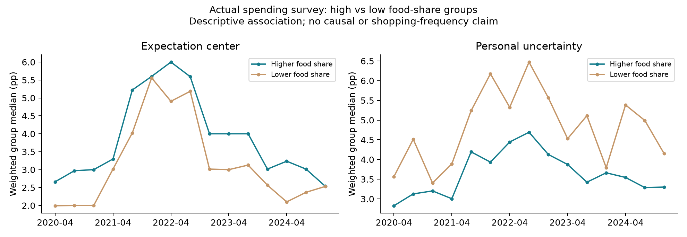
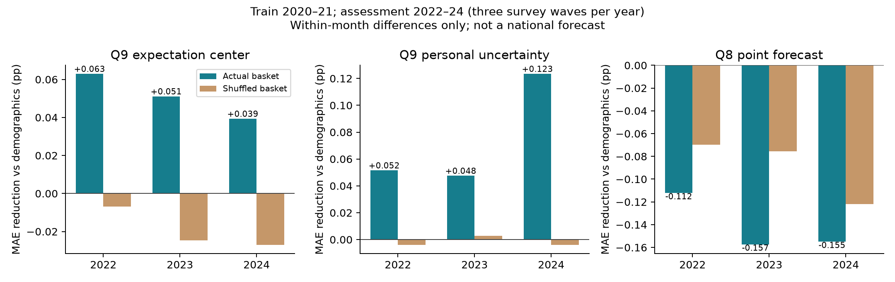

# 从真实消费篮子理解居民通胀预期

2026-10-09｜水上挽月｜路线A开发研究。**数据关联、统计对照和真实LLM试验准备已完成；真实调用尚未开始。**

## 1. 这次推进了什么

此前的CE篮子来自另一批家庭，需要借人口特征来匹配。这次找到更直接的参考：SCE自己的支出模块。它每四个月调查一次，QSP5让家庭把月度支出分成九类，填各类占总支出的百分比。我们下载了官方数据、问卷、修订说明和三篇相关论文，并把同一人的篮子与核心SCE通胀回答关联起来。

这样可以先检查：**现实中消费结构不同的人，预期是否也不同；Agent拿到这个结构以后，是否更接近真人。**它为P和E之间的连接提供实测依据，不只是增加一个合成人设。

## 2. 数据核验结果

- 支出文件：2014-12至2024-12，31次调查、33,782条记录、15,052人。在线图表已更新到2026年，不能因此说微观文件也更新到了2026年。
- 2020—2024年与本地核心SCE重叠的15,931条记录，按“受访者ID＋月份”全部匹配；无重复键。官方轮换模块说明、论文中的同户关联和实测一致性共同支持这一连接；支出表没有独立人口字段，无法另做画像一致性验证。
- 其中11,327条满足九类完整、0—100、合计100以及有效核心调查权重。缺失不当零值，不擅自归一化。
- 2014-12只有八类，第九类2015-04才加入；它不能参加九类分析，是问卷结构变化，不是全体填错。
- 九类包括住房、水电、食品、衣着个人护理、交通、医疗、娱乐、教育育儿及其他。住房含房贷、保险等，交通含公共交通和维修；不能直接当成CPI房租权重或汽油权重。

## 3. 实测有什么启发

按各月食品支出占比分成低组和高组（低于等于加权25分位、高于等于75分位），15次调查中，高组的Q9预期中心中位数均更高，差距月均约0.72个百分点；但个人不确定性中位数均更低，差距月均约1.16个百分点。这是关联，可能同时反映收入、年龄、家庭结构等差异，不能直接当作食品注意力的因果效应。

进一步做了固定参数的时间外统计对照：2020—2021年学习，2022—2024年复查，每年三次支出调查；先扣除同月总体均值，研究人与人之间的差异。比较“人口特征”“人口＋本人篮子”“人口＋随机错配篮子”。三个模型都是同一岭回归、同一权重与训练内标准化，惩罚参数固定10，不用复查期挑参数。

加入本人篮子后，Q9预期中心的个人MAE分别减少0.063、0.051、0.039个百分点；个人不确定性的MAE减少0.052、0.048、0.123个百分点。提升很小，Q8点预测没有改善。2022年尚有少量训练期同人，另对从未进入训练的人复查，Q9改善方向仍在；2023、2024年全部是训练期未见过的人。

**判断：篮子有少量新增信息，值得试；它不足以独自解释此前的大幅偏低和过度集中。**这里使用官方个人派生Q9字段做统计研究，不是Agent计分器比较，也不是全国指标预测；复查期此前做过其他描述研究，不能冒称全项目未触碰的盲测。重复家庭依赖、选择偏差和统计显著性尚未完整处理。

## 4. 与文献怎么衔接

消费篮子回答的是“钱花在哪里”。D’Acunto等的购物数据研究强调，日常看到的价格变动及接触频率，不能由支出占比替代。因此，我们将篮子作为价格接触的线索，而不直接指定“食品20%就给食品信息20%权重”。[论文](https://www.nber.org/papers/w26237)。

纽约联储的随机价格信息实验还显示，询问“自己常买的东西”与“总体通胀”会得到不同响应。我们保留原SCE问卷，不把总体通胀偷偷换成个人篮子的涨幅。[研究](https://www.newyorkfed.org/medialibrary/media/research/staff_reports/sr543.pdf)。

Briand的2025年工作论文使用核心SCE和支出模块研究家庭资源约束与预测能力，给出了可借鉴的同户数据连接和信息注意力机制；它不是已定稿的通用LLM配方，也没有为本项目提供可直接照抄的注意力参数。[作者稿](https://ei.cerge-ei.cz/pdf/events/papers/Briand_paper.pdf)。详见[数据与理论说明](literature/sce/native_spending/DATA_AND_METHOD_20261009.md)。

## 5. 已准备的真实模型对照

2021年5、6月分别有665、616人拥有最近四个月内的有效篮子，实际均来自4月。按食品支出占比排序分四组，每组随机选8人：每月32人，同人三组，共192次回答。

1. **不提供篮子**：沿用完整共同经济信息和原问卷。
2. **本人篮子**：增加同一人最近自报的九类份额。
3. **随机错配篮子**：人口不变，九类完整向量在选中人中置换；无自己作为供体，也无相同向量，保留同一份额集合。

两月分别冷启动，无上期精确回答；E沿用现有77信号、新闻标题＋摘要与开发截止（5月12日／6月10日）；DeepSeek官方API、请求模型`deepseek-flash`、温度0.5、不启用思考、输出最多1024token、无自动重试。记录实际返回型号，型号改变或输入/格式核验失败停止。篮子本身包含在显式模拟配置中，经白名单校验；真实人口ID和问卷答案留在本地评价层。

以同样的人、同样计分法比较Q9中位数误差、分布距离、人际分散度差距及食品分组差距；个人误差辅助。只看“更分散”不算成功；随机错配也改善，则不能归因于正确匹配。32人×两月是机制筛查，单次生成不能排除随机波动，不自动升级主配置。

按当前官方峰值价格，192次请求即使全部达到输出上限，计划保守预留约$0.843，总封顶$1。规则干跑两月各32条合法轨迹，**仅验证工程，不产生行为实验结果**。

## 6. 仍须解决的两件事

**样本选择。**有篮子的人只覆盖开发月约53%／46%的调查权重，60岁以上占比比全样本高约6个百分点。小试只评价选中人；正式A研究应验证缺失机制，再为缺篮子者做带不确定性的条件分布匹配，不能直接把这批人视为全国。

**信息感知。**本次保持完整E以隔离篮子作用。如果真实篮子仍无效，下一步研究“共同背景＋个人接触价格＋信念更新”，尤其是购物频率、近期涨价幅度和信息可靠性。个人交易价格目前没有直接观测，地区或品类官方价格只能明确标成代理，不能编造个人购物小票。

路线B使用截止前已公布的历史资料学习篮子条件分布，按预测人口合成；当前下载的历史文件不证明它当时公开，也不提供2026年当期真人篮子。

## 7. 文件和继续执行

- [官方数据目录](/Users/wushuyue/Documents/科研/DISC/socioverse_challenge/data/raw/sce_spending_20261009/)：Excel、问卷、修订说明、论文及来源哈希。
- [统计结果](/Users/wushuyue/Documents/科研/DISC/socioverse_challenge/outputs/sce_spending_audit_20261009_v2/summary.json)；个体关联只在同目录的私有Parquet。
- [试验输入与192份预览](/Users/wushuyue/Documents/科研/DISC/socioverse_challenge/outputs/sce_native_spending_trial_20261009_v4/trial_manifest.json)。v1—v3是运行前迭代，全部未发生真实调用，v4为当前准备包。
- [无个人记录的封存摘要](sources/sce_native_spending_20261009.json)；[浏览器图解](SCE_NATIVE_SPENDING_20261009.html)。

**当前调用状态：尚未开始，费用$0。**自动审批在进程创建前拒绝了v2启动：旧授权涵盖合成CE篮子，未明确涵盖真实QSP5支出占比外发。已向用户发出具体范围及$1确认。收到明确答复后，记录原话再执行v4；未回复不能自动运行。

后续入口：`scripts/run_sce_native_spending_trial.py --out outputs/sce_native_spending_trial_20261009_v4 --execute --approval-note '实际收到的明确用户授权'`。使用现有Conda `socioverse`环境；真实执行需网络权限。完成后由`analyze_sce_native_spending_trial.py --trial outputs/sce_native_spending_trial_20261009_v4 --out 新分析目录`离线评价，不能重跑已完成的调用。
