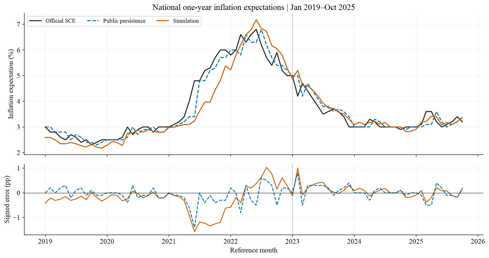
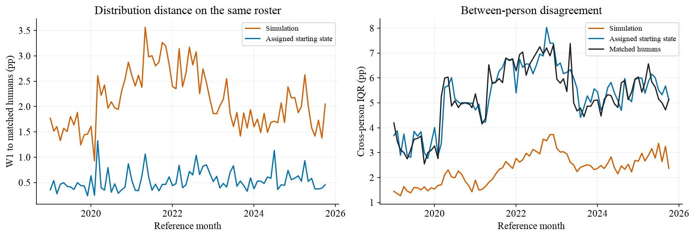
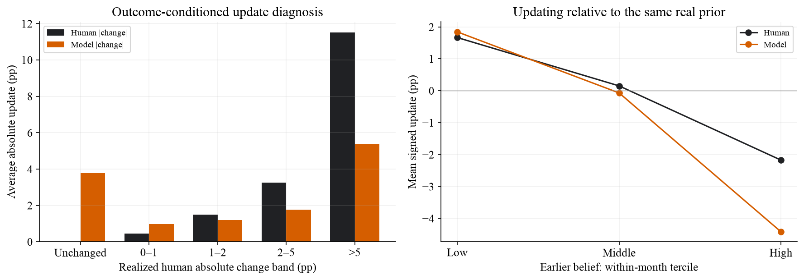
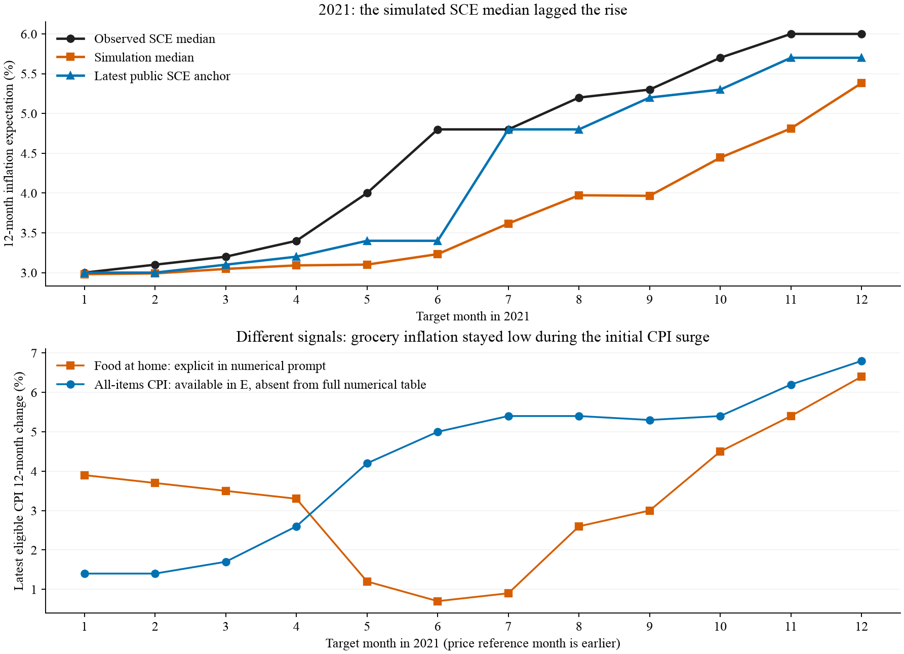

# 居民通胀预期的智能体重建

基于SCE的跨时期评估与机制对照

研究报告初稿 v0.1 · 2026-10-24

工作稿：历史重建结果已完成；近期预测评测、研究包验收与完整实验费用总账待补。

## 第1页：研究问题与经验目标

能否从家庭特征、可接触信息与既有信念出发，重建居民的通胀预期，而不只拟合一条全国曲线？本研究在SocioVerse2框架下，将美国消费者预期调查（SCE）的点预期与十档概率问卷作为智能体行为输出，依次检验先验表达、认知与财务情境、价格接触、新闻分配和模型选择。最终按54个人口格分层，每月模拟512人，覆盖2019年1月至2025年10月。82个月全国中心MAE为0.317个百分点，未优于公开历史值持续性基线的0.223；后34个月纯模型误差为0.176，基线为0.194，但改善区间跨零。模型的人际分歧明显不足，约87%的净方差缺口发生在人口格内。结果说明，聚合拟合、行为异质性与信息增量需要分别验证；具有理论动机的提示补充，也不能代替对实际响应机制的检验。

关键词：生成式社会模拟；通胀预期；异质家庭；概率问卷；时间边界；持续性基线

### 1 研究问题：从总体指标回到调查回答

短期通胀预期影响家庭的消费、储蓄与工资判断，也是货币政策沟通的重要对象。全国指标具有持续性，但其变化来自不同家庭对价格、政策和新闻的不同理解。本项目遵循SocioVerse的“人群P—环境E—行为B”研究框架，将问卷回答作为可观测行为，研究B=f(P,E)的经验有效性，而不把LLM的宏观分析能力直接等同于居民的判断方式。

我们检验三个相互关联但不能互相替代的问题：第一，模拟的全国预期中心能否增加持续性基线之外的信息；第二，模型能否同时恢复人际分歧、个人不确定性与跨月更新；第三，哪些输入或表达调整确有增量，哪些只是改变了回答形式。研究目标是重建居民预期，而不是以未来实际CPI替代居民答案作为主目标。

### 1.1 为什么选择SCE

纽约联储自2013年开展SCE。它是按月进行、全国代表性的线上轮换户主调查；官网FAQ目前表述约1,200名户主，每位最多连续参与12个月，答卷分布于当月各周。全国摘要按月发布，核心微观资料约滞后9个月公开。[1,2] 轮换面板使我们既能观察同一人的信念更新，也能区分新入组者和回访者；微观概率回答还允许检验“中心接近、结构却不相似”的情形。

### 1.2 理论动机与可检验机制

信息更新具有成本，居民未必持续吸收全部公共信息；日常购买中频繁、显著的价格变化可能获得较高权重。[4,5] ConsumerSim则提供了将人口、情境、调查回答和惯性校准拆分检验的参照。[3] 因此，我们把既有信念、信息接触与解释方式作为机制候选，分别设置对照；不将人口标签写入提示就视为机制已经生效，也不把增加随机输出等同于恢复真实异质性。

本文的贡献定位：提供一套可追溯的调查重建与多层评价流程，并识别其时期、人群和更新边界。全期未胜基线的结果完整保留；后期局部改善不改写为稳定预测优势。

## 第2页：人群、信息接触与信念状态

### 2 P/E/B设计及其数据来源

模块 | 实际输入与来源 | 机制及边界
人群 P；SCE年龄组、教育、收入档、地区/州、住房、就业、数理标签；当月人口用于A线条件重建；抽样概率、权重和原始身份不发给模型。
合成属性；CE 2020支出资料；ATUS 2022活动资料；Gallup历史信心波次；按人口/家庭条件迁移支出占比、采购角色与信心；不是SCE本人实测，也不是所有历史月份当时已公开的资料。
环境 E；BLS首发价格档案、NYT历史新闻标题/摘要/片段、政策事实；实际提示显示居家食品总体与角色可见食品细项、新闻和政策；档案中完整宏观数表并未全部投喂。
行为 B；严格更早的Q8、Q9及历史密度均值/次数摘要；直接回答本期Q8和Q9，允许维持或修改旧信念；不强制固定更新幅度。

### 2.1 抽样：保留小群体，再按人口质量汇总

网格采用学历3类×数理2类×年龄3类×收入3类，共54格；任一维未知者另池。学历为高中及以下/部分大学/大学及以上，年龄为＜40/40—60/＞60，年家庭收入为＜5万/5—10万/＞10万美元；数理沿公开高/低分类。前期比较了126套候选划分，随后把覆盖作为约束，通过小格保底与过采样保留年龄、收入等具有解释意义的维度；不声称该划分是唯一最优特征集。每月抽512人，非空格尽量保底8人，小格取全体，余额按原调查权重质量分配；格内以固定种子20261023、月份和本地身份确定无放回随机排序，选择器不读取当期通胀答案。

π_h = n_h / N_h； d_i = w_i / π_h； a_i = d_i × W_h / Σ_{j∈s_h} d_j

其中w为原调查权重，W_h为完整框架内该格的权重总和，a为最终分析权重。格内校准恢复各格人口质量，不保证格内信念或总体中位数无偏；汇总时对全部个体的加权经验分布取中位数，不平均各格中位数。98,382条源人月中30条原权重无效/缺失者不进入正权重框架，未补成1。

### 2.2 信息接触：数量异质性与价格可见性分开

在整月框架上，约50%、29.17%、20.83%的人分别分配3、8、20篇新闻，随后抽取模拟者；3篇为共同新闻，新增部分为个人新闻，主题保留50%均匀与50%相关加权抽取。整月设计均值为8篇，抽样后不要求恰好为8。该分配是机制设定，并非观测到本人阅读量。价格视图按合成食品采购角色决定细项颗粒度；完整CPI、就业、汽油和滚动趋势数表在提示变换中被移除，宏观事实仍可能见于新闻与政策。

### 2.3 新人：近期供体初始化，不用统计扩展替代回答

合法本人历史优先，Q8/Q9分字段处理。缺失时优先相邻上月、最多近3个月供体；新人和回访缺失者分别匹配历史新/老池，按年龄＋学历＋收入逐级放宽，至少5供体且有效样本量ESS≥3。尽量联合抽取Q8/Q9，仅对合成分配作有限倾斜以贴近过去总体信念，不改变本人实答或借本期真值选供体。所有入选者均由LLM作答，未采用Normal代答。

## 第3页：问卷计分、信息边界与评价

### 3 问卷输出与多层评价

Q8直接询问未来12个月的通胀/通缩点预期；Q9让受访者向十个区间分配概率。Q9区间依次为≥12%、8—12%、4—8%、2—4%、0—2%及对应五个负向区间，各概率须非负、总和100%。负的通胀点预期本身合法，负的概率不合法。Q8与Q9是独立输出，不能因一项失败而删除另一项。

Q9采用冻结近似计分器：单个闭区间取均匀分布；两个相邻正概率区间用三角分布；至少三个正概率档拟合广义Beta密度，并记录开放尾部约束和拟合状态。异常情形按事前失败/保留起点规则处理，不另造新算法。先取每人的密度均值μ_it，再取跨人的设计加权中位数m_t。这对应官方“个人密度均值再聚合”的概念，但本项目优化细节与加权经验CDF左逆分位数不等于纽约联储官方完整实现；官方部分统计采用插值中位数。[1,2]

层次 | 指标与含义 | 可比对象
全国中心；MAE：月度绝对误差均值；RMSE更重视大偏差；bias保留方向。单位pp。；官方全国Q9中心，对比截止前最后公开全国SCE值。
同人群分布；W1为两条加权分位数曲线绝对差的面积；跨人IQR=P75−P25，表示人际分歧。；模型/真人同支持、同权重；保留起点作基线。个体密度内部IQR另报，表示个人不确定性。
更新与分组；Δμ相对本人真实相邻上期；变化W1、保持率、大变化率；人口组与54格分解。；真实相邻回访者单列；分组须N≥20、ESS≥10，稀疏组不精确排序。

### 3.1 三个参照层，不能混用分母

同支持微观比较控制名单和权重；完整真人波次比较显示抽样偏移；官方全国比较再包含计分/聚合差异。固定512人名单相对完整真人波次的Q9中位数平均绝对偏移0.107pp、最大0.676pp，未据此重抽种子。基线“保留起点”含真实与合成历史；只有真实相邻回访子样本才称“照抄本人上期”。主微观Q9共同支持40,933人月，真实相邻回访33,726人月。

### 3.2 时间划分与可作出的结论

A线覆盖2019-01—2025-10：使用历史当期画像及严格更早个人回答，属于条件重建；每月独立初始化，不是自主连续人生。月内统一E截止通常取CPI首发日纽约当地日终，真人却分散作答，存在共同信息窗口近似。CE/ATUS等事后可得合成规则与新闻当前文本版本均明确披露，A不自动具有严格事前资格。

c_t(λ) = (1−λ) × b_t + λ × m_t， 0≤λ≤1（无截距）

全国组合仅在2019-01—2022-12的48个月拟λ，2023-01—2025-10的34个月固定评价；b_t为截止前最后公开值，可能来自t−2。机制开发曾使用跨时期小样本，后34月只对组合权重是时间外评价，不是整套机制未见盲测。全国差值区间采用6个月区块、2,000次重抽样；不假定82个月相互独立。近期11个月B线尚未运行，模型知识与外部输入两种时间边界均待落实。

数据获取与隔离：SCE微观于2026-09-28下载并在10-21复核；这只是本地获取记录，不能替代各历史版本的公开时间。生成器只读P/E白名单与允许的更早信念，目标期答案留在独立评价文件，评价在另一进程执行。48/34月划分拟合的是聚合权重，不是微调LLM；各机制开发月份与生成遍数随批次索引披露，不另造“从未看过的最终测试集”。

## 第4页：机制对照与配置取舍

### 4 从理论假设到可检验的输入变化

实验逐项改变输入或输出接口，固定其余P/E、同批样本与计分；可复用旧答时保留跨批限制。每轮同时检查中心、分布、更新及合法率，保留原筛选判定。项目采用渐进取舍：有明确核心收益且代价可解释的方案可作为工作配置，但“工作采用”与“通过原筛选/独立验证”分开记录。表1列代表性证据，数值仅在各行内部可比。

机制问题/样本 | 控制与观察 | 取舍及依据
原有信念是否生效 Flash，4期×48人；U1另12人/期；明确起点后W1 2.617→2.329；中心MAE 0.687→0.704。另个时间标签对照中心0.721→0.588。；保留可读历史和时序信息，允许保持/更新；不声称提示能恢复身份。U1半程指导无可辨增量，固定更新规则不采用。
认知与财务 Flash，开发/另期验证；原题实答中心0.736→0.652，概率结构未稳定改善；Q1开发0.637→0.502，另四期0.290→0.476。；信息含量与表达方式都需检验。低数理组选择性注入收益未在加权口径保持；跨月财务收益未复现，原题实答、Q1/Q2均未叠入最终配置。
购买频率/心理 Flash，独立对照；频率两组共有，额外强调作用使中心0.763→0.808；心理新波次匹配0.440→0.514，W1 1.875→2.174。；不把失败归结为理论错误：合成频率/心理不是本人体验，条件匹配可能丢失联合关系。暂缓标签强化与心理注入。
增加采样随机性 Flash，4期×24人×4遍；温度0.5/0.8/1.0的W1为2.665/2.420/2.505；重复噪声上升，跨人差异仅小幅扩大。；区分人内生成噪声和人际异质性；主1.0比较未过门槛，最终温度保留0.5。
模型响应差异 Qwen与V3.2，同输入4期；381共同人月：中心MAE 0.792→0.349，W1 2.534→1.392，IQR 3.217→4.553（真人4.845）。；结合新增2025四期结果选择V3.2；这是开发选型，不能证明其无训练污染或所有时期胜基线。
信息接触量/主题 V3.2，8期、四组两遍；固定/随机/人口量/均匀主题，固定框架中心0.231/0.205/0.235/0.199；直接两组共同支持固定→随机0.273→0.260。；采用随机3/8/20篇，保留既有相关主题。直接比较W1 1.206→1.208近乎不变；人口量未显示优势，主题改变不随最低中心一并采用。

表1 代表性机制对照（误差单位pp）。各行模型、月份、支持和样本量不同，不能跨行拼接最低误差。认知/Q1开发多为四期各24人，Q1另期各48人；心理新波次为三期各48人；新闻旧四期各96人、新四期各192人。详配套证据索引。

### 4.1 为什么不将所有理论合理的模块叠加

理论主要告诉我们应检验什么，不能保证合成匹配或一句行为指令的实现正确。采购角色在Qwen试验中中心略有改善，但匹配相对打乱的增量很小、W1反而变差；最终沿该价格视图开展模型对照，不能把它列为已证实的个体机制。近期供体小试也只证明初始化可执行，新人W1仍恶化。因此最终模型是明确记录取舍的可评估配置，而不是每一模块都已通过因果识别的结构模型。

## 第5页：完整历史跨度的总体结果

### 5 全国中心：后期信号未形成全期优势

时期/比较 | 模型MAE | 基线MAE | 模型RMSE | 基线RMSE
全82月；0.317；0.223；0.470；0.317
2021年（12月）；0.822；0.325；0.977；0.491
后34月（2023起）；0.176；0.194；0.252；0.270
2025年1—10月；0.157；0.230；0.180；0.285

表2 官方全国比较，单位pp。2025仅覆盖1—10月，不是全年；这是纯模型与基线，尚非组合结果。

模型全期30/82月误差较低。相对基线MAE差为+0.094pp，6个月区块95%区间[0.004,0.213]；2021年全部12月低估且均未胜出。后34月差为−0.018pp，区间[−0.064,0.020]跨零；2025年前10月胜8月，但2024年0.105pp仍劣于基线0.067pp。结果支持时期异质性，不能概括为后期稳定超越。

### 5.1 惯性组合：不能用后期最优权重替代冻结权重

48个月拟权期中，纯模型MAE约0.417pp、基线0.244pp，最小化MAE或MSE均得到λ=0。因此，后34月冻结组合MAE为0.194pp，不能把纯模型0.176pp写成组合成绩。即使把全82月事后一起拟合，MAE仍选λ=0；MSE仅给模型2.897%权重，RMSE从0.317190降至0.317022pp，改善很小。

只在后34月自身真值上拟权会得到较高模型权重和更低误差，但这是事后时期敏感性描述，不是独立验证。固定组合无法解决2021年两个分量同时低估的问题。本文保留早期拟权规则及全部年份，避免把聚合校准误当作微观机制有效。

Q8单独评估：同人群中心MAE为模型0.815pp、保留起点0.356pp；同支持Q9中心则为0.315/0.226pp。Q8是点预期，不能用Q9较小的误差代替；不同统计层的0.315与全国0.317也不是计算冲突。

## 第6页：微观结构、条件差异与信息增量

### 6 分布收缩主要发生在同类家庭内部

模型跨人W1为2.114pp，保留起点为0.537pp；跨人IQR为2.349pp，真人为5.256pp，仅恢复约44.7%的宽度。整体中位数对齐后W1仍为2.081pp，说明问题不只是中心平移。54格方差分解中约87.0%的净方差缺口在格内；扩大网格维度或恢复格比例，不能自动恢复同类人之间的不同判断。

个人密度内部IQR为3.941pp，真人5.651pp；零通缩概率回答占31.8%，真人54.4%。二者刻画不同的概率表达特征，不能以某一比例更接近就宣布完整密度拟合成功。只看33,726个真实相邻回访人月，模型W1仍为1.967pp，照抄本人上期为0.512pp；微观困难不只来自新人合成起点。

变化分布W1模型1.244pp、小于完全不更新的2.906pp，但模型保持不变者只有7.35%（真人16.66%）。真人不变组被模型平均改动3.781pp；真人变化>5pp组平均动11.520pp，模型仅5.390pp。模型产生了变化，却未把变化放到相应的人身上；这些变化也可能包含测量误差和填答习惯，不能直接当结构更新系数。

### 6.1 人群差异与条件信息

满足支持门槛的月份中，新人中心MAE0.816pp、回访者0.311pp；高中及以下0.665pp/大学及以上0.233pp，低数理0.649pp/高数理0.282pp，低收入0.559pp/高收入0.261pp。各组月份支持不同，以上是诊断而非人口特征的因果作用。对33,726人月的描述性加权回归，模拟单独R²为20.42%，上期单独36.55%；控制历史、人口和月份后41.812%，再加模拟41.873%，仅增加0.061个百分点。回归不是时间外预测检验，也不提供独立人月假设下的显著性结论。

## 第7页：2021年偏差：从实际输入追问机制

### 7 上升阶段低估，是否来自环境实现错误

2021年占全期14.6%的月份，却贡献37.9%的模型绝对误差。针对全年6,144份实际请求，重新渲染的messages全部一致；食品PDF哈希、显示数值及已登记日期检查通过，未发现错月接线或运行时丢文件。该核查证明执行与冻结设计相符，不证明信息视图充分，也不认证新闻历史文本版本。

### 7.1 食品信号、政策叙事与个人先验可能相互作用

5/6/7月提示直接显示的居家食品同比为1.2%/0.7%/0.9%，同一截止日前已可得总体CPI为4.2%/5.0%/5.4%；后者未以独立完整统计表展示，仍可能出现在新闻。5—12月政策摘要包含当时的“暂时性”通胀判断。[7,8] 因而模型可能把温和的局部价格数字与政策锚结合，对较高个人先验过度收缩；这是数据支持的候选解释，而非已经识别的因果贡献。

误差也并非主要来自新人或抽样。2021年同支持有符号误差分解中，模型—真人为−0.769pp，抽样项−0.064pp，其余支持/定义项较小；分解的是偏差，不是把MAE直接相加。真实相邻回访者单列4,934人月，平均月度中心偏差仍为−0.715pp。6月同一400人，真人上期中位数4.000%、本期4.364%，模型却为3.262%。模型不只少上调，也可能主动下拉已有较高信念。

### 7.2 能推出什么，尚不能推出什么

这些证据把后续问题定位为“哪些信号被看见、如何解释、何时保留个人信念”的联合机制，而非泛泛增加更多人口字段。它不证明NYT整体倾向降温、社交媒体必然推高预期，或换一组报道便能改善；也不能把Qwen的价格背景对照直接外推至V3.2。媒体多样性与叙事旁线由Kimi另行研究，当前未纳入本批结果。

拟合人类预期与预测CPI是两个任务。补充对齐未来12个月实际CPI时，2021年真人全国预期MAE3.466pp、模型4.288pp，两者均低估；该补充只使用本地CPI版本能覆盖的月份，不替代主研究目标，也不是新的独立机制识别。

## 第8页：研究边界、可复现性与待补部分

### 8 结论与适用边界

本研究完成了连续82个月、含新人和回访者的问卷行为重建。当前模型没有在全期全国指标上超过持续性基线，后期局部收益也尚不稳定。更关键的限制在于同类家庭内部差异与更新对象的错配：能产生宏观合理的答卷，不等于能恢复居民的异质预期。这与既有研究对LLM替代调查数据可能低估差异的警示相呼应，但本文证据限于当前模型、输入及SCE任务。[6]

模型参数知识与外部信息时间是两道边界。模型名、标称知识截止或提示中的历史日期不能排除后训练污染；回顾性重建不写成严格事前预测。统一月内截止、固定CE/ATUS供体年份、合成采购/信心属性、单一媒体及每月一次生成，也限制解释与外推。国家/时期不变参数、独立预测收益及微观因果机制均未被证明。

### 8.1 执行与复现声明

主批使用OpenRouter固定SiliconFlow FP8的DeepSeek V3.2，温度0.5、关闭思考、JSON、最多1,024输出token，每个人月生成一次；抽样/新闻分配等伪随机规则随协议记录，不把它们称作模型采样种子。41,984逻辑人月，加两轮人工技术补跑共42,351物理尝试，41,982技术完整。API已报$29.134，含未知费用预留$30.359；该数只属于主批，不是全部开发成本。主生成账本累计计时约13,376秒（不含技术补跑及分析）；剩Q8一份/Q9两份停止补跑。63份概率比例归一化与29份密度计分边界按冻结规则披露。

原始/修复记录、白名单、source快照、协议哈希与独立评价分开保存。剩Q9极端补值对注册主中心MAE影响上界约0.00104pp，不能解释全期结论。报告使用既有汇总，未新增模型调用或重新拟合Q9。研究包将区分无密钥干跑、缓存重算与真实生成；数据再分发范围、全项目费用总账及独立解压验收尚待完成，不在初稿中提前宣称通过。

待补结果：2025-11—2026-09的B线暂缓，是否采用Kimi新新闻机制尚未决定。后续先冻结旧人口可得性、合成起点和历史版本；仅有全国真值时只评全国，不填造微观W1/IQR。报告主体不等待这部分，新增配置与结果另留版本。

### 参考文献与资料

[1] Federal Reserve Bank of New York. SCE Frequently Asked Questions；核心问卷与数据，2026-10-24核查。 https://www.newyorkfed.org/microeconomics/sce/sce-faq

[2] Armantier O., Topa G., van der Klaauw W., Zafar B. (2017). An Overview of the Survey of Consumer Expectations. Economic Policy Review, 23(2): 51-72. Appendix C. https://www.newyorkfed.org/research/epr/2017/epr_2017_overview-of-sce_armantier

[3] Huang Y., Yin Y., Lin J., et al. (2026). Uncovering Salience-Driven Dynamics in Consumer Confidence with Generative Social Simulation. arXiv:2606.30395. 同时参照SocioVerse2框架与赛事P/E/B要求。 https://arxiv.org/abs/2606.30395

[4] Mankiw N. G., Reis R. (2002). Sticky Information versus Sticky Prices. Quarterly Journal of Economics, 117(4): 1295-1328. 信息更新成本作为理论动机，未直接校准本文家庭更新率。 https://doi.org/10.1162/003355302320935034

[5] D’Acunto F., Malmendier U., Ospina J., Weber M. (2021). Exposure to Grocery Prices and Inflation Expectations. Journal of Political Economy, 129(5): 1615-1639. https://doi.org/10.1086/713192

[6] Bisbee J., Clinton J. D., Dorff C., Kenkel B., Larson J. M. (2024). Synthetic Replacements for Human Survey Data? The Perils of Large Language Models. Political Analysis, 32(4): 401-416. https://doi.org/10.1017/pan.2024.5

[7] U.S. Bureau of Labor Statistics. CPI News Release, 2021-06-10（May 2021参考期）；其余逐月首发稿随研究档案保存。 https://www.bls.gov/news.release/archives/cpi_06102021.htm

[8] Federal Reserve. FOMC Statement, 2021-04-28；本项目原始请求及政策摘要保留各月版本。 https://www.federalreserve.gov/newsevents/pressreleases/monetary20210428a.htm
