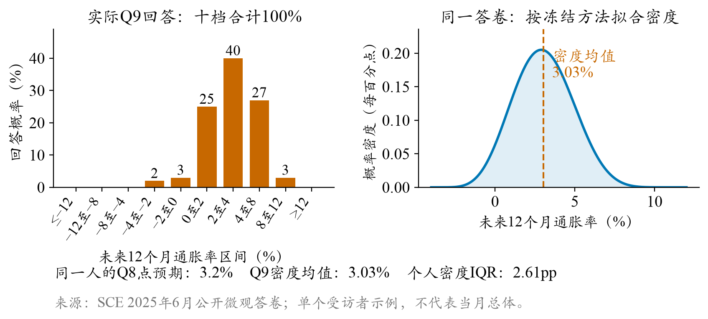
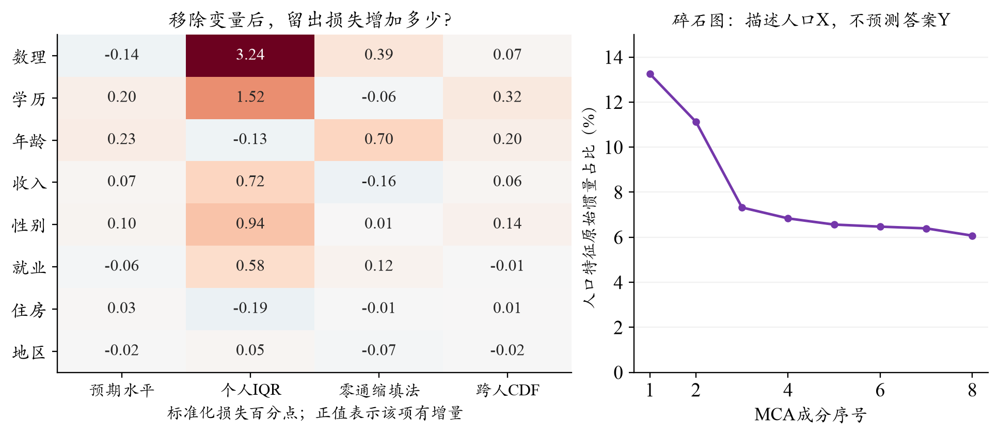
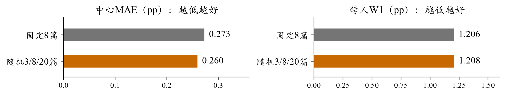
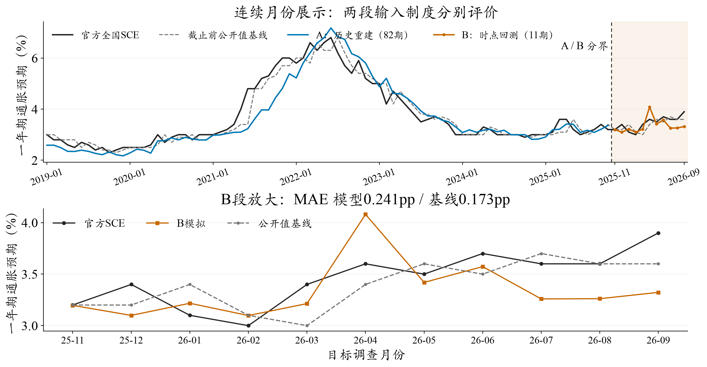
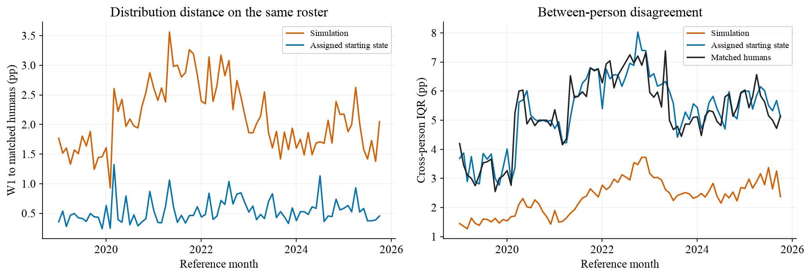
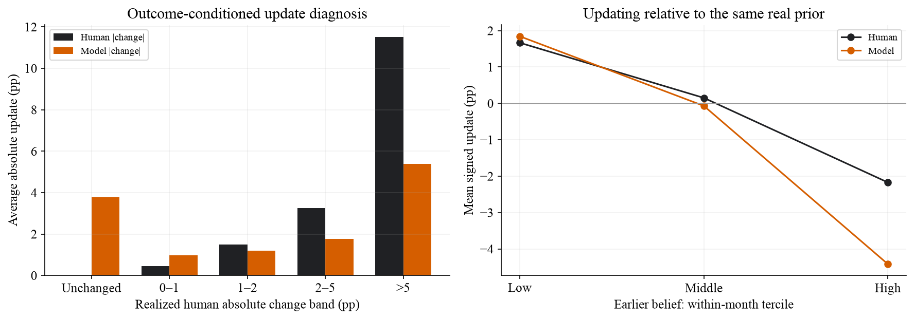
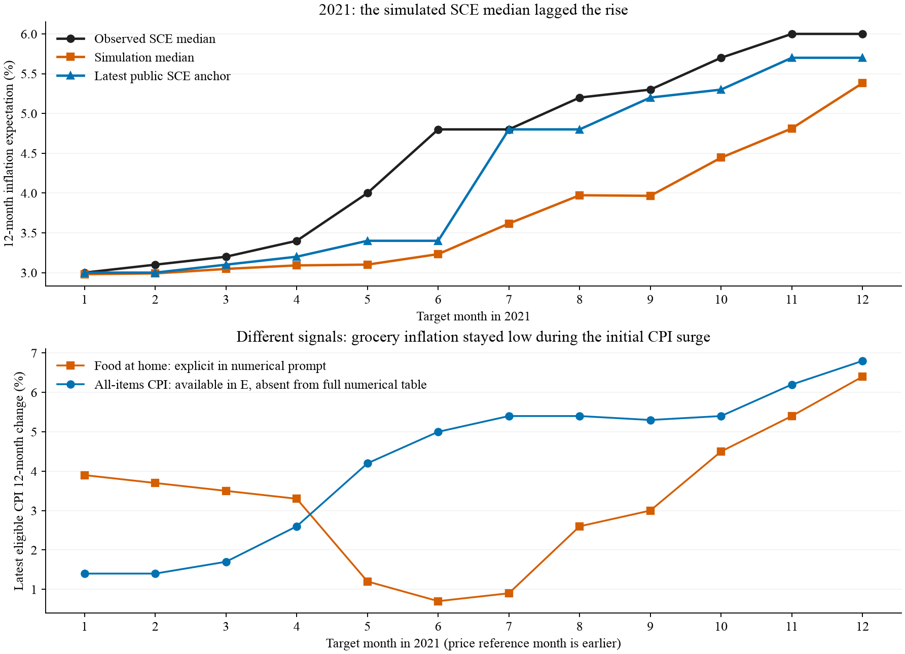

# 居民通胀预期的智能体重建

机制依据、设计选择与跨时期评估

研究报告初稿 v0.4 · 2026-10-25

工作稿：纳入A82历史重建与B11时点回测；两段人口与先验边界分开，保留后续新闻实验和研究包补充空间。

## 第1页：从研究问题到机制假设

居民通胀预期既有持续性，也随生活价格和公共信息而变。我们在SocioVerse2的P/E/B框架下，以纽约联储消费者预期调查（SCE）为对象，将人口构成、信息接触和既有信念转化为可检验设计。经人口维度筛选与受控比较，形成54格分层样本，每月512名LLM智能体回答点预期与概率问卷。2019年1月至2025年10月的历史重建，全国中心MAE为0.317个百分点，持续性基线为0.223；2025年11月至2026年9月改用滞后画像与合成先验的时点回测，分别为0.241和0.173。两段均有局部收益，但尚未稳定超越基线，人际分歧仍有收缩。本文结合理论依据、实验取舍与失败时期，检验生成式社会模拟在调查重建中的经验有效性。

关键词：通胀预期；生成式社会模拟；异质家庭；信息接触；概率问卷

### 1 研究问题与理论框架

家庭怎样看待未来物价，会影响消费、储蓄和工资判断，也是政策沟通的重要问题。只拟合一条全国曲线，却可能掩盖微观机制的错误：高预期与低预期家庭的偏差可以互相抵消，缺乏个人差异的模型也可能碰巧得到正确中位数。我们把人群P（家庭背景与既有状态）、环境E（可见信息）和行为B（问卷回答）分开，因此同时研究总体中心、家庭之间的分歧，以及同一家庭如何修订判断。

### 1.1 SCE调查的研究价值

SCE由纽约联储开展，自2013年起按月调查美国户主。官网FAQ目前表述约1,200人，采用全国代表性的线上轮换面板；受访者最多连续参与12个月，答卷分布在当月各周。全国摘要按月发布，核心微观资料约滞后9个月公开。[1,2] 它既能追踪个人更新，又同时询问点判断和概率分布，适合检验“平均看起来合理，个人行为却不相似”的问题。本文预测的是居民对未来12个月通胀的看法，并非把实际CPI当成调查答案。

### 1.2 从理论依据到机制假设

理论线索 | 对预期形成的启发 | 本项目可检验的设计
信息更新有成本[4]；公开信息不等于人人接触、理解和吸收；旧信念可能持续。；保留真实历史，允许保持或更新；分别检验新闻数量与主题。
生活价格具有显著性[5]；购买中反复接触的涨价可能比支出占比更能影响判断。；从家庭结构匹配采购角色，再改变可见价格，设置打乱对照。
经历与认知存在差异[9]；经历的时间长度、数理理解和资源约束可能塑造不同响应。；先用真人数据筛选人口维度，再检验认知/财务信息能否改变模型。

这些文献提供的是传导方向，而不是可直接套用的个人更新系数。我们的研究策略是先把每条理论路径变成明确的输入差异，再用对照实验判断模型是否真的使用了这些信息。ConsumerSim提供了人口、环境、回答和惯性校准分层比较的参照；本项目进一步利用SCE微观答卷，检查聚合拟合之外的行为结构。[3]

## 第2页：SCE问卷与指标构建

### 2 SCE问卷与指标构建

两道题都面向未来12个月，却记录不同层面的判断。Q8询问预计通胀或通缩的幅度，是一个点预期；Q9要求为十个可能区间分配概率，表达未来涨幅的不确定性。图1展示2025年6月一位实际受访者的答卷：Q8为3.2%，Q9则把40%的概率分配给2—4%，27%给4—8%，25%给0—2%，其余概率落在其他区间。两题来自同一人，点判断和密度均值不必完全一致。

### 2.1 从十档概率到个人密度，再到人群中位数

每档概率须在0—100%之间，合计100%；负的通胀预期合法，负的概率不合法。按照SCE方法的研究复现，单个闭区间用均匀分布，两个相邻正概率区间用三角分布，至少三个正概率档拟合广义Beta密度。Beta参数通过带约束最小二乘，使有效档界的累计概率尽量贴近回答。随后取每人密度的均值μ，而不是先把所有人的十档概率平均。最后将这些个人均值按人口权重排序，累计权重首次达到50%的位置，就是本项目的群体中位数。

这样就区分了两种“宽度”：一位受访者的密度IQR反映他对未来有多不确定；不同受访者的密度均值IQR反映人群有多大分歧。两者可以朝不同方向变化。官方概念同样先取个人密度均值，但本项目冻结的近似拟合和经验CDF左逆分位数并不等于官方全部优化及插值细节，因此另列官方全国值与同支持微观比较。[1,2]

评测问题 | 采用指标 | 怎样理解
总体中心准不准；MAE、RMSE、bias，单位为百分点（pp）。；MAE看平均绝对偏差；RMSE更重视大偏差；bias区分偏高或偏低。
结构是否相似；跨人W1、跨人IQR、个人密度IQR。；W1是两条分位数曲线距离的面积；IQR=P75−P25，应与真人对照，不是越大越好。
是否在正确的人身上更新；相对本人真实上期的变化W1、保持率、大变化率及分组误差。；让模型产生更多变化，并不保证它能识别谁会改变、谁会保持。

## 第3页：人口网格的统计依据与代表性

### 3 人口分层的统计依据

若只按少数粗特征抽样，可能遗漏重要群体；若把所有人口字段交叉，小格又会缺乏支持。我们因此把“对回答有多少独立信息”和“能否获得可靠支持”分开判断。使用98,382个历史人月构成的框架，从学历、数理、收入、年龄、就业、性别、住房和地区八项中比较126套三/四维候选；监督分析在八项已知且答卷有效的95,375人月共同支持上进行。

左图显示，数理与学历对个人不确定性较有增量，年龄更多关联预期水平和零通缩填法，各变量的用途并不相同。我们同时检查了冗余：学历—数理的加权Cramer V约0.317，整块调整GVIF仅1.007—1.186，没有证据需要因严重共线性机械删除其中一项。MCA帮助描述结构，最终取舍仍以留出表现和抽样支持为依据。

### 3.1 维度选择与有限样本下的代表性

四领域等权评分涵盖个人均值、密度IQR、零通缩填法和均值CDF；它衡量月内异质性，不是全国MAE。相对无人群差异参照，旧“学历×在职”六格的平均标准化损失改善为2.160%，学历×数理×年龄×收入为4.917%；后两段时间检查为5.413%和5.471%。原较严支持约定偏向更省样本的“学历×数理×性别”12格，但年龄和收入也提供资源与经历维度。允许小格过采样后，我们据此选择四维54格，而不是把12格或碎石图的某个拐点视为唯一答案。

实际分类为学历3档、数理高/低、年龄＜40/40—60/＞60、年家庭收入＜5万/5—10万/＞10万美元；未知另池。每月抽512人，非空格尽量保底8人，小格全取，余额按人口质量分配。固定种子20261023按人无放回排序，不读取本期预期；设计权重w/π再在格内校准，使过采样的小格汇总时回到其真实人口比例。82个月均可分配，格质量误差＜1e-12，但512人方案只有约60%的质量落在格内ESS≥10的格，不能把覆盖当作精度保证。 就业、住房与地区仍进入画像，不因未列为网格坐标而删除；调查权重和原始身份不发给模型。

### 3.2 分层画像与个人历史的结合

同类家庭内部仍可能有不同习惯与经历。因此，网格只决定抽样和分组，模型仍读取本人更早的Q8/Q9及历史摘要。没有历史者从最近1—3个月同类匿名新/老受访者池取得联合起点，并保留合成标签；本期答案不参与匹配。新人同样由LLM作答，不用Normal复制来填补身份信息。

### 3.3 样本加权与近期人口来源

A、B两段都由每月512人直接调用LLM，没有Core＋Normal贝叶斯扩展，也不把其余人复制成新答卷。代表性由抽样权重承担：在格h内，先按原调查权重除以入选概率π，再乘校准系数，使各格权重质量恢复源人口比例；经验CDF按权重而非人数累计，达到50%处取中位数。权重可以是非整数，扩成约1,300个标签并不会凭空增加信息。

A以历史当月人口为源，缺历史者才匹配近期联合供体。B受微观披露滞后约束，按“源调查月末加九个日历月且早于截止”的推定规则逐月取源，2025-11用2025-01，推进至2026-08/09用2025-10；精确历史字节版本尚未认证。B权重代表相应旧源，而非已知近期真实人口；就业、收入随源记录，不额外宏观修正。合成Q8/Q9保持供体联合答卷，分配后仅将历史Q9中心校准到当时已公开全国值±0.05pp。此步骤是初始化，不是扩样；Q8不强加Q9锚。

## 第4页：理论路径如何变成信息与机制对照

### 4 信息接触机制与实验设计

有限注意力意味着“公开可得”与“本人接触”之间还有选择过程。SCE专项研究发现，学历、收入及年龄与宏观关注有关，但关系依主题而变，通胀关注回归的伪R²仅0.027。[10] 这不能换算成个人阅读篇数，却提醒我们保留大量组内差异：高学历不等于一定看很多新闻，经常采购也不等于经常读财经报道。

我们把数量、主题、理解分开：用3/8/20篇表示消息广度，分别约占50%、29.17%、20.83%，整月平均8篇；以同月分配打乱区分“异质性本身”与“人口匹配”的增量。另一方面，CE 2020提供合成支出，ATUS 2022按年龄、住所人数和儿童状态提供采购角色概率，再决定食品细项的可见程度。它们是代理匹配，不是本人的阅读记录、购物收据或心理实测。

理论依据 | 对照设计 | 证据与取舍
旧信念具有持续性；明确个人起点与时序；另比较固定半程更新指导。；Flash先验表达使W1 2.617→2.329，中心未同步改善；保留状态，不规定固定更新幅度。
认知与财务处境可能改变解释；数理原题/转述、Q1/Q2，以及心理匹配对打乱；跨月检查。；认知和Q1开发中心有收益，结构或另期表现未保持；不把局部信号全部叠进默认。
价格体验应通过接触传导；采购角色匹配与同月打乱；区分频率数据与强调性指令。；Qwen匹配比打乱中心仅低0.003pp，W1略差；当前价格视图沿用，但身份机制未获确认。
更强模型或更高温度是否更像人；Qwen与V3.2同输入；Flash另以0.5/0.8/1.0四遍区分人内噪声与人际差异。；V3.2共同381人月W1 2.534→1.392，支持选型；提高温度主要增加重复噪声，最终保留0.5。

表1 各行来自不同模型/月份，数值只在本行内部可比。新闻随机量按核心收益及有限代价工作采纳；原分布筛选未过的判定保留。当前实际提示为食品视图＋新闻/政策/信心/旧信念，完整CPI等宏观数表不直接投喂。 信心由Gallup资料合成匹配；E通常统一截至目标月CPI首发日纽约当地日终，而非各人的真实答卷时刻。

## 第5页：历史重建与近期回测的总体结果

### 5 连续月份展示，两段制度分别评价

时期/比较 | 模型MAE | 基线MAE | 模型RMSE | 基线RMSE
A：全82月；0.317；0.223；0.470；0.317
A：2021年12月；0.822；0.325；0.977；0.491
A：后34月；0.176；0.194；0.252；0.270
A：2025年1—10月；0.157；0.230；0.180；0.285
B：近期11月；0.241；0.173；0.296；0.211

表2 相对官方全国首发值的误差，单位pp；基线均取各自截止前最后公开全国值。两段输入制度不同，不能把成绩差异归因于某个单一机制。

A全期30/82月模型胜出，MAE差+0.094pp，6月区块95%区间[0.004,0.213]；2021年全年低估。后34月纯模型略优于基线，差−0.018pp、区间[−0.064,0.020]，2025年前10月胜8月，但2024年仍落后。局部改善具有时期条件，不能从有利小试推到全期。

### 5.1 微观资料滞后时的近期一步回测

B覆盖2025-11—2026-09，每月独立初始化，截止沿逐期CPI首发日；2025-11例外按已选11月13日。合成起点只对齐已公开历史全国Q9，不利用待预测期真值。模型5/11月胜出，平均偏差−0.114pp，4月高估与7—9月低估是主要偏离。3月区块MAE差区间[−0.045,0.190]较宽；本批是回顾性时点回测，尚非严格事前封存预测。

### 5.2 冻结组合与比较对象

采用无截距凸组合c=(1−λ)b＋λm，b为截止前公开值、m为模拟中心。只用2019—2022年48月拟权，MAE与MSE均选λ=0；故A后34月冻结组合MAE0.194pp，B11仍为0.173pp，分别等于基线，不能用后期重新拟权替代。A后期曾用于机制开发，因此该划分仅是权重的时间外评价。

官方全国值、完整真人波次及同支持样本仍分开报告。A固定512人相对整波Q9中位数的平均绝对偏移为0.107pp，未因偏移换种子；Q8同支持MAE为0.815pp、保留起点0.356pp。B缺近期个人真值，不报告个人误差或真人分布距离。

## 第6页：微观结构、条件差异与信息增量

### 6 分布收缩主要发生在同类家庭内部

总体中心的局部改善并未消除分布收缩。模型跨人W1为2.114pp，保留起点0.537pp；人际IQR为2.349pp，真人5.256pp。把中位数对齐后，W1仍为2.081pp。更重要的是，54格方差分解中约87%的净缺口发生在格内：人口比例虽然恢复了，同类人的不同判断却没有被充分重建。这正是需要把网格代表性与个体响应机制分开验证的原因。

个人密度内部IQR也偏小，模型3.941pp、真人5.651pp；零通缩概率回答占31.8%，真人54.4%。二者反映不同的填答特征，不能互相代替。仅看33,726个真实相邻回访人月，模型W1仍为1.967pp、照抄本人上期0.512pp，因此微观差距不只来自新人合成起点。

模型变化分布W1为1.244pp，小于完全不更新的2.906pp，说明它确实生成了与新环境有关的变化。但模型保持不变者只有7.35%，真人16.66%；真人不变组被平均改动3.781pp，真人变化＞5pp组的11.520pp改动却只被模拟出5.390pp。它会更新，却没有在恰当的人身上更新。

### 6.1 人群差异与条件信息

满足支持门槛的月份中，新人中心MAE0.816pp、回访者0.311pp；高中及以下0.665pp/大学及以上0.233pp，低数理0.649pp/高数理0.282pp，低收入0.559pp/高收入0.261pp。各组月份支持不同，以上是诊断而非人口特征的因果作用。对33,726人月的描述性加权回归，模拟单独R²为20.42%，上期单独36.55%；控制历史、人口和月份后41.812%，再加模拟41.873%，仅增加0.061个百分点。回归不是时间外预测检验，也不提供独立人月假设下的显著性结论。

B段只能描述输出结构：每月跨人IQR平均2.325pp，合成起点5.569pp；低数理组比高数理组更分散，但没有同期微观真值，不能称分组拟合已改善。旧源供体本身也不是近期真实分布，一次生成无法分开稳定个体差异和LLM随机噪声。

## 第7页：相反方向的偏差：环境叙事与预期更新

### 7 2021年偏差的机制诊断

为什么2021年尤其偏低？该年只占全期14.6%的月份，却贡献37.9%的绝对误差。我们先排查实现问题：6,144份实际请求与重新渲染的提示全部一致，食品原始档案、显示数值及登记日期也相符。没有发现错月或运行时丢文件，注意力由此转向“冻结设计让模型看到了什么”。

### 7.1 食品信号、政策叙事与个人先验可能相互作用

这里存在一个有经济含义的信号分离：5/6/7月提示中的居家食品同比为1.2%/0.7%/0.9%，同一截止日前可得总体CPI为4.2%/5.0%/5.4%，后者没有作为完整统计表直接展示。与此同时，政策摘要保留当时“暂时性”通胀判断。[7,8] 若模型把这些公共信号理解为较强的降温理由，就可能比真人更快下调已有较高预期。

回访者提供了进一步线索。2021年4,934个真实相邻人月的月度中心偏差仍为−0.715pp；6月同一400人，真人上期中位数4.000%、本期4.364%，模型却为3.262%。因此问题不只是未能预见上涨，也包括对较高旧信念的过度修正。误差分解中模型—同支持真人的−0.769pp远大于抽样项−0.064pp，两者相加的是有符号偏差，而非MAE。

### 7.2 2026年4月：供应风险的向上外推

相反方向的案例出现在B段4月：起点3.400%、模型4.080%，而官方从3.4%升到3.6%；Q8中位数也到4.2%，不宜仅归因于密度转换。全部512人收到伊朗战争威胁食品供应的共同新闻，352份回答理由提到战争或冲突、207份明确提到伊朗/中东/霍尔木兹，关键词可重叠。这支持供应风险驱动向上外推的解释，但生成理由不等于因果证明，也没有未暴露组。

本期模型截至4月10日，真人覆盖4月1—30日；3月风险报道仍作为共同新闻，4月初的缓和报道仅部分代理抽到。官方同时显示汽油涨价预期从3月高点下降4.3pp至5.1%。[11] 信息排序、时点与对风险持续性的判断可能共同作用；不能用月底结果反向改写4月10日输入。

### 7.3 从接触概率到解释幅度

2021低估与本次4月高估提示，缺口未必是统一的“过于保守”。注意到负面消息的概率，与把消息外推成一年期通胀的幅度是两个环节。Kimi正在研究媒体扩展和负面权重，当前尚无新结果；后续需同时检查低估、高估时期。新闻来源、曝光和旧信念保留仍需受控对照，不能把NYT普遍降温或负面加权必然改善拟合写为已证实机制。

## 第8页：研究边界、可复现性与待补部分

### 8 结论与适用边界

本研究能重建部分总体走势，但A82与近期B11都未稳定胜过持续性基线，A的微观分歧和个体更新仍有明显差距。人口网格与信息匹配解决的是代表性及可接触信息，LLM如何使用这些信息还须由对照和结构检验。总体中心、分布宽度和更新对象应共同构成经验标准，而非只看一条曲线。[6]

结论限于当前输入与模型。A使用历史当期画像及个人更早回答；B改用按滞后规则推定可得的旧画像，匿名联合供体起点仅校准已公开历史全国Q9。B未设置代理人出入、Normal代答或上月模拟回灌。CE/ATUS固定年迁移、历史微观及新闻字节版本、模型知识截止均有未认证部分，不能称严格事前预测；两段每月独立初始化。

### 8.1 执行与复现声明

两段均为OpenRouter固定SiliconFlow FP8的DeepSeek V3.2，温度0.5、关闭思考、JSON、最多1,024输出token，每个人月一次；分配伪随机种子不等于模型采样种子。A：41,984逻辑位置、含人工补跑42,351次尝试，41,982技术完整，API报告$29.134；B：5,632逻辑位置、含20次自动补跑共5,652次，全部完整，报告$4.075。两批合计48,003次尝试/$33.209，不是全部开发成本；未知费用预留合计$1.294，不是确认扣费。A生成账本计时约223分钟，B约28分钟。

原始和修复回包分别存档，成功字段保留；A剩Q8一份/Q9两份停止补跑，极端补值对主中心MAE影响上界约0.00104pp。A的63份、B的6份概率按约定比例归一化；A有29份密度边界后备，B无密度后备。B评价漏登9月的索引错误已补官方首发资料离线恢复，未重问模型。真值只进独立评价，输入、协议、源码及结果均保留哈希；本版报告不新增模型调用或密度拟合。

下一步优先收束研究包：无密钥干跑、缓存重算、真实生成三种入口，补许可/数据获取说明、全项目总账和独立解压验收，再录制演示视频。Kimi新闻结果到位后独立补入。个人信念连续递推保留为扩展，不作为主线交付门槛；本稿仍为可修改的工作稿。

### 参考文献与资料

[1] Federal Reserve Bank of New York. SCE Frequently Asked Questions；核心问卷与数据，2026-10-24核查。 https://www.newyorkfed.org/microeconomics/sce/sce-faq

[2] Armantier O., Topa G., van der Klaauw W., Zafar B. (2017). An Overview of the Survey of Consumer Expectations. Economic Policy Review, 23(2): 51-72. Appendix C. https://www.newyorkfed.org/research/epr/2017/epr_2017_overview-of-sce_armantier

[3] Huang Y., Yin Y., Lin J., et al. (2026). Uncovering Salience-Driven Dynamics in Consumer Confidence with Generative Social Simulation. arXiv:2606.30395. 同时参照SocioVerse2框架与赛事P/E/B要求。 https://arxiv.org/abs/2606.30395

[4] Mankiw N. G., Reis R. (2002). Sticky Information versus Sticky Prices. Quarterly Journal of Economics, 117(4): 1295-1328. 信息更新成本作为理论动机，未直接校准本文家庭更新率。 https://doi.org/10.1162/003355302320935034

[5] D’Acunto F., Malmendier U., Ospina J., Weber M. (2021). Exposure to Grocery Prices and Inflation Expectations. Journal of Political Economy, 129(5): 1615-1639. https://doi.org/10.1086/713192

[6] Bisbee J., Clinton J. D., Dorff C., Kenkel B., Larson J. M. (2024). Synthetic Replacements for Human Survey Data? The Perils of Large Language Models. Political Analysis, 32(4): 401-416. https://doi.org/10.1017/pan.2024.5

[7] U.S. Bureau of Labor Statistics. CPI News Release, 2021-06-10（May 2021参考期）；其余逐月首发稿随研究档案保存。 https://www.bls.gov/news.release/archives/cpi_06102021.htm

[8] Federal Reserve. FOMC Statement, 2021-04-28；本项目原始请求及政策摘要保留各月版本。 https://www.federalreserve.gov/newsevents/pressreleases/monetary20210428a.htm

[9] Malmendier U., Nagel S. (2016). Learning from Inflation Experiences. Quarterly Journal of Economics, 131(1): 53-87. https://doi.org/10.1093/qje/qjv037

[10] Pfajfar D., Winkler F. (2024). Households’ Preferences Over Inflation and Monetary Policy Tradeoffs. June working paper, §4.1/Table 1. https://www.ecb.europa.eu/press/conferences/shared/pdf/20241001_expectation_surveys/Pfajfar_paper.pdf

[11] Federal Reserve Bank of New York. April 2026 SCE release, May 7, 2026；仅作为评价后诊断，不进入4月10日输入。 https://www.newyorkfed.org/newsevents/news/research/2026/20260507
