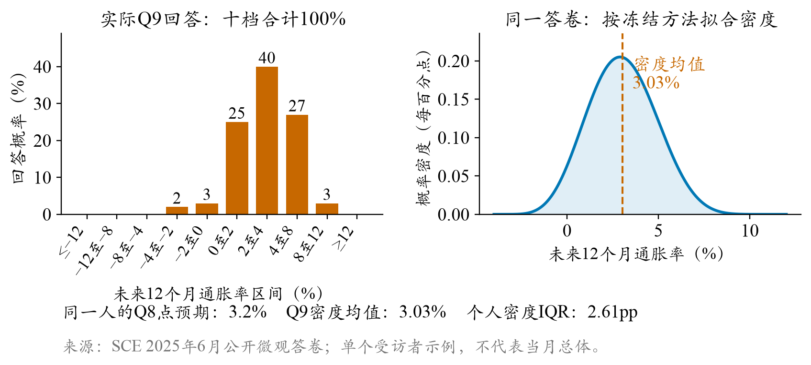
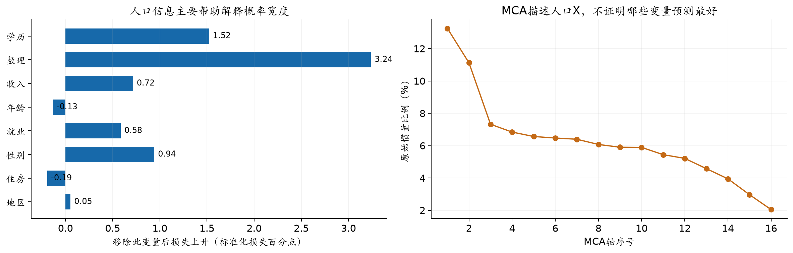
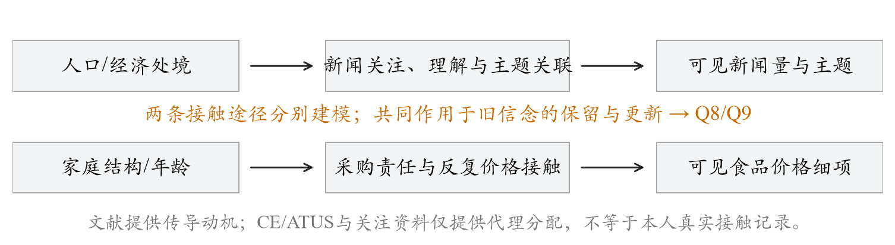
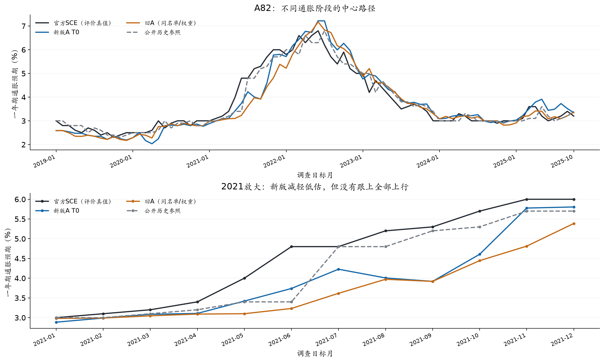
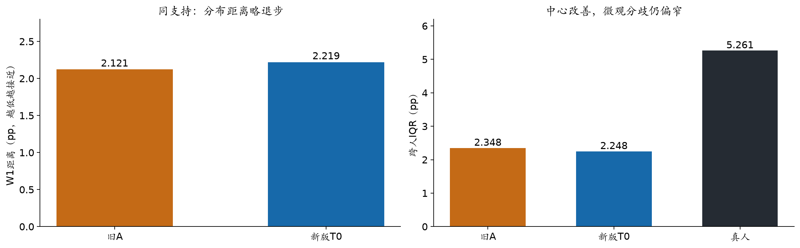
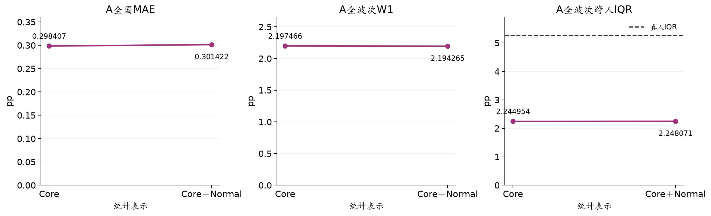
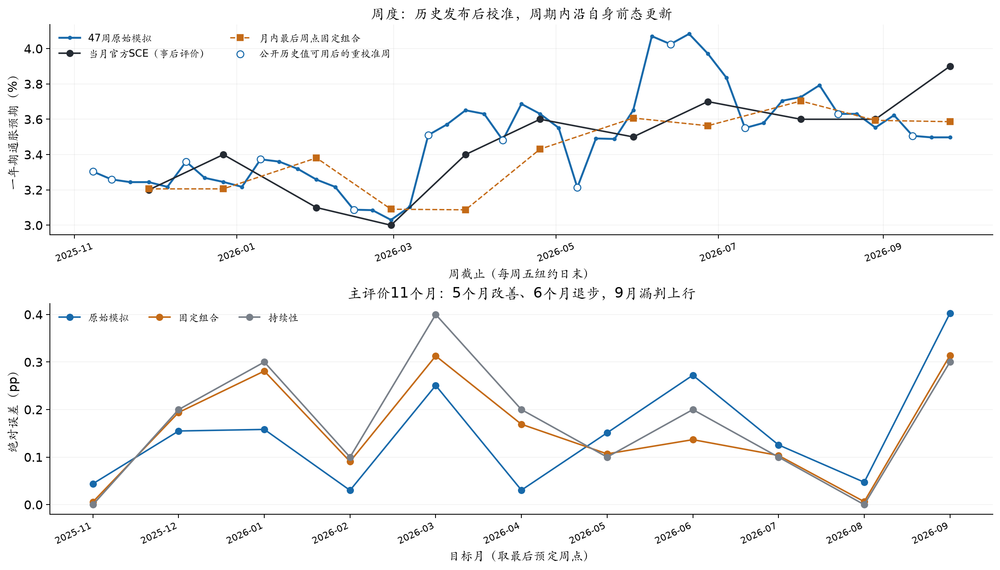
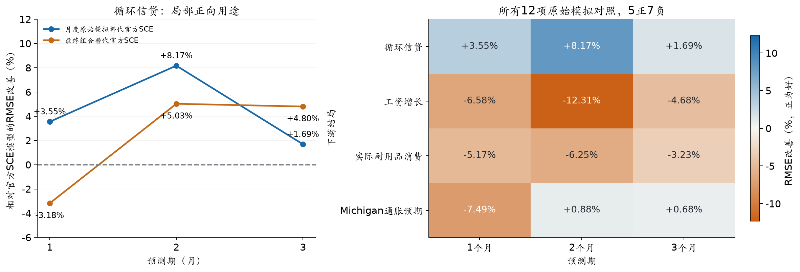

# 居民通胀预期的生成式社会模拟

信息接触、信念更新与跨层验证

重写稿 v0.6 · 2026-10-27

作者审阅稿：全文重写，直接模拟与统计扩展分报，最终署名与提交状态待确认

## 第1页：研究问题与论证主线

摘要  本文研究生成式智能体能否在真实调查约束下重建居民的一年期通胀预期。我们将家庭背景与既有信念、作答时可得的信息和问卷行为分开建模，并用美国纽约联储消费者预期调查（SCE）的概率答卷检验模拟结果。历史重建覆盖2019年1月至2025年10月，直接模拟的全国中心MAE为0.298个百分点，低于旧方案的0.318，但仍高于公开历史参照的0.223。更细致的检查显示，中心误差的缩小并未带来相应的人际分歧，2021年的低估也只是部分缓解。在近期11个月中，原始模拟不如持续性基线，少量模拟与公开历史值的冻结组合则将MAE降至0.144，低于基线的0.173。周度探索提供了进一步的正向线索，但月度自主递推出现后期漂移。研究表明，总体拟合、微观差异和动态稳定性需要分别验证，模拟的增量价值取决于使用方式。

关键词  通胀预期；生成式社会模拟；异质家庭；信息接触；概率问卷

### 1 研究问题

居民如何理解未来物价，会影响消费、储蓄和工资协商，也关系到货币政策沟通。对这类预期进行模拟，最直接的目标是复现全国指标，但一条接近真实值的曲线并不能说明家庭行为得到了重建。高估与低估可以在人群中相互抵消，过度整齐的回答也可能碰巧落在正确的中位数附近。因此，我们同时考察全国中心、家庭之间的分歧和同一家庭随时间的更新。

SCE为这些问题提供了合适的观察对象。它按月访问美国家庭，既询问未来12个月价格变化的点判断，也要求受访者把概率分配给不同的通胀区间。轮换面板保留了部分家庭的连续回答，公开微观资料则使个体层面的检验成为可能。[1,2] 本文的评价对象是居民答卷及其人口分布，实际CPI只作为环境信息或后续经济结局，不替代调查真值。

已有生成式模拟研究展示了分层人口、环境输入和行为校准的价值，ConsumerSim是其中与本研究最接近的参照。[3] 我们希望更进一步回答两个问题。模型接触到家庭背景和差异化信息后，能否保留真实问卷中的分歧；当输入随时间更新时，它又能否避免机械跟随或过度外推。围绕这两个问题，本文把理论线索转化为可比较的输入差异，再报告它们在全国、个体和跨期评价中的收益与代价。研究的重点不是证明模型全面优于统计基线，而是弄清它在哪些层面提供了有效信息。

### 1.1 研究路径

研究先进行82个月的历史重建。这里可以使用当时真实的人口资料和本人更早的回答，重点检验信息接触与回答生成能否重建观察到的家庭分布。随后转向近期11个月，在真实个人上期答卷尚未公开时，只使用较早人口、匿名供体和公开全国历史值初始化。两项任务共享问卷与评价方法，但初始化条件不同，因此分别报告，不把拼接后的曲线当作同一种预测能力。

方法部分围绕三项选择展开。人口网格解决代表性，个人历史保留网格内部的状态差异；时间窗口限定可见信息，差异化分配描述接触而非公开可得；统一问卷与计分则让模型输出能够回到真实调查。完成主检验后，月度递推和周度更新用于检查时间制度，下游回归用于观察模拟指标是否还含有其他经济信息。这样的安排使机制设计、结果诊断和拓展用途能够沿同一条研究链路展开。

## 第2页：问卷、模拟框架与评价

### 2 从概率问卷到可检验的模拟

模拟过程分为三个环节。人群P提供家庭画像和既有信念，环境E提供作答前已经公开且被分配给该家庭的信息，行为B则是模型填写的Q8点预期与Q9概率答卷。这样的拆分使我们能够分别检查人口代表、信息接触和回答生成，而不是把全部差异归结为模型本身。模型输出随后经过统一计分和人口加权，与真实调查在相同口径下比较。

Q8给出一个点预期，Q9要求将100%的概率分配到十个通胀或通缩区间。图1是一位真实受访者的匿名答卷。点判断与概率分布来自同一人，却不必给出相同的数值中心。我们按照冻结的研究复现规则，将每个人的十档概率转换为连续密度，取密度均值后再按调查权重求跨人中位数。这个过程不同于先平均所有人的概率，也不同于取个人密度中位数的中位数。[1,2]

评价也相应分为三个层次。全国层面以月度中位数的MAE、RMSE和偏差衡量中心拟合；分布层面比较跨人W1距离和四分位距；动态层面观察同一受访者是否保持、上调或下调预期。个人密度内部的IQR表示主观不确定性，跨人IQR表示家庭之间的分歧，二者不能混用。本文所称百分点均为通胀预期或误差的绝对单位，百分比则用于表示相对改善。

评价层次 | 主要指标 | 回答的问题
全国中心；MAE、RMSE、bias；月度中位数离真实调查有多远，是否系统性偏高或偏低
人群结构；跨人W1、跨人IQR、个人密度IQR；模型是否保留家庭间分歧与个人不确定性
个人更新；变化分布、保持率、分组误差；发生变化的是否是真实也会变化的家庭

本地冻结计分器是官方方法的近似实现，并不包含官方全部密度优化细节。全国主结果采用官方发布值，微观比较则在双方共同合法答卷上使用同一计分器，避免把算法差异误当作模型差异。

## 第3页：P：人口代表与个人历史

### 3 人口设计为何同时使用网格与个人历史

人口设计需要解决两个不同的困难。抽样应覆盖与预期有关的家庭差异，但过多交叉维度会让许多小格缺乏真实受访者。即便两个家庭画像相近，他们过去的通胀经历和既有判断也可能不同。为此，我们用人口网格组织抽样和加权，再用个人历史补充网格内部的状态差异。

网格维度的选择始于八项人口特征和126套三、四维候选。开发期使用2019—2022年数据，并按受访者固定分折，避免同一人的不同月份同时进入训练与验证。评价涵盖个人预期均值、概率密度宽度、零通缩填法和跨人分布。我们另用加权关联与整块共线性检查排除冗余，但没有把任何一种统计排序当作唯一答案。

最终方案形成54格，未知类别另设人口池。严格的样本支持条件曾偏向更紧凑的12格方案；引入小格过采样、人口降权和部分汇聚后，54格成为覆盖与可解释性之间的折中，而非统计上唯一正确的分组。

维度 | 分档 | 保留理由
学历；三档；与概率表达及信息处理差异有关
数理；高、低两档；对个人概率密度宽度提供较多增量信息
年龄；<40、40—60、>60岁；保留生活经历与预期水平的差异
家庭收入；<5万、5—10万、>10万美元；描述经济资源与约束

每月从真实框架中抽取512个Core家庭。非空格尽量保留基本样本，小格可以全取，其余名额按人口质量分配。由于小格被过度代表，入选概率π必须回到权重中。我们先使用原调查权重w除以π，再乘以格内比率校准系数c(g)，使汇总人口份额恢复到真实框架。模型不读取权重和原始身份，权重只进入评价。

w*(i) = [w(i) / π(i)] × c(g)

82个月的格级人口质量均可精确恢复，但小格有效样本量仍然有限，覆盖完整并不等于每格都估计得准。

个人状态来自严格早于当期的本人Q8、Q9和历史摘要。缺少历史的新受访者使用最近一至三个月的匿名联合供体，保留供体两题回答的联合关系，并明确标记合成起点。近期11个月受微观披露滞后影响，只能沿用较早的人口框架与供体，再依据当时已公开的全国SCE校准先验中心。这里重建的是可获得的初始化条件，不代表已知的近期真实家庭名单。

## 第4页：E与B：信息接触和回答生成

### 4 信息如何进入家庭答卷

公开信息不会自动成为每个家庭的信息。新闻传播研究提示，家庭对宏观信息的吸收可能缓慢且不均衡；日常价格研究则表明，反复接触的商品价格变化与通胀预期有关。[4—7] 我们据此区分两类环境输入。新闻提供公共叙事和政策变化，购物相关价格提供更接近生活经验的信号。理论为这两条路径提供动机，具体篇数、权重和匹配规则仍需由对照实验检验。

环境首先受时间约束。历史重建以每位受访者完成日前一日为截止，近期模拟则将合成作答日与原全局截止取较早者。新闻、食品价格、政策文本和信心资料都按各自可见时间筛选。个人日期只限制环境，不会改变同期真值或初始化规则。这样的窗口比统一月中截止更接近实际作答条件，但它仍不是阅读记录，也不能证明历史文本从未修订。

在可见资料中，家庭并不会收到完全相同的新闻。调查中的宏观关注差异提示，人口特征不能完整决定信息接触。[9] 当前方案按人口特征分配4、8、16或32篇，CPI高度相关的文章获得1.5倍路由权重，警示内容不额外加权。购物价格按照家庭采购角色组织，但不把支出份额直接解释为注意力。新闻数量和价格相关性来自小样本对照后的工程取舍，不是居民真实阅读量的估计。

设计问题 | 比较方式 | 形成的判断
新闻是否越多越好；固定篇数与随机多档比较；随机数量改善部分中心误差，分布几乎不变，保留差异化输入
如何对待既有信念；提供历史状态与规定固定更新幅度比较；保留个人起点，不强制所有家庭向共同中心收缩
画像能否代表信息接触；采购角色匹配与同月打乱比较；身份匹配未显示稳定优势，价格通道保留但不作因果宣称
提高随机性是否更像人；模型与温度对照，区别人内噪声和人际差异；较高温度主要增加重复噪声，固定温度0.5

行为生成使用DeepSeek V3.2，经OpenRouter固定到SiliconFlow FP8服务，关闭思考模式，以JSON输出Q8、Q9和理由，最多1,024个输出token。提示要求模型在家庭状态和所见信息下填写原问卷，不指定应向个人基准移动多少，也不提供当期真值。我们没有把所有认知、财务和心理标签都堆入最终提示，因为局部样本上的收益并未稳定转化为跨期改善。保留下来的机制应当能被输入接口表达，也应经得起后续分布和动态检查。

## 第5页：主结果：中心改善及其边界

### 5 历史重建与近期模拟的中心结果

历史重建覆盖2019年1月至2025年10月，共82个月和41,970个合格个人月。修订方案同时调整了个人信息截止、新闻数量与路由，因此它与旧方案的差异应理解为一组输入制度的比较，而不是某一个组件的净效应。直接由LLM生成的Core结果是本节主口径，统计扩展留到下一节。

任务与口径 | 直接模拟MAE | 组合MAE | 对应参照MAE
历史重建82个月；0.298；—；旧方案0.318；历史0.223
其中2021年；0.577；—；旧方案0.826；历史0.325
近期11个月；0.349；0.144；持续性0.173
近期11个月＋Normal；0.346；0.144；持续性0.173

表1  全国Q9中心误差，单位为百分点。近期组合中模拟权重0.133976来自历史早48月的MSE拟合，并非用近期真值重新选择。Normal行为统计扩展，不是新增LLM回答。

新版历史重建的全期MAE为0.298，旧方案在同一名单和权重下为0.318。误差在39个月下降，也在其余月份上升，月份块区间跨零，说明改善并不稳定。2021年的变化更明显，MAE由0.826降至0.577，12个月中有9个月改善，但仍显著高于历史参照的0.325。新版仍低估高通胀时期的居民预期，2020年和2025年的退步也提醒我们，不能用单一年份替代全期判断。

近期11个月回答的是另一个问题。由于真实个人上期答卷尚未公开，模型只能使用旧人口框架、匿名供体和公开全国历史值初始化。原始Core的MAE为0.349，高于持续性基线的0.173，主要问题是向上偏移。将13.3976%的模拟与86.6024%的公开历史值组合后，MAE降至0.144。这个结果支持模拟包含一些有用的方向信息，却不意味着原始模型可以独立取代历史锚。只有11个月，且人口和文本的历史版本未完全认证，结论仍属于回顾性证据。

历史早48月拟合的模拟权重用于后34月时，组合MAE为0.184，公开历史参照为0.194。后段时期曾参与机制探索，因此这只能作为时间顺序上的检查，不能改名为全研究从未触碰的盲测。

## 第6页：跨层诊断与人口规模扩展

### 6 中心接近之后，家庭差异仍然不足

全国中位数只描述分布的一个位置。若模型把不同家庭回答得过于相似，它仍可能在中心指标上表现尚可。我们因此在同一真人、权重和计分器上比较新旧回答，避免通过改变样本支持获得表面改善。

结果与全国中心并不同步。新方案的W1由2.121升至2.219，跨人IQR由2.348降至2.248，而真人为5.261。模型不仅保留了过少的人际差异，新输入还使分布进一步收窄。Q8也呈现类似的分层差异，中心MAE由0.818降至0.722，个人MAE却由8.173小幅升至8.215。对33,715个具有真实相邻上期回答的人月，照抄本人上期的中心MAE和W1分别为0.211和0.512，均优于模型的0.309和2.064。个体持续性仍然是难以击败的基线。

2021年的残余低估与这里的分布收缩共同限定了机制解释。新闻来源、政策叙事[10,11]和模型的均值回归倾向都可能与现象相容，但当前对照没有单独识别它们。尤其是新版同时改变了信息时点和路由，不能把误差下降归给某类文章，也不能根据模型生成的理由反推真实居民的心理过程。

### 6.1 Core＋Normal用于规模适配，而非增加判断

直接调用512个Core家庭后，还需要恢复每月约千人的调查人口表示。我们采用经验贝叶斯式的Normal扩展，将某格的答卷分布与相近格的父池混合。小格的有效样本越少，混合越依赖父池；τ=8控制借力强度，来自早期答卷的遮蔽验证。完整十档答卷作为整体参与扩展，不把每个家庭压成一张平均答卷。

P(g) = n(eff) / [n(eff) + τ] × P(local) + τ / [n(eff) + τ] × P(parent)

扩展后，历史重建每月形成976至1,372个代理，全期MAE由0.298变为0.301，RMSE则略有下降。近期每月补齐到1,300个代理，原始MAE由0.349变为0.346，11个月中9个月的中位数不变。总体而言，Normal基本保留了全国结果，却没有修复微观收缩，也没有创造新的独立LLM判断。它更适合被理解为有限预算下的人口规模适配。

## 第7页：动态更新与经济用途

### 7 跨期更新提供了新的检验，也暴露了新的失败

月度自主递推固定同一批512户，将本人上月模拟回答作为下月状态，不再用公开全国值重新对齐。排除共同起点后的10个月中，原始MAE为0.306，高于持续性的0.190；后五期升至0.500，后期高估逐渐积累。平滑的回答链并不必然更可靠，连续更新还可能把早期偏差带入后续月份。

周度方案据此改变更新制度。固定300户在47个周五连续作答，新闻逐周累计并去重，只有新的历史SCE公开后才重校准先验。每月最后一个预定周点构成11个真实评价目标。原始周度指标的MAE为0.152，低于持续性的0.173，约下降12.24%；它也没有经过输出层线性组合。不过，改善只出现在5个月，9月末仍漏判上行。47周不能被当成47个独立真值，这一结果应视为探索性正向证据，而非稳定的周度预测能力。

### 7.1 下游检验以循环信贷为主

如果模拟指标包含额外信息，它应在其他经济结局的同结构预测中有所体现。我们使用月度历史与近期Core＋Normal序列，在共同宏观和领域控制下比较滚动OLS预测，不将周度指标拼接到这项检验。以模拟替代官方SCE后，循环信贷未来1、2、3个月累计对数增长的RMSE分别改善3.55%、8.17%和1.69%；使用历史与模拟的组合时，对应变化为−3.18%、5.03%和4.80%。这提供了消费与借贷用途的线索，但信贷历史均值基线在三个期限仍然更强。

其他结局并未呈现一致收益。四类结局乘三个预测期共12项比较中，原始模拟5项改善，组合3项改善，工资、耐用品和Michigan预期各自都有较强的简单基线。下游结果因此适合说明潜在用途，不适合概括为普遍的经济预测优势。

## 第8页：讨论、复现与参考资料

### 8 讨论

本文从真实概率问卷出发，将人口代表、信息接触和信念更新组织为一条可检查的模拟链路。研究得到的一项主要经验判断是，中心拟合、微观分歧和动态稳定性并不等价。调整信息制度可以改善部分全国指标，却同时压缩家庭间差异；让家庭连续继承模拟状态可以使路径更平滑，也可能造成后期漂移。这些结果把“模型能否重建居民行为”转化为更具体、也更容易被否证的问题。

模拟的价值更可能体现在与历史信息的合理组合及特定更新频率中，而不是无条件替代调查或简单统计基线。近期组合、周度原始信号和循环信贷回归提供了有限正向证据，强度不同的反例则规定了它们的适用范围。后续研究应优先识别信息暴露与个体更新如何共同造成分布收缩，而不是继续叠加未经验证的人口标签。

### 8.1 时间与复现边界

本文实验均为回顾性研究。输入按公开日期筛选，但历史文本版本和模型训练知识无法完全封存，后期时间段也曾参与机制开发。近期人口与供体来自较早框架，个人合成日期只限制环境。下游回归还受到小样本、重叠结局和上游校准未逐原点嵌套的限制。这些条件决定了本文不作严格实时预测或因果机制宣称。[8]

研究包保留人口与环境输入、模型原始回复、计分、加权、评价和版本哈希，提供无密钥复算入口。当前v05包的62项包内测试已通过，但这不等同于完整受控微观再生成或全部开发测试通过。费用按实验批次记录，历史重建、近期生成和周度运行的供应商实报分别约33.060、4.682和8.919美元，未知费用另列，不能视为全项目总支出。数据许可、完整费用覆盖和受控微观复现仍是提交前的独立核查事项。[12]

### 参考文献与资料

[1] Federal Reserve Bank of New York. Survey of Consumer Expectations: FAQ and microdata documentation. 2026-10-24核查。 https://www.newyorkfed.org/microeconomics/sce/sce-faq

[2] Armantier O., Topa G., van der Klaauw W., Zafar B. (2017). An Overview of the Survey of Consumer Expectations. Economic Policy Review, 23(2), 51–72. https://www.newyorkfed.org/research/epr/2017/epr_2017_overview-of-sce_armantier

[3] Huang Y., Yin Y., Lin J., et al. (2026). Uncovering Salience-Driven Dynamics in Consumer Confidence with Generative Social Simulation. arXiv:2606.30395. https://arxiv.org/abs/2606.30395

[4] Carroll C. D. (2003). Macroeconomic Expectations of Households and Professional Forecasters. Quarterly Journal of Economics, 118(1), 269–298. https://www.econ2.jhu.edu/people/ccarroll/epidemiologyqje.pdf

[5] D’Acunto F., Malmendier U., Ospina J., Weber M. (2021). Exposure to Grocery Prices and Inflation Expectations. Journal of Political Economy, 129(5), 1615–1639. https://doi.org/10.1086/713192

[6] Mankiw N. G., Reis R. (2002). Sticky Information versus Sticky Prices. Quarterly Journal of Economics, 117(4), 1295–1328. https://doi.org/10.1162/003355302320935034

[7] Malmendier U., Nagel S. (2016). Learning from Inflation Experiences. Quarterly Journal of Economics, 131(1), 53–87. https://doi.org/10.1093/qje/qjv037

[8] Bisbee J., Clinton J. D., Dorff C., Kenkel B., Larson J. M. (2024). Synthetic Replacements for Human Survey Data? Political Analysis, 32(4), 401–416. https://doi.org/10.1017/pan.2024.5

[9] Pfajfar D., Winkler F. (2024). Households’ Preferences Over Inflation and Monetary Policy Tradeoffs. Working paper. https://www.ecb.europa.eu/press/conferences/shared/pdf/20241001_expectation_surveys/Pfajfar_paper.pdf

[10] U.S. Bureau of Labor Statistics. CPI News Release, May 2021 reference period, released 2021-06-10. https://www.bls.gov/news.release/archives/cpi_06102021.htm

[11] Federal Reserve. FOMC Statement, 2021-04-28. 本项目按各月版本保留政策文本。 https://www.federalreserve.gov/newsevents/pressreleases/monetary20210428a.htm

[12] SocioVerse Challenge 2026. Study、复现与交付说明。2026-10-27核查。 https://socioverse.fudan-disc.com/docs/zh/
