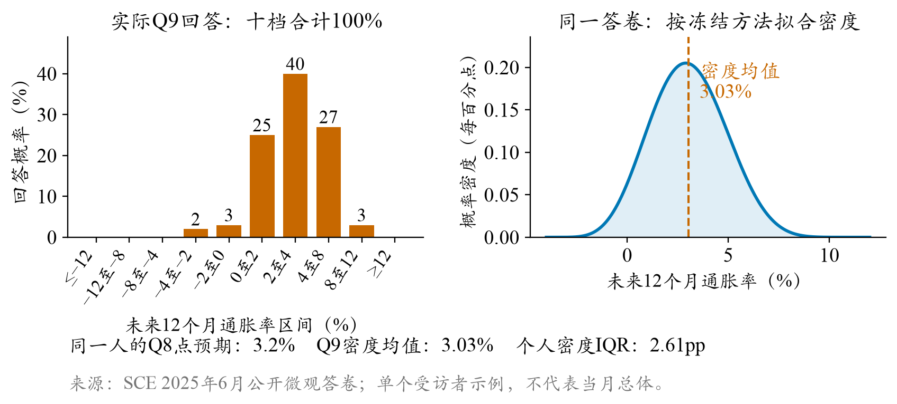
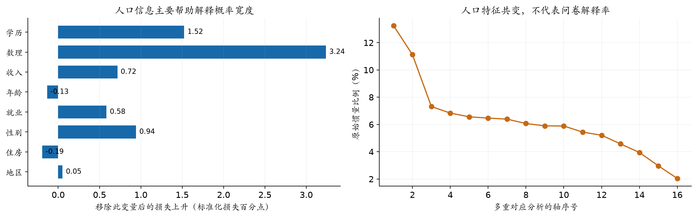
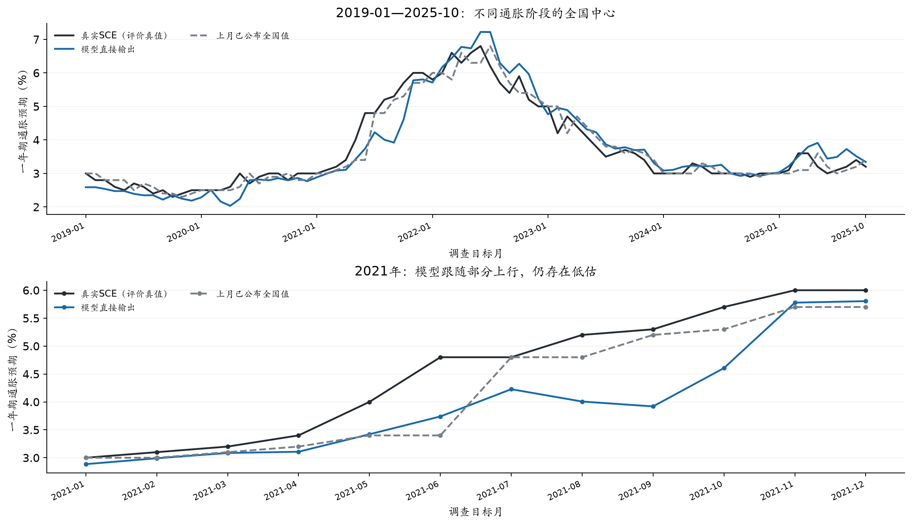
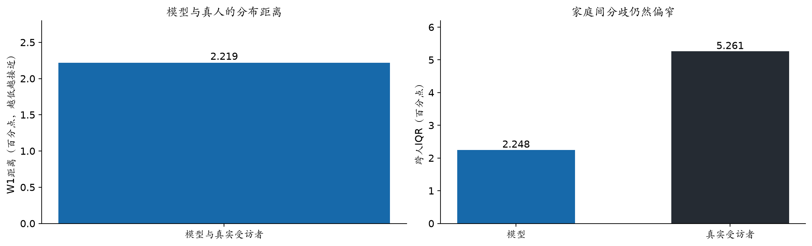
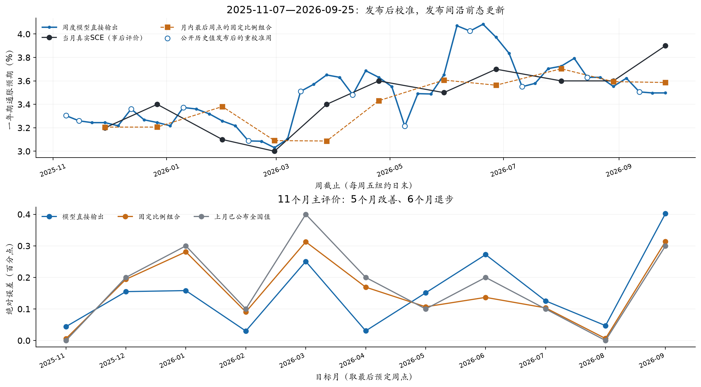
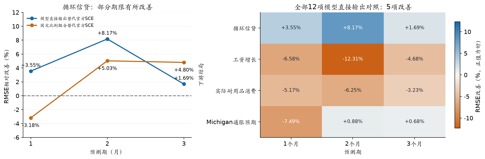

# 居民通胀预期的生成式社会模拟

## 信息接触、信念更新与跨层验证

水上挽月 · SocioVerse Challenge 2026 · 赛道A  
作者审阅稿 v0.8 · 2026-10-27

**摘要**　我研究能否用生成式智能体重建美国家庭的一年期通胀预期，并把家庭背景与既有信念、作答前可得信息和问卷行为分别建模。历史重建覆盖2019年1月至2025年10月，模型直接输出的全国中心平均绝对误差为0.298个百分点；近期模拟覆盖2025年11月至2026年9月，将少量模拟与上月已公布的全国通胀预期按固定比例加权后，误差降至0.144个百分点。**中心拟合没有同步带来家庭间分歧：模型分布仍然过窄，2021年高通胀期的低估也只得到部分缓解。**周度更新和循环信贷预测提供了有限的正向线索，月度自主递推则出现后期漂移。这些结果说明，全国指标、微观差异和动态稳定性需要分别检验。

**关键词**　通胀预期；生成式社会模拟；异质家庭；信息接触；概率问卷

### 1 研究问题与数据发布节奏

居民对物价的判断会影响消费、储蓄、借贷和工资协商。模拟若只接近全国曲线，仍可能把不同家庭回答得过于相似，或者让误差在人群中相互抵消。因此，我同时考察全国中心、家庭之间的分歧和同一家庭随时间的更新。

纽约联储消费者预期调查（SCE）按月访问美国家庭，要求受访者给出未来12个月价格变化的点判断，并把概率分配给十个通胀区间。轮换面板保留了部分家庭的连续回答，公开微观资料使个体层面的检验成为可能。[1,2] 本文以居民答卷及其人口分布为评价对象，实际CPI用于环境信息或后续经济结局。

SCE两类资料的发布节奏不同。**核心微观数据滞后九个月，全国摘要通常在调查后的次月发布。**例如，2026年8月调查于9月8日发布，2026年9月调查于10月7日发布。[1] 因此，历史重建可以使用当月人口框架和本人更早的回答；2025年11月至2026年9月的近期模拟只能沿用当时可得的较早人口框架、匿名供体和公开全国值。两项任务共享问卷和评价方法，初始化条件不同，结果分别报告。

### 2 从概率问卷到可比较的指标

模拟分为三个环节。人群P提供家庭画像和既有信念，环境E提供作答前已经公开并分配给该家庭的信息，行为B是模型填写的Q8点预期与Q9概率答卷。模型输出经过统一计分和人口加权，再与真实调查比较。

[[METHOD_OVERVIEW]]

Q9要求将100%的概率分配到十个通胀或通缩区间。图1展示一份真实匿名答卷。点预期和概率分布来自同一人，两者的数值中心可以不同。我先将每个人的十档概率转换为连续密度，计算密度均值，再按调查权重求跨人中位数。个人密度内部的四分位距表示主观不确定性，跨人四分位距表示家庭之间的分歧。

**官方只半公开连续密度拟合细节，本地计分器属于近似实现。**在同人、同权重且只更换密度算法的条件下，82个月全国中位数的平均绝对差为0.013272个百分点。从原始答卷到全国指标的整条重算与官方发布值相差0.026928个百分点，后一个数还包含其他处理步骤，不能全部归为密度误差，也不能从模型误差中直接扣除。全国主结果采用官方发布值，微观比较让模型与真人共用同一计分器。

### 3 P：人口框架、家庭属性与个人历史

历史重建的P以当月SCE公开微观框架为基础。人口字段描述家庭背景，个人历史描述既有信念，外部调查匹配的属性补充生活价格接触与政策态度。三类信息来源不同，不能混为受访者的实测特征。

| P的组成 | 来源与构造 | 在模拟中的作用与边界 |
|---|---|---|
| 人口画像与调查权重 | 当月SCE微观资料：学历、数理、年龄、收入、就业、住房、地区、性别等 | 用于54格抽样、家庭提示和加权评价；模型不读取身份与权重 |
| 本人历史与匿名供体 | 严格早于当期的本人Q8/Q9；无历史者使用最近1—3个月匿名联合供体 | 提供既有信念起点，保留Q8与Q9的联合关系 |
| 家庭支出结构 | 美国消费者支出调查（CE）2020Q4供体，按家庭条件联合匹配食品、汽油、住所及其他支出份额 | 描述支出相关性和生活价格视图；不是SCE本人消费记录，也不等于CPI权重 |
| 家庭购物分工 | 美国时间利用调查饮食与健康模块（ATUS-EH）2022年资料，按年龄、家庭人数和子女状况形成五档食品采购角色概率 | 决定家庭看到哪些食品细项价格；不是本人实测分工 |
| 对美联储的信心 | 截止前已发布的Gallup历史波次，按全国分布合成五档信心，保留不知道/拒答 | 描述对货币政策的态度差异；不是SCE受访者实测态度 |
| 购物频率 | 当前没有SCE个人真实购物频率；CE购买日或支出份额不能替代实际购买次数 | 最终配置未把合成频率当作实测输入，价格接触仍是代理 |

人口网格用于代表性抽样，个人历史保留网格内部的状态差异。维度筛选始于八项人口特征和126套三、四维候选，开发数据为2019—2022年，按受访者固定分折，避免同一人的不同月份同时进入开发与验证。评价包括个人预期均值、概率密度宽度、零通缩填法和跨人分布，并辅以加权关联和共线性检查。

最终网格由三档学历、两档数理、三档年龄和三档家庭收入交叉形成54格，未知类别另设人口池。年龄、收入、教育和地区更直接对应家庭政策分组与资源约束，数理能力为概率表达提供额外信息。性别仍保留在家庭画像中，但未作为网格坐标；这一取舍同时考虑小格样本支持和分组的政策解释性，不表示性别与预期无关。

每月从真实框架中抽取512户直接作答。小格可以全取，其余名额按人口质量分配。入选概率π(i)用于校正小格过采样，w(i)为原调查权重，c(g)为格内比率校准系数：

$$w^{*}(i)=\frac{w(i)}{\pi(i)}\,c(g)$$

该校正恢复各格在真实框架中的人口份额，小格有效样本量有限所带来的估计不稳定性仍需单独披露。近期模拟受九个月微观披露滞后约束，按“调查月末加九个日历月”的操作化假设选择旧人口源：2025年11月使用2025年1月，推进至2026年8月和9月使用2025年10月，再以当时已公开的全国SCE校准先验中心。这里重建的是初始化条件，并非已知的近期真实家庭名单。

### 4 E：公共信息、生活价格与可见时间

环境E同时包含全国宏观信息、新闻与政策叙事，以及按家庭属性组织的生活价格。每类资料都保留参考期、发布时间和来源；进入提示前还要经过作答时间过滤和家庭差异化分配。

| E的信息块 | 来源与具体内容 | 如何进入家庭提示 |
|---|---|---|
| 通胀与就业统计 | 美国劳工统计局（BLS）的CPI总项及食品、能源、住所、汽油等分项，以及就业数据和滚动历史 | 提供已公开的宏观背景，按参考期和发布日期选择当时可得值 |
| 汽油零售价格 | 美国能源信息署（EIA）经FRED发布的GASREGW周度序列，形成月均水平及同比变化 | 提供高频生活价格信号，保留自己的参考期与可得时间 |
| 经济新闻 | 按日期归档的《纽约时报》文章及主题、CPI相关标签 | 每户分配4、8、16或32篇；CPI高度相关文章的路由权重为1.5 |
| 货币政策文本 | 联邦公开市场委员会（FOMC）声明等按日期保存的政策资料 | 选择截止前最近已发布版本，提供政策行动与表述 |
| 家庭生活价格视图 | BLS食品分类价格、EIA汽油价格，结合CE支出结构与ATUS采购角色 | 按采购角色组织食品细项的可见程度；全国分类价格不等于个人购物小票 |

历史重建以每位受访者完成日前一日为截止，近期模拟取合成作答日前一日与原全局截止中的较早者。家庭收到的新闻并不完全相同，购物价格也会随采购角色变化。新闻分配描述的是模拟中的信息接触，不能解释为真实阅读记录；生活价格视图同样不代表家庭实际成交价。

### 5 B与实验时间划分

行为生成使用DeepSeek V3.2，经OpenRouter固定到SiliconFlow FP8服务，关闭思考模式，以JSON输出Q8、Q9和理由，最多1,024个输出token。提示要求模型依据家庭状态和所见信息填写原问卷，不提供当期调查真值，也不规定必须向个人基准移动多少。新闻数量、CPI相关度和温度等设置来自开发期的小样本对照；局部收益并不稳定，因此正文只把它们作为工程选择，不声称已估计出普遍行为参数。

**不同参数的时间来源不同，不能把所有结果统称为测试集表现。**人口网格与新闻机制在2019—2022年开发；人口网格按受访者分折。统计扩展的借力强度τ在候选0、8、24中选择，使用同期已有模型答卷的遮蔽实验，后34个月和真人不参与选参。

| 用途 | 拟合或开发数据 | 评价方式与边界 |
|---|---|---|
| 人口与新闻机制 | 2019—2022年 | 部分后续月份也参与机制探索，不称全研究盲测 |
| 统计扩展τ=8 | 2019—2022年模型答卷遮蔽实验 | 后34个月与近期模拟直接沿用 |
| 模拟与历史值的组合权重 | 2019-01—2022-12，共48个月 | 2023-01—2025-10按时间顺序检查34个月 |
| 近期模拟 | 不再拟合组合权重 | 2025-11—2026-09沿用历史权重，仍属回顾性证据 |
| 下游普通最小二乘回归 | 每个预测原点之前已形成的标签 | 历史段逐月扩展窗口，至少36条完整训练行；近期段只在首个原点前拟合一次 |

组合指标把上月已公布的全国通胀预期记为b_t，把模型直接输出的全国值记为m_t：

$$c_t=(1-\lambda)b_t+\lambda m_t$$

历史早48个月按均方误差拟合得到λ=0.133976257。该权重用于2023年1月至2025年10月时，组合平均绝对误差为0.184个百分点，上月已公布全国值的误差为0.194个百分点。这是沿时间顺序的检查，部分后段月份曾参与机制探索。近期模拟和动态拓展沿用同一权重，没有用近期真值重新选择。

### 6 全国中心结果：历史重建与近期模拟

历史重建覆盖2019年1月至2025年10月，共82个月和41,970个合格个人月。图4只呈现最终采用的输入方案，并以真实SCE和上月已公布全国值作为外部参照。2021年单独放大，用于观察异常通胀时期的跟随程度。

| 时期与指标口径 | 模型直接输出MAE | 模拟与历史值组合MAE | 上月已公布全国值MAE |
|---|---:|---:|---:|
| 2019-01—2025-10：模型训练知识所对应的历史时期，用于历史重建 | 0.298 | 0.222 | 0.223 |
| 其中2021年：异常通胀年份，重点检查高通胀期的跟随能力 | 0.577 | 0.365 | 0.325 |
| 2025-11—2026-09：模型训练数据截止后的近期阶段，用于模拟预测 | 0.349 | 0.144 | 0.173 |
| 同期贝叶斯扩展：补齐至每月1,300个代理，对齐调查人口规模 | 0.346 | 0.144 | 0.173 |

注：MAE为平均绝对误差，单位是百分点。前两行组合采用全82个月事后拟合的λ=0.159249952，属于样本内描述；2021年只是年度切片，并非独立验证。后两行采用2019—2022年拟合的λ=0.133976257。贝叶斯扩展不增加独立的模型回答。

**历史全期直接输出的MAE为0.298，上月已公布全国值为0.223。**全期事后拟权的组合误差为0.222，与简单历史参照接近，但它只用于描述全期信息组合后的结果。2021年直接输出、组合和历史参照的MAE分别为0.577、0.365和0.325，说明高通胀期的低估仍然明显。

近期11个月中，模型直接输出的MAE为0.349，高于上月已公布全国值的0.173，主要问题是向上偏移。将13.3976%的模拟与86.6024%的历史值组合后，MAE降至0.144。这一结果提供了模拟含有增量方向信息的线索，但样本只有11个月，人口和文本的历史版本也未完全认证。

### 7 微观诊断与人口规模扩展

全国中位数只描述分布的位置。为检查家庭差异，我在共同合法Q9人月上比较模型与真实受访者，双方使用相同权重和计分器，样本为41,042个人月，按月份等权。W1为分布间的一阶Wasserstein距离，IQR为四分位距。

**模型与真实受访者的分布仍有明显距离，家庭间分歧也偏窄。**W1为2.219，跨人IQR为2.248，真人为5.261。Q8同样呈现中心与个人层面的差异：全国中心MAE为0.722，个人MAE为8.215。对33,715个具有真实相邻上期回答的人月，沿用本人上期回答的中心MAE和W1分别为0.211和0.512，低于模型的0.309和2.064。

2021年的残余低估与分布收缩可能同时受到新闻来源、政策叙事[10,11]和模型均值回归倾向影响。现有对照不能单独识别这些因素，模型生成的理由也不能用来反推真实居民的心理过程。

直接调用512户后，还需恢复每月约千人的调查人口表示。我采用经验贝叶斯式的统计扩展，将某格答卷分布P(local)与相近格父池P(parent)混合；n_eff为该格有效样本量，τ控制借力强度：

$$P(g)=\frac{n_{\mathrm{eff}}}{n_{\mathrm{eff}}+\tau}P(\mathrm{local})+\frac{\tau}{n_{\mathrm{eff}}+\tau}P(\mathrm{parent})$$

完整十档答卷作为整体参与扩展。历史重建每月形成976至1,372个代理，全期MAE由0.298变为0.301；近期每月补齐至1,300个代理，直接输出MAE由0.349变为0.346，11个月中9个月的中位数不变。统计扩展基本保留全国结果，没有修复微观收缩，也没有创造新的独立模型判断。

### 8 跨期更新：月度漂移与周度探索

月度自主递推固定同一批512户，将本人上月模拟回答作为下月状态，不再用公开全国值重新对齐。排除共同起点后的10个月中，直接输出MAE为0.306，高于上月已公布全国值的0.190；后五期升至0.500，后期高估逐渐积累。连续更新会把早期偏差带入后续月份。

周度探索固定300户，在2025年11月7日至2026年9月25日的47个周五连续作答。新闻逐周累计并去重，只有新的历史SCE公开后才重校准先验，每月最后一个预定周点构成11个评价目标。直接输出的MAE为0.152，低于上月已公布全国值的0.173，约下降12.24%，未经过输出层线性组合。**改善只出现在5个月，9月末仍漏判上行；47周共享11个月度真值，因此这只是探索性正向证据。**

### 9 下游用途：以循环信贷为主

如果模拟指标包含额外信息，它应在其他经济结局的同结构预测中有所体现。我使用月度历史与近期统计扩展序列，在共同宏观和领域控制下比较普通最小二乘回归，不把周度指标拼接到这项检验。历史段采用逐月扩展窗口，每个原点只使用当时已经形成完整标签的训练行；近期段只用首个近期原点之前的历史数据拟合一次，之后不更新系数。

以模拟替代官方SCE后，循环信贷未来1、2、3个月累计对数增长的均方根误差分别改善3.55%、8.17%和1.69%；使用历史与模拟的组合时，对应变化为−3.18%、5.03%和4.80%。**这些改善只相对于同结构的官方SCE回归，信贷历史均值基线在三个期限仍然更强。**

其他结局没有呈现一致收益。四类结局乘三个预测期共12项比较中，模型直接输出5项改善，组合3项改善；工资、耐用品消费和Michigan通胀预期各自都有较强的简单基线。因此，本文只把循环信贷作为潜在用途的线索，工资、耐用品和其他通胀预期的完整对照留在研究包中。

### 10 讨论与复现边界

我从真实概率问卷出发，将人口代表、信息接触和信念更新组织为一条可检查的模拟链路。**研究得到的主要经验是，中心拟合、微观分歧和动态稳定性并不等价。**信息接触与个体更新可以同步改善部分全国指标，也可能压缩家庭间差异；连续继承模拟状态使路径更平滑，也造成后期漂移。近期组合、周度直接输出和循环信贷回归提供有限正向证据，反例则限定了它们的适用范围。

本文实验均为回顾性研究。输入按公开日期筛选，历史文本版本和模型训练知识无法完全封存，后期时间段也曾参与机制开发。近期人口与供体来自较早框架，个人合成日期只限制环境。下游回归还受到小样本、重叠结局和上游校准未逐原点嵌套的限制。因此，本文不作严格实时预测或因果机制宣称。[8]

研究包保留人口与环境输入、模型原始回复、计分、加权、评价和版本哈希，提供无密钥复算入口。当前v05包的62项包内测试已通过，完整受控微观再生成和全部开发测试仍需单独核查。历史重建、近期生成和周度运行的供应商实报分别约33.060、4.682和8.919美元，未知费用另列，这些数字不构成全项目总支出。数据许可、完整费用覆盖和受控微观复现仍是提交前的独立事项。[12]

### 参考文献与资料

[1] Federal Reserve Bank of New York. Survey of Consumer Expectations: FAQ and microdata documentation. 2026-10-27核查。https://www.newyorkfed.org/microeconomics/sce/sce-faq

[2] Armantier O., Topa G., van der Klaauw W., Zafar B. (2017). An Overview of the Survey of Consumer Expectations. Economic Policy Review, 23(2), 51–72. https://www.newyorkfed.org/research/epr/2017/epr_2017_overview-of-sce_armantier

[3] Huang Y., Yin Y., Lin J., et al. (2026). Uncovering Salience-Driven Dynamics in Consumer Confidence with Generative Social Simulation. arXiv:2606.30395. https://arxiv.org/abs/2606.30395

[4] Carroll C. D. (2003). Macroeconomic Expectations of Households and Professional Forecasters. Quarterly Journal of Economics, 118(1), 269–298.

[5] D’Acunto F., Malmendier U., Ospina J., Weber M. (2021). Exposure to Grocery Prices and Inflation Expectations. Journal of Political Economy, 129(5), 1615–1639. https://doi.org/10.1086/713192

[6] Mankiw N. G., Reis R. (2002). Sticky Information versus Sticky Prices. Quarterly Journal of Economics, 117(4), 1295–1328.

[7] Malmendier U., Nagel S. (2016). Learning from Inflation Experiences. Quarterly Journal of Economics, 131(1), 53–87. https://doi.org/10.1093/qje/qjv037

[8] Bisbee J., Clinton J. D., Dorff C., Kenkel B., Larson J. M. (2024). Synthetic Replacements for Human Survey Data? Political Analysis, 32(4), 401–416.

[9] Pfajfar D., Winkler F. (2024). Households’ Preferences Over Inflation and Monetary Policy Tradeoffs. Working paper.

[10] U.S. Bureau of Labor Statistics. CPI News Release, May 2021 reference period, released 2021-06-10. https://www.bls.gov/news.release/archives/cpi_06102021.htm

[11] Federal Reserve. FOMC Statement, 2021-04-28. 本项目按各月版本保留政策文本。https://www.federalreserve.gov/newsevents/pressreleases/monetary20210428a.htm

[12] SocioVerse Challenge 2026. Study、复现与交付说明。2026-10-27核查。https://socioverse.fudan-disc.com/docs/zh/
