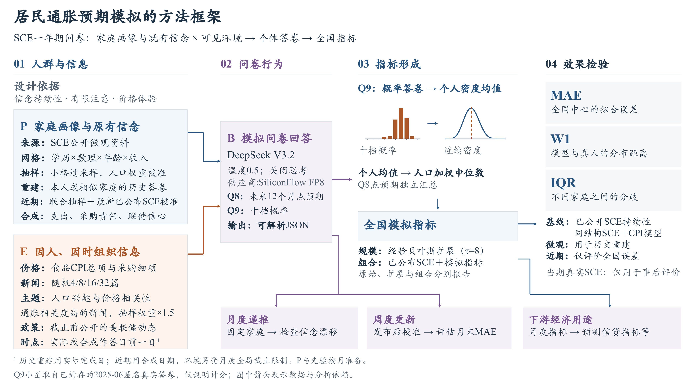
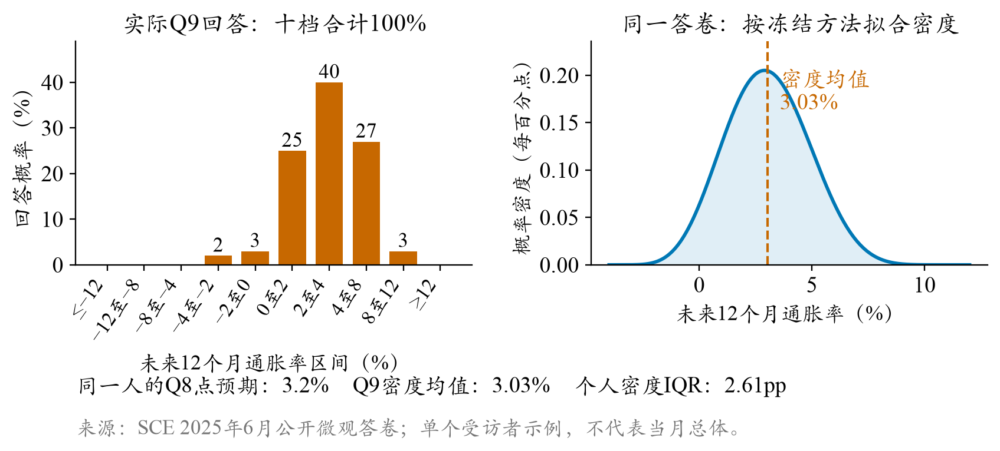
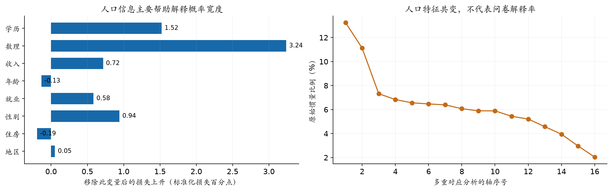
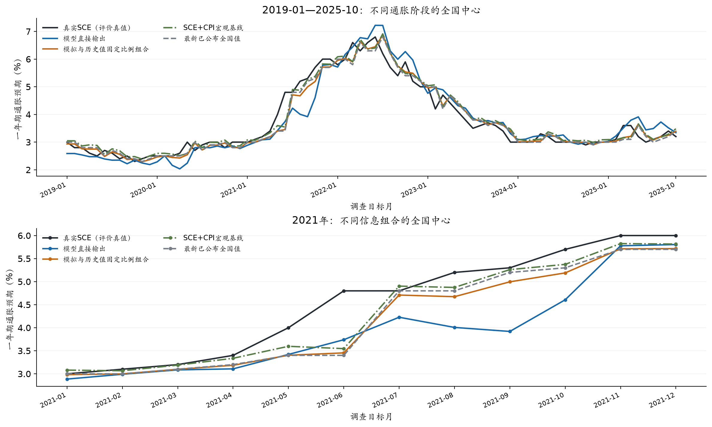
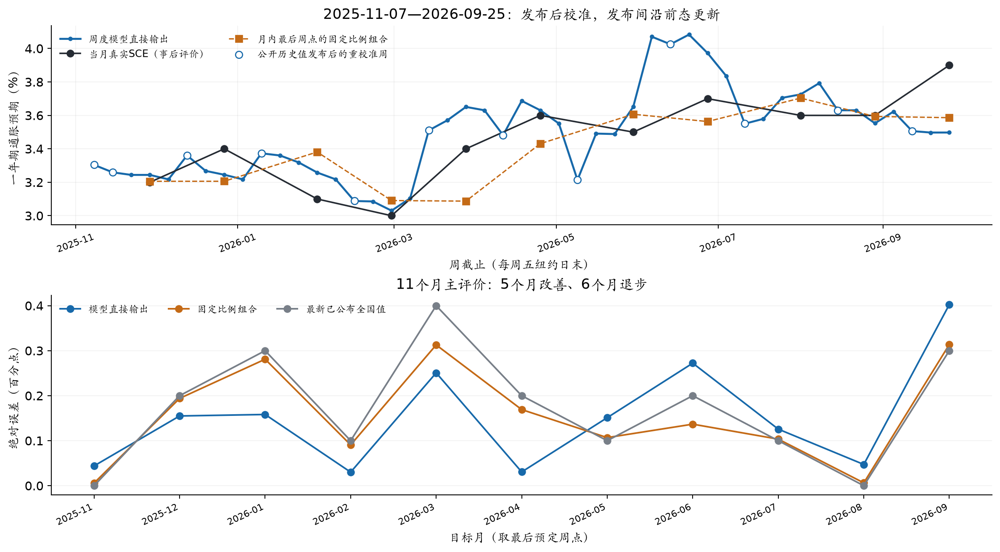
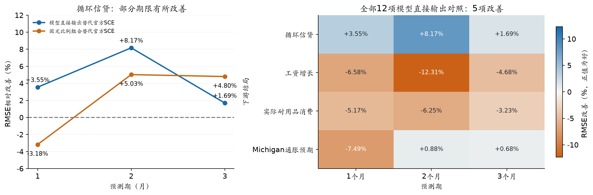

# 居民通胀预期的生成式社会模拟

## 信息接触、信念更新与跨层验证

水上挽月 · SocioVerse Challenge 2026 · 赛道A  
作者审阅稿 v0.10.8 · 2026-10-29

**摘要**　本项目使用生成式智能体，通过社会模拟重建美国家庭的一年期通胀预期：将家庭背景与既有信念（P）、作答前可得信息（E）、问卷作答行为（B）分别建模，让异质家庭智能体逐月填写纽约联储消费者预期调查（SCE）的通胀预期部分。历史重建覆盖2019年1月至2025年10月，模型直接输出的全国中心平均绝对误差为0.298个百分点；模拟预测覆盖2025年11月至2026年9月，将模拟输出与截止前最新已公布的全国通胀预期按固定比例加权后，误差降至0.144个百分点，低于持续性基线（沿用同期最新已公布全国值）和SCE+CPI时间序列宏观基线。**全国中心、家庭间分歧和动态稳定性构成三个相互补充的评价层次：模型在全国中心上接近真实调查，家庭间分歧仍然偏窄，2021年高通胀期的低估只得到部分缓解。**周度更新和循环信贷预测提供了正向线索，月度自主递推则出现后期漂移。

**关键词**　通胀预期；生成式社会模拟；异质家庭；信息接触；概率问卷

### 1 研究问题与数据发布节奏

居民对物价的判断会影响消费、储蓄、借贷和工资协商，通胀预期因此成为政策制定与市场判断的重要参考；在官方指数公开发布之前，提前给出可信的通胀预期模拟具有实际意义。同时，经济系统并非单一的宏观聚合值，每一类家庭的行为及由此构成的微观结构同样重要。2026年诺贝尔经济学奖授予Robert Hall与Michael Woodford，表彰他们为宏观经济稳定化建立的微观基础，即从个体家庭和企业的行为出发理解整体经济表现，这一方向与本研究的关注点直接相关。[12] 模拟若只接近全国曲线，仍可能把不同家庭回答得过于相似，或者让误差在人群中相互抵消。因此，本研究同时考察全国中心、家庭之间的分歧和同一家庭随时间的更新。

纽约联储消费者预期调查（SCE）按月访问美国家庭，要求受访者给出未来12个月价格变化的点判断，并把概率分配给十个通胀区间。轮换面板保留了部分家庭的连续回答，公开微观资料使个体层面的检验成为可能。[1,2] 本文以居民答卷及其人口分布为评价对象，实际CPI用于环境信息或后续经济结局。

SCE两类资料的发布节奏不同。**核心微观数据滞后九个月，全国摘要通常在调查后的次月发布。**例如，2026年8月调查于9月8日发布，2026年9月调查于10月7日发布。[1] 因此，历史重建可以使用当月人口框架和本人更早的回答；2025年11月至2026年9月的模拟预测沿用当时可得的公开资料，对较早人口框架、匿名供体和公开全国值进行匹配、抽样或合成。两项任务分别对应赛道A的历史重建与未来预测，共享问卷和评价方法，初始化条件不同，结果分别报告。

### 2 从概率问卷到可比较的指标

本研究的模拟链路基于SocioVerse2纵向社会模拟框架[13]实现，分为三个环节：人群（P）提供家庭画像和既有信念，环境（E）提供作答前已经公开并分配给该家庭的信息，行为（B）是模型填写的Q8点预期与Q9概率答卷。模型输出经过统一计分和人口加权，再与真实调查比较。

Q9要求将100%的概率分配到十个通胀或通缩区间。图2展示一份真实匿名答卷。点预期和概率分布来自同一人，两者的数值中心可以不同。**计分先将每个人的十档概率转换为连续密度并计算密度均值，再按调查权重求跨人中位数。**个人密度内部的四分位距表示主观不确定性，跨人四分位距表示家庭之间的分歧。

官方连续密度拟合的规则族已随SCE概述文章公开发表（Armantier等，2017，附录C）[2]，本地计分器据此实现，按均匀、相邻双档三角与广义Beta三类分支拟合，完整规则随研究包公开。官方文章未给出广义Beta分支的全部优化细节，例如参数初值与收敛准则，本地Beta拟合因此是有文档记录的研究复现而非官方原始实现；两者的差异可以量化并保持可控：在同人、同权重且只更换密度算法的条件下，82个月全国中位数的平均绝对差为0.013272个百分点；从原始答卷到全国指标的整条重算与官方发布值相差0.026928个百分点，其余差值来自其他处理步骤。全国主结果采用官方发布值，微观比较让模型与真人共用同一计分器。

### 3 P：人口框架、家庭属性与个人历史

历史重建的P以当月SCE公开微观框架为基础。人口字段描述家庭背景，个人历史描述既有信念，外部调查匹配的属性补充生活价格接触与政策态度，三者分别进入抽样、状态初始化与环境构造。

| P的组成 | 来源与构造 | 在模拟中的作用与边界 |
|---|---|---|
| 人口画像与调查权重 | 当月SCE微观资料：学历、数理、年龄、收入、就业、住房、地区、性别等 | 用于54格抽样、家庭提示和加权评价；最终外发画像仅含年龄组、学历、收入档、就业、住房、数理、地区和州，不含性别、身份与权重 |
| 本人历史与匿名供体 | 严格早于当期的本人Q8/Q9；无历史者使用最近1—3个月匿名联合供体 | 提供既有信念起点，保留Q8与Q9的联合关系 |
| 家庭支出结构 | 美国消费者支出调查（CE）2020Q4供体，按家庭条件联合匹配食品、汽油、住所及其他支出份额 | 描述支出相关性和生活价格视图；不是SCE本人消费记录，也不等于CPI权重 |
| 家庭购物分工 | 美国时间利用调查饮食与健康模块（ATUS-EH）2022年资料，按年龄、家庭人数和子女状况形成五档食品采购角色概率 | 决定家庭看到哪些食品细项价格；不是本人实测分工 |
| 对美联储的信心 | 截止前已发布的Gallup历史波次，按全国分布合成五档信心，保留不知道/拒答 | 描述对货币政策的态度差异；不是SCE受访者实测态度 |
| 购物频率 | 当前没有SCE个人真实购物频率；CE购买日或支出份额不能替代实际购买次数 | 最终配置未把合成频率当作实测输入，价格接触仍是代理 |

人口网格用于代表性抽样，个人历史保留网格内部的状态差异。维度筛选始于八项人口特征和126套三、四维候选，开发数据为2019—2022年，按受访者固定分折，避免同一人的不同月份同时进入开发与验证。评价包括个人预期均值、概率密度宽度、零通缩填法和跨人分布，并辅以加权关联和共线性检查。

最终网格由三档学历、两档数理、三档年龄和三档家庭收入交叉形成54格，未知类别另设人口池。我选择年龄、收入、学历和数理作为网格坐标，因为它们直接对应家庭政策分组与资源约束；数理能力为概率表达提供额外信息，一并保留。性别保留在源数据与分组诊断中，但未进入最终外发画像，也未作为网格坐标；地区同样不作为网格坐标，仅保留在画像与分组诊断中；这一取舍综合考虑了小格样本支持和分组的政策解释性。

每月从真实框架中抽取512户直接作答。小格可以全取，其余名额按人口质量分配。入选概率π(i)用于校正小格过采样，w(i)为原调查权重，c(g)为格内比率校准系数：

$$w^{*}(i)=\frac{w(i)}{\pi(i)}\,c(g)$$

该校正恢复各格在真实框架中的人口份额，小格有效样本量有限所带来的估计不稳定性仍需单独披露。模拟预测受九个月微观披露滞后约束，按“调查月末加九个日历月”的操作化假设选择旧人口源：2025年11月使用2025年1月，推进至2026年8月和9月使用2025年10月，再以当时已公开的全国SCE校准先验中心。这里重建的是初始化条件，并非已知的近期真实家庭名单。

模拟预测的初始化分三步合成。作答日期按前一年同月的实际月内完成日频率逐人抽取，个人环境截止取合成作答日前一日与原全局截止中的较早者；日期只进一步限制环境，人口框架与先验仍按月全局截止准备。既有信念从旧源库末端1—3个月的同类池中抽取完整的联合Q8/Q9供体，再经有限样本分配约束调整供体概率，使人口加权的Q9先验中位数落在当时已公开历史值的±0.05个百分点内；Q8不作强行对齐，供体原始答卷与人口权重保持不变。普通模拟预测每月独立初始化；月度递推与周度链固定同一批人群连续更新，三者的结果分别报告。

### 4 E：公共信息、生活价格与可见时间

环境E的资料库包含新闻、政策叙事与按家庭属性组织的生活价格，宏观统计另用于基线回归与统计对照。每类资料都保留参考期、发布时间和来源，任何信息只在公开之后才可用。模型提示并不装载全部资料：每户家庭先按作答时间过滤可得信息，再依据画像特征以加权随机的方式匹配其中一部分，不同家庭因此看到不同的信息组合。

| E的信息块 | 来源与具体内容 | 与最终模型提示的关系 |
|---|---|---|
| 经济新闻 | 按日期归档的《纽约时报》文章及主题、CPI相关标签 | 直接输入：每户随机分配4、8、16或32篇；CPI高度相关文章的抽样权重为1.5，作用于新闻抽样，不是数值CPI放大 |
| 食品价格视图 | BLS食品分类价格，结合CE支出结构与ATUS采购角色 | 直接输入：按采购角色组织食品细项的可见程度；全国分类价格作为个人实际购物价格的代理指标 |
| 货币政策文本 | 联邦公开市场委员会（FOMC）声明等按日期保存的政策资料 | 直接输入：选择截止前最近已发布版本，提供政策行动与表述 |

历史重建以每位受访者完成日前一日为截止，模拟预测取合成作答日前一日与原全局截止中的较早者。家庭收到的新闻并不完全相同，食品价格视图也会随采购角色变化。新闻分配与价格视图共同控制模型可见的信息组合。

### 5 B与实验时间划分

行为生成使用DeepSeek V3.2，经OpenRouter固定到SiliconFlow FP8服务，关闭思考模式，温度0.5，以JSON输出Q8、Q9和理由，最多1,024个输出token。提示要求模型依据家庭状态和所见信息填写原问卷，不提供当期调查真值，也不规定必须向个人基准移动多少。新闻数量、CPI相关度和温度等关键设置均在开发期的小样本对照中选定（证据见本节末），主运行直接沿用。

**机制开发、权重拟合和近期评价使用不同的时间窗口。**人口网格在2019—2022年按受访者分折开发；新闻与行为机制在间隔抽取的月份中比较，部分新闻量对照包含2025年样本；因此后34个月用于冻结组合系数的时序检查，不视为全项目未触碰的盲测。统计扩展的借力强度τ在候选0、8、24中选择，使用同期已有模型答卷的遮蔽实验，后34个月不参与选参。

| 用途 | 拟合或开发数据 | 评价方式与边界 |
|---|---|---|
| 人口网格筛选 | 2019—2022年，按受访者分折 | 结构冻结后沿用至全部时期 |
| 新闻与行为机制 | 间隔抽取的多个月份，部分含2025年 | 抽样机制对照，与组合系数的时间划分分开 |
| 统计扩展τ=8 | 2019—2022年模型答卷遮蔽实验 | 后34个月与模拟预测直接沿用 |
| 模拟与历史值的组合权重 | 2019-01—2022-12，共48个月 | 2023-01—2025-10按时间顺序检查34个月 |
| 模拟预测 | 沿用历史48个月冻结的组合权重λ=0.134，不再重新拟合 | 2025-11—2026-09按同一冻结权重组合；该期真值在分析时已公开，属事后回测而非事前实时预测 |
| 下游普通最小二乘回归 | 每个预测原点之前已形成的标签 | 历史段逐月扩展窗口，至少36条完整训练行；近期段只在首个原点前拟合一次 |

组合指标把截止前最新已公布的全国SCE中位数记为b_t，把模型直接输出的全国值记为m_t。82个月中67个月的锚为上月值，15个月因原截止时最新一期摘要尚未公布而取前两个月值，下文统称最新已公布全国值。

$$c_t=(1-\lambda)b_t+\lambda m_t$$

历史早48个月按均方误差拟合得到λ=0.133976257。该权重用于2023年1月至2025年10月时，组合平均绝对误差为0.184个百分点，最新已公布全国值的误差为0.194个百分点。模拟预测和动态拓展沿用同一权重。

另设SCE与CPI宏观时间序列基线，以上月公开SCE水平、最新可得CPI同比相对SCE的差值、CPI同比变化为自变量。历史段在2019—2021年拟合、2022年选择岭回归强度，再用早48个月重新估计系数；用于模拟预测期时沿用该强度，系数只使用历史82个月的数据重新估计，2025年11月之后的真实值不参与任何拟合。

行为配置的每条主要机制都先有文献动机，再经小样本候选对照决定是否进入主配置。粘性信息理论指出，家庭只在部分时点更新信息集，不同家庭的信息接触量存在持续差异[4,6]，这支持按随机篇数而非统一篇数分配新闻；显著性研究表明，与自身支出直接相关的价格与新闻对预期的影响远大于宏观总量[3,5]，这支持按家庭属性组织食品价格视图，并提高CPI相关新闻的抽样权重；经历学习与信念持续性研究支持以本人历史回答作为下期起点，并用固定比例组合吸收预期的惯性成分[7]。在文献提供的参考方向下，新闻篇数的四档设定、1.5倍路由权重与组合权重λ等具体参数，均由本项目的对照实验或历史拟合确定。主要候选的对照证据与取舍如下；心理与财务标签、生成温度、媒体来源混入等候选未获稳定收益，登记于实验台账。

| 机制候选 | 开发期对照证据 | 最终取舍 |
|---|---|---|
| 新闻总量：固定8篇／随机量／按人口预测 | 八期1,116共同人月：固定8篇中心MAE 0.273，随机量0.260，分布距离基本持平 | 随机四档4、8、16、32；档数为工程设定而非文献估计 |
| CPI相关文章：均匀抽样／相关度路由 | 七期641共同人月：Q9中心MAE由0.485降至0.439，Q8中心由0.864升至0.907 | 采用1.5倍路由，接受点预期的代价 |
| 信息截止：共同月中截止／逐人作答日 | 七期654共同人月：统一截止0.516，逐人截止0.478，叠加警示加权0.491 | 采用逐人作答日截止 |
| 信念更新：每月独立／连续继承 | 月度递推后五期MAE升至0.500；周度发布后重校准配置为0.152 | 主结果按月独立初始化，连续机制列为探索性证据 |

### 6 全国中心结果：历史重建与模拟预测

历史重建覆盖2019年1月至2025年10月，共82个月和41,970个合格个人月。图5同时呈现模型直接输出、固定比例组合、最新已公布全国值与SCE+CPI宏观基线，并单独放大2021年，观察异常通胀时期的跟随程度。

| 时期与指标口径 | 模型直接输出MAE | 模拟与历史值组合MAE | 最新已公布全国值MAE |
|---|---:|---:|---:|
| 2019-01—2025-10：微观资料已公开，用于历史重建 | 0.298 | 0.222 | 0.223 |
| 其中2021年：异常通胀年份，重点检查高通胀期的跟随能力 | 0.577 | 0.365 | 0.325 |
| 2025-11—2026-09：微观资料尚未公开，用于模拟预测 | 0.349 | 0.144 | 0.173 |
| 同期贝叶斯扩展：补齐至每月1,300个代理，对齐调查人口规模 | 0.346 | 0.144 | 0.173 |

注：MAE为平均绝对误差，单位是百分点。前两行组合采用全82个月事后拟合的λ=0.159249952，属于样本内描述；后两行采用2019—2022年拟合的λ=0.133976257。贝叶斯扩展不增加独立的模型回答。

**全期固定比例组合将直接模拟的MAE从0.298降至0.222，与最新已公布全国值的0.223接近。**SCE+CPI宏观基线的全期MAE为0.227。2021年直接输出、组合、最新已公布全国值和宏观基线的MAE分别为0.577、0.365、0.325和0.250；宏观变量在这一年提供了更强的全国中心参照。按时间顺序保留的后34个月中，组合与参照的MAE分别为0.184和0.194，差值约−0.010个百分点，六个月块重抽样的95%区间约[−0.021,+0.001]并跨过零，该差异只作方向性参考。

近期11个月中，模型直接输出的MAE为0.349，主要问题是向上偏移。将13.3976%的模拟与86.6024%的历史值组合后，MAE降至0.144，低于最新已公布全国值的0.173和SCE+CPI宏观基线的0.160。**近期结果中，固定比例组合在两类参照之上进一步降低了误差。**

### 7 微观诊断与人口规模扩展

全国中位数只描述分布的位置。为检查家庭差异，本研究在共同合法Q9人月上比较模型与真实受访者，双方使用相同权重和计分器，样本为41,042个人月，按月份等权。W1为分布间的一阶Wasserstein距离，IQR为四分位距。

**模型的家庭间分歧明显窄于真实受访者。**W1为2.219，模型跨人IQR为2.248，真人为5.261。Q8同样呈现中心与个人层面的差异：全国中心MAE为0.722，个人MAE为8.215。对33,715个具有真实相邻上期回答的人月，沿用本人上期回答的中心MAE和W1分别为0.211和0.512，低于模型的0.309和2.064。这组指标从分布距离、分歧宽度、点预期和个人持续性四个角度补充了全国结果，也表明模型对真实受访者预期异质性的模拟仍然有限。

2021年的残余低估与分布收缩可能同时受到新闻来源、政策叙事[10,11]和模型均值回归倾向影响，未来需要通过进一步对照实验分解三者的作用，并据此优化机制、提高拟合效果。

直接调用512户后，还需恢复每月约千人的调查人口表示。统计扩展采用经验贝叶斯式混合，将某格答卷分布P(local)与相近格父池P(parent)结合；n_eff为该格有效样本量，τ控制借力强度：

$$P(g)=\frac{n_{\mathrm{eff}}}{n_{\mathrm{eff}}+\tau}P(\mathrm{local})+\frac{\tau}{n_{\mathrm{eff}}+\tau}P(\mathrm{parent})$$

完整十档答卷作为整体参与扩展。历史重建每月形成976至1,372个代理，全期MAE由0.298变为0.301；近期每月补齐至1,300个代理，直接输出MAE由0.349变为0.346，11个月中9个月的中位数不变。**统计扩展在保持全国中心基本稳定的同时，将直接作答样本桥接到调查人口规模。**

### 8 跨期更新：月度漂移与周度探索

月度自主递推固定同一批512户，将本人上月模拟回答作为下月状态，不再用公开全国值重新对齐。排除共同起点后的10个月中，直接输出MAE为0.306，高于最新已公布全国值的0.190；后五期升至0.500，后期高估逐渐积累。连续更新会把早期偏差带入后续月份，未来还需继续探索如何在保留状态连续性的同时抑制偏差积累、提高递推稳定性。

周度探索固定300户，在2025年11月7日至2026年9月25日的47个周五连续作答。新闻逐周累计并去重，只有新的历史SCE公开后才重校准先验，每月最后一个预定周点构成11个评价目标。**该周度配置的直接输出MAE为0.152，低于最新已公布全国值的0.173；同一时期保持先验不动的配置为0.171。**改善出现在5个月，9月末仍漏判通胀预期的上行。周度与月度主线在人口框架、作答日期和初始化上均不同，该结果说明固定人群的周度更新本身可行；改善究竟来自更高的模拟频率还是对新发布SCE的重校准，未来还需进一步研究加以区分；47周共享11个月度真值，结果作为动态机制的探索性证据。

### 9 下游用途：以循环信贷为主

如果模拟指标包含额外信息，它应在其他经济结局的同结构预测中有所体现。下游检验使用月度历史与近期统计扩展序列，在共同宏观和领域控制下比较普通最小二乘回归，不拼接周度指标。历史段采用逐月扩展窗口，每个原点只使用当时已经形成完整标签的训练行；近期段只用首个近期原点之前的历史数据拟合一次，之后不更新系数。历史A段包含41至44个有效预测原点，近期B段仅7至10个，后者只作冻结迁移的敏感性对照，不与A合并报告。

**循环信贷是历史A段（2019—2025年滚动评价）未来1—3个月预测中出现正向结果的主要结局。**以模拟替代官方SCE后，累计对数增长的均方根误差分别改善3.55%、8.17%和1.69%；使用历史与模拟的组合时，对应变化为−3.18%、5.03%和4.80%。这些改善相对于同结构的官方SCE回归；信贷历史均值基线在三个期限仍然更强。

其他结局没有一致收益：12项结局与期限的比较中，直接输出5项改善、组合3项；工资、耐用品消费和Michigan通胀预期各自有较强的简单基线。正文以循环信贷作为潜在用途的线索，其余对照留在研究包。

### 10 讨论与复现边界

本项目从真实概率问卷出发，将人口代表、信息接触和信念更新组织为一条可检查的模拟链路。**中心拟合、微观分歧和动态稳定性共同决定了模拟指标的解释价值。**信息接触与个体更新改善了部分全国指标，也压缩了家庭间差异；连续继承状态使路径更平滑，也带来后期漂移。正向证据与反例共同标定了方法的适用条件。本研究表明，在公开信息约束下，基于领域理论构建的模拟机制可以在通胀预期等重要经济指标上提供有增益信息的模拟指标序列；但模拟指标在异常时期、微观结构拟合度和连续递归等维度上表现仍不足，未来仍需基于领域特点和智能体行为特征改善B=f(P,E)的机制设计。

本文实验均为回顾性研究：输入按公开日期筛选；模型在历史重建期未表现出依靠训练记忆复现真实指标的优势，但预训练知识对模型回答的影响不能完全排除；环境信息使用特定新闻来源和全国性价格指标作为代理，不能完全复现真实个体的信息渠道与价格感知；近期人口与供体来自较早框架；下游回归还受到小样本、重叠结局和上游校准未逐原点嵌套的限制。本文不作严格实时预测或因果机制宣称。[8]

**在更好拟合的基础上，这一框架可以走向反事实实验与内生经济系统。**要实现足够好的拟合，首先需要改进机制设计：围绕异常时期的信息权重、家庭异质性保持和连续状态的偏差控制优化B=f(P,E)。在此之上，可以固定人口与行为、只改变信息环境，开展反事实控制变量实验，估计特定信息冲击对通胀预期的影响；也可以让消费者与生产者智能体互动、共同决定价格与实际通胀水平，从拟合既有预期走向模拟预期与现实的共同演化。

本研究的模型调用费用由供应商实报记录：历史重建、模拟预测、月度递推和周度运行四个最终任务分别约33.06、4.68、4.28和8.92美元，合计约50.94美元；包含早期实验与新闻处理在内的全项目总支出，按作者账单估计约108美元。

### 参考文献与资料

[1] Federal Reserve Bank of New York. Survey of Consumer Expectations: FAQ and microdata documentation. 2026-10-27核查。https://www.newyorkfed.org/microeconomics/sce/sce-faq

[2] Armantier O., Topa G., van der Klaauw W., Zafar B. (2017). An Overview of the Survey of Consumer Expectations. Economic Policy Review, 23(2), 51–72. https://www.newyorkfed.org/research/epr/2017/epr_2017_overview-of-sce_armantier

[3] Huang Y., Yin Y., Lin J., et al. (2026). Uncovering Salience-Driven Dynamics in Consumer Confidence with Generative Social Simulation. arXiv:2606.30395. https://arxiv.org/abs/2606.30395

[4] Carroll C. D. (2003). Macroeconomic Expectations of Households and Professional Forecasters. Quarterly Journal of Economics, 118(1), 269–298.

[5] D’Acunto F., Malmendier U., Ospina J., Weber M. (2021). Exposure to Grocery Prices and Inflation Expectations. Journal of Political Economy, 129(5), 1615–1639. https://doi.org/10.1086/713192

[6] Mankiw N. G., Reis R. (2002). Sticky Information versus Sticky Prices. Quarterly Journal of Economics, 117(4), 1295–1328.

[7] Malmendier U., Nagel S. (2016). Learning from Inflation Experiences. Quarterly Journal of Economics, 131(1), 53–87. https://doi.org/10.1093/qje/qjv037

[8] Bisbee J., Clinton J. D., Dorff C., Kenkel B., Larson J. M. (2024). Synthetic Replacements for Human Survey Data? Political Analysis, 32(4), 401–416.

[9] Pfajfar D., Winkler F. (2024). Households’ Preferences Over Inflation and Monetary Policy Tradeoffs. Finance and Economics Discussion Series 2024-036, Board of Governors of the Federal Reserve System. https://www.federalreserve.gov/econres/feds/households-preferences-over-inflation-and-monetary-policy-tradeoffs.htm

[10] U.S. Bureau of Labor Statistics. CPI News Release, May 2021 reference period, released 2021-06-10. https://www.bls.gov/news.release/archives/cpi_06102021.htm

[11] Federal Reserve. FOMC Statement, 2021-04-28. 本项目按各月版本保留政策文本。https://www.federalreserve.gov/newsevents/pressreleases/monetary20210428a.htm

[12] The Royal Swedish Academy of Sciences (2026). The Sveriges Riksbank Prize in Economic Sciences in Memory of Alfred Nobel 2026: Robert E. Hall and Michael Woodford, “for microeconomic foundations of macroeconomic stabilisation”. Press release, 2026-10-12；2026-10-28核查。https://www.nobelprize.org/prizes/economic-sciences/2026/press-release/

[13] Zhang X., Lin J., Wang J., et al. (2026). SocioVerse2: A Longitudinal Dynamic Social Simulation Framework under a Human-AI Co-evolutionary Paradigm. arXiv:2609.24911. https://arxiv.org/abs/2609.24911
