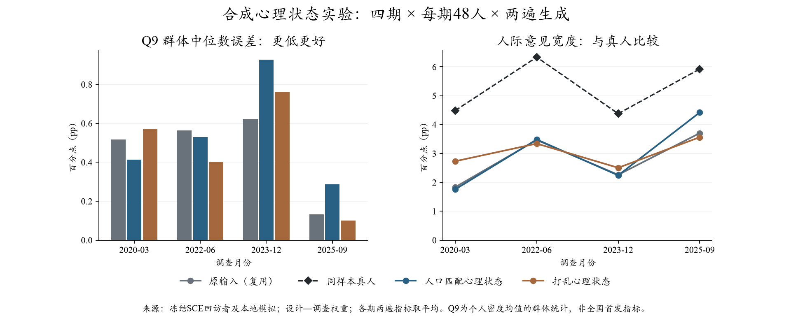

# 心理状态实验：未见稳定拟合收益，暂不加入默认配置

2026-10-17（北京时间）。**768次新增调用全部完成且有效，无错误、无重试；估计费用$0.865/$4，API运行约4.15分钟，评价约21.9秒。**费用按token及登记单价估算，不是独立账单。复用原配置384份回答，未重复调用。

## 本轮检验与结果

固定四期2020-03、2022-06、2023-12、2025-09，每期48人、各两遍。原输入不变，新增两组：按年龄/教育/粗收入/地区分配GSS幸福感和财务满意度；同月打乱相同心理组合。使用DeepSeek官方Flash、温度0.5、关闭思考，沿用原SocioVerse2 Core和Q9计分器。

目标是**同一批回访者的Q9个人密度均值及其分布**，不是官方全国首发值。主口径为设计—调查权重，各月/两遍等权汇总；两遍不算两倍真人。

- **Q9群体中位数MAE**：原输入 **0.459** → 匹配 **0.540**；打乱 **0.459**。匹配组更差。
- **个人Q9均值MAE**：**3.581 → 3.570**；打乱 **3.622**。匹配的变化很小。
- **跨人分布W1**：**2.505 → 2.564**；打乱 **2.633**。两种新增均未优于原输入。
- **人际IQR**：**2.818 → 2.977**；打乱 **3.036**；真人 **5.282**。意见稍宽，但打乱也能变宽，且与真人的差距仍大。
- **更新分布W1**：**2.269 → 2.388**；打乱 **2.366**。未改善。
- **Q8点回答**另计：群体中位数MAE **1.050 → 0.950**，个人MAE **6.292 → 6.268**；打乱分别 **1.075/6.155**。不能用Q8的局部改善代替Q9主指标。

人口匹配组的分月Q9中心MAE：2020-03 **0.517→0.415**；2022-06 **0.564→0.530**；2023-12 **0.622→0.928**；2025-09 **0.133→0.288**。两期略好、两期较差。个人MAE几乎不动也掩盖抵消：2020-03约改善0.995pp，后三期均变差，不能据总平均说每个人都未受影响。

等人权重敏感性下，Q9中心 **0.377→0.386**，W1 **2.036→2.038**；主方向仍没有可采用的整体收益。保留原权重口径，不为取得好结果换权重。

## 从统计上能得出什么

三组共同可评分Q9/Q8均192人月，每组384份生成。按人聚类、两遍及月份保持在一起的1000次探索性bootstrap，匹配减原输入的95%区间：

- 中心MAE：**[−0.108，+0.243] pp**；样本差+0.081。
- 个人MAE：**[−0.517，+0.394] pp**；样本差−0.011。
- 跨人W1：**[−0.457，+0.456] pp**；样本差+0.059。

匹配减打乱的相应区间为中心 **[−0.184，+0.176]**、个人MAE **[−0.235，+0.107]**、W1 **[−0.257，+0.073]**。均包含0，尚不能认定人口匹配有稳定的额外收益，也不能把它解释为已经证明效应为零。这些区间未做多重比较校正，也不反映换到其他月份的有效性。

## 如何理解这次结果

**更分散不等于更像真人。** 两种心理描述都稍微加宽意见，但跨人W1没有改善，说明新增变化未必落在真人所处的位置。背景文字、生成随机性或机械的人口—心理联系都可能参与，不能凭理由文字认定传导机制。

**供体是另一批人，不是这位受访者的心理测量。** 本轮191/192人月成功分配，证明有匹配支持；它不证明年龄等条件能决定某个人的真实幸福与通胀信念。2018条件分布迁移到疫情、高通胀和2025年也缺少当期心理状态。因而本试验否定不了近期情绪、财务压力或稳定人格在真人中的作用。

**目前只检验了短状态描述。** 没有告诉模型如何因这些状态选择记忆、信任信息或更新信念；没有验证该文字能复制人的心理传导。另一方面，也不应仅因结果不好，就在同四期强写“悲观要报高通胀”直到拟合成功。两项一起新增，不能识别幸福和财务满意各自效应。

## 决定与下一步

1. 保留本轮全部输入、分配与回答；**心理状态模块不升级默认配置**。不在这四期继续搜索心理措辞或供体种子。
2. 财务Q1、上期Q2及心理状态均已有单独结果，不能把各自某个局部收益拼接成“组合已验证”。当前共同底座继续保留。
3. 后续若再推进心理，应优先寻找同一SCE人的实测状态或可核验的近期变化，并明确信息如何影响更新。外部人格供体仅作为假设与敏感性条件；新数据不等于新机制已有效。
4. 个人常态方向此前只完成程序前推诊断，未完成新的表达对照。若下一步选择该方向，应复用原输入，单独改变“上期判断与更早惯常水平的关系”表达；不与心理/财务同时新增，不固定强制更新系数。新真实试验另冻结范围与预算。

## 工程复用与核验

共用入口按mechanism接准备适配器；运行、授权、预算、官方Core、概率解析、计分和评价均复用。16个离线单元及16项定向/兼容测试已通过；新增692种概率向量使用原计分器缓存，真人与原对照沿用冻结分数，未做重复全量拟合。

评价器核对768份实际提示/回包/动作；原对照按缓存/提示/人口/权重/目标一致性复用。独立144项加权/等权中位数、MAE、SciPy W1检查最大差约3.11e−15。实际模型参数及0重试逐条确认，15份保护文件及冻结源码保持。模型回包fingerprint与上轮一致，但这不保证可变模型别名绝无批次影响。

准备计算约0.523秒、API运行248.851秒、评价21.928秒；不包含Agent阅读、设计、编码、记录的总时间。真实运行使用源码提交`5878465`。本轮不包含新的新闻或MCP费用。

精确记录：[方案](plan.md)、[完整聚合结果](results_summary.json)、[运行记录](execution_receipt.json)、[完成核验](completion_verification.json)。逐人输入/分配/回答只存本地忽略目录`outputs/sce_psychological_state_trial_20261017_v2`与`outputs/sce_psychological_state_evaluation_20261017_v1`，不进Git。v1为零API准备失败快照，不可用于结果。复算入口见方案，不得重启已完成真实批次。
