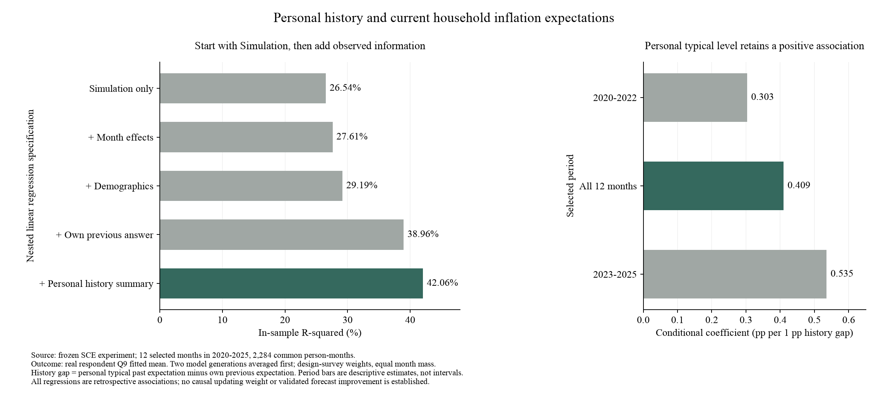

# 个人历史、答题经验与经济前景：离线回归诊断

日期：2026-10-17。复用十二期已完成模拟，新增API调用0；未改模拟输入、提示词或计分器。本页是事后关联分析，不是新一轮模拟，也未证明预测误差下降。

## 1. 这次具体研究什么

问题是：模型已经看到个人过去回答，但是否充分保留了这个人的惯常判断？此外，答题次数能否代表调查经验，财务前景与风险偏好是否提供额外信息？

使用2020—2025预选十二个月、2,284个共同可评分个人月。两遍模型回答先按人月平均，不把重复生成当成新增真人样本。沿用调查权重÷入样概率，各月权重总和归一为1。目标为真人本期Q9十档概率拟合出的个人均值，既不是Q8点预测，也不是下一年实际CPI。

所有模型沿用同一支持集。月份控制项吸收各月共同变化；人口控制包括年龄、学历、收入、数理、地区、住房与就业。这里没有估计因果效应或报告统计显著性。相邻预测窗口重叠、同人重复出现、问卷误差和选择进入回访池，都可能贡献相关性。

## 2. 先只用Simulation，再逐步加入其他信息

| 回归中使用的信息 | 样本内R² |
|---|---:|
| 只用Simulation个人判断，带截距 | 26.54% |
| 再控制月份 | 27.61% |
| 再加入七类人口特征 | 29.19% |
| 再加入本人上期真实回答 | 38.96% |
| 再加入个人历史常态、其可得标记和有效回答次数 | 42.06% |

此前“模型只增加约0.9个R²百分点”，指的是**已有月份、上期回答和人口信息后，再加模型的条件增量**。它不等于“单独模型只有0.9%的解释力”。改变变量进入顺序会改变贡献分配，同一完整回归的最终R²不变。

这些数值经过样本内线性回归，不能当作原始Simulation的准确率，也不表示已达到42%的样本外解释力。尤其不能用它替代全国中位数MAE、跨人W1与个人更新评价。



## 3. 个人过去的常态：有值得继续验证的信息

“过去常态”是本人本期之前有效Q9派生均值的平均，原准备包含上期，最多11次；不是一生通胀经历。至少有两次有效历史回答者为2,013人月，其余保留缺失标记。

以“过去常态−上期回答”为变量，在控制月份、人口、上期真实回答及Simulation后，其系数为**+0.409**。例如，两人上期都回答4%，其中一人惯常回答6%，另一人惯常回答4%，该关联对应前者本期平均高约0.82个百分点；这是条件比较，不是对每个人下达更新指令。

这个系数在2020—2022所选时期为+0.303，2023—2025为+0.535；依次去掉一个年份后为+0.325至+0.500。严格去掉上期、只用更早回答构造常态时，系数仍为正（+0.333，样本2,013）。后一模型样本不同，其R²不与主模型直接比较。这些都是已看数据上的敏感性检查，不能称为独立验证。

可能机制至少有三种：个人有相对稳定的高低判断；上期受到暂时冲击，本期部分回到个人常态；多期平均减轻单次填答噪声。现有回归无法区分三者。我们之前固定一半权重的个人历史锚基线并未普遍超过上期照抄，因此不能直接把0.409写成提示词或固定行为权重。

### 相对别人、相对CPI：分别能说明什么

把个人常态减去同月样本的共同参照，能描述“此人长期偏高还是偏低”；这里采用同月样本的加权中位数，不能称全国水平。减去当时最新已公布的CPI同比，也可帮助解释其判断背景。

但只要回归已经控制月份，减去上述同月共同常数只是改变零点，R²完全相同，并未创造新信息。**高于当前CPI不等于预测错误**：SCE问未来12个月，当前CPI描述过去12个月。要衡量预测误差，需要另行对齐未来的实际价格变化；本轮没有使用未来实际CPI。

## 4. 历史答题次数：不能直接解释为“更关注通胀”

区分两种计数：有效历史Q9次数，以及官方tenure所表示的实际已完成调查次数减1。两者都在1—11次，127人月不一致；有效次数同时反映回答质量与经验。实际完成次数不是连续月份长度。

用实际既往调查次数替代有效回答次数后，完整模型R²为42.057%，系数为**+0.165个百分点/次**；有效次数版本为+0.166。控制原有信念后，没有出现“参加越多、本期预期越低”的简单关系。以个人主观Q9的IQR为目标，控制上期IQR等后，实际调查次数系数为+0.032，也不能据此认定老手更确定。

这不否定问卷学习机制：原有信念本身可能是学习的结果，而回归已将它控制；参加次数也混合了选择留在调查中的差异、进入批次等因素。本样本全部是回访者，无法识别首次参加者与老手的差异。应优先把次数作为历史信息质量与覆盖指标，而非直接贴“高度关注通胀”的标签。

[Kim与Binder的问卷学习研究](https://www.aeaweb.org/articles?id=10.1257/mac.20200387)提供了可检验的学习假说；本轮条件回归不等同于该研究的识别设计。

## 5. 心理因素：先用SCE本人的实测信息

### 有配对观测，已经完成的回归

SCE Q2询问未来12个月家庭财务状况相对现在会变差、相同或变好，共五档。它反映经济前景判断，不等于一般人格乐观。QRA1/QRA2是1—7档的金融/一般风险偏好。缺失单列，五档和七档用分类变量，不强加线性关系。

在42.06%的完整历史模型上，分别新增各组变量：

| 新增内容 | 样本内R²增量（百分点） | 时间边界 |
|---|---:|---|
| 本人上期Q2财务前景 | +0.95 | 历史问卷条件信息；不自动视为当时已公开 |
| 本人本期Q2财务前景 | +1.32 | 仅A路线同期条件诊断 |
| 上期已有金融风险偏好 | +0.46 | 过去实测偏好 |
| 上期已有一般风险偏好 | +0.17 | 过去实测偏好 |
| 两种风险偏好一起加入 | +0.56 | 联合信息，不能将单项增量相加 |

Q2本期“会差很多”相对“不变”的条件系数为+2.62个百分点，“会好一些”为−1.01。再控制Q1过去一年财务变化后，Q2仍增约0.93个R²百分点。但上期Q2的五档系数并非严格单调，不应据此为每档预设统一通胀偏移。

可能解释是经济压力、悲观前景与高通胀判断相关；也可能是高通胀预期使人担忧家庭财务，或二者共同受经济冲击及填答方式影响。尚未做跨期检验，不能把它解释成“乐观造成低通胀预期”，更不能声称它已经改善Simulation。

联合风险回归中，两题缺失指示完全相同，设计矩阵为52秩/53列；这里只使用可识别的拟合值与联合R²，不解释两列缺失系数。其他上述主回归均满秩。

### 外部人格资料为何不能直接接上回归

已有GSS的幸福感/财务满意度、MIDUS人格和乐观资料来自**另一批人**。按年龄、学历等匹配供体，能构造有现实分布参考的合成属性，但不能恢复SCE受访者真实人格与本期通胀回答之间未观测的关系。直接把供体特质配到SCE答案回归，所得关联会依赖人为匹配规则。

因此本轮没有读取MIDUS受限个人记录，没有将外部分配值冒充SCE心理实测。MIDUS继续走已登记的用户本地汇总路径；外部分布可用于后续明确假设的机制敏感性实验。[Istat统计匹配方法说明](https://www.istat.it/en/classifications-and-tools/methods-and-software-of-the-statistical-process/process-phase/data-integration/)解释了未共同观测变量之间关系的识别限制。

## 6. 对下一步机制设计的含义

1. **优先验证个人常态是否具有跨期增量。** 固定几种简单历史摘要，在早期估计、较晚时期检验；同时评价中心MAE、跨人W1和个人变化，不能只看R²。现有十二期已看过，只能称事后前推诊断，正式独立月份须另登记。
2. **其次准备财务前景输入。** 先检验上期Q2的关联是否跨时期保持，再拟定同事实对照。把实际观点写入P，与预设“悲观者必然给更高数字”分开；本期Q2只能用于A条件重建，不直接进入严格B。
3. **次数用于说明历史的覆盖与可靠性。** 不给所有老手统一加减预期，也不把年龄、次数和关注程度当成同一变量。
4. **外部心理与新的E来源保留候选。** USTR、Google Trends、Household Pulse由Kimi资料衔接，先查历史可得性、指标口径与时段覆盖；本轮不取付费数据。外部人格先做分布/匹配假设说明，再讨论模拟。

这些方向还不是获证实的新配置。任何新增真实API调用另列数据范围、预算与未用于调整的评价期。

## 复算、产物与核验

```sh
/Users/wushuyue/anaconda3/envs/socioverse/bin/python scripts/analyze_sce_history_mechanism.py --out outputs/sce_history_mechanism_recheck_<new_id>
```

必须使用不存在的新目录，从仓库根运行；需本地已归档的十二期案例、个人历史、画像评价缓存和两份官方SCE工作簿。不是仅克隆代码即可运行。原始问卷哈希、逐月历史哈希与实现哈希保存在公开聚合JSON中，个人关联记录不提交。

- 数值：[聚合结果](history_mechanism_diagnostic_20261017.json)
- 核验：[独立核验收据](history_mechanism_verification_20261017.json)
- 图：[图及来源收据](figures/history_mechanism_20261017_v1/)
- 完整本地结果：`outputs/sce_history_mechanism_diagnostic_20261017_v2/`
- 首次准备失败目录v1仅留失败记录，未产生结果或API费用，不复用。

12个Q2样例用另一套openpyxl读取器直接对照源表一致；历史块R²与此前独立结果差约1.1e−16；月份中心化恒等式差为0；15个待审文件哈希未变。当前只报告点估计和时期敏感性，不报告因果或显著性结论。
