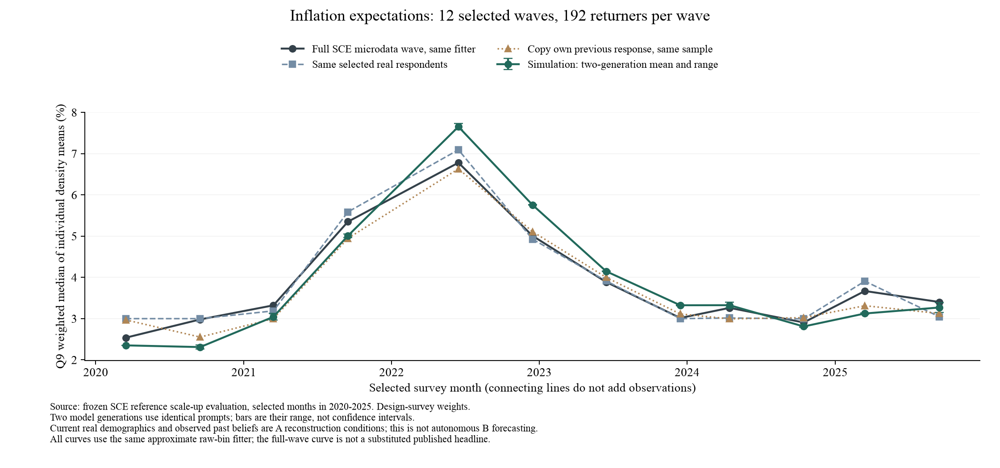
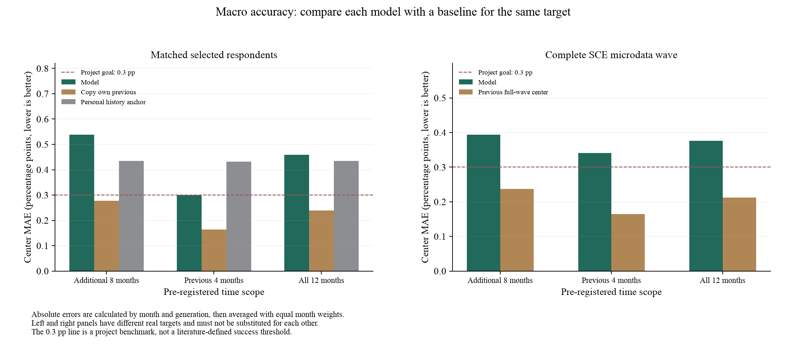
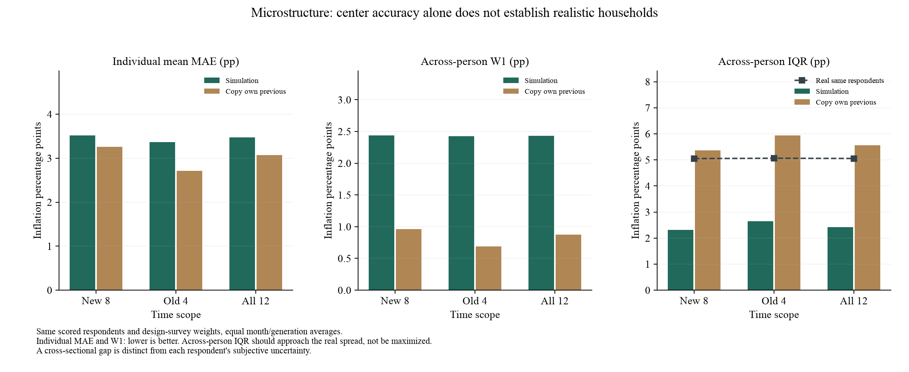
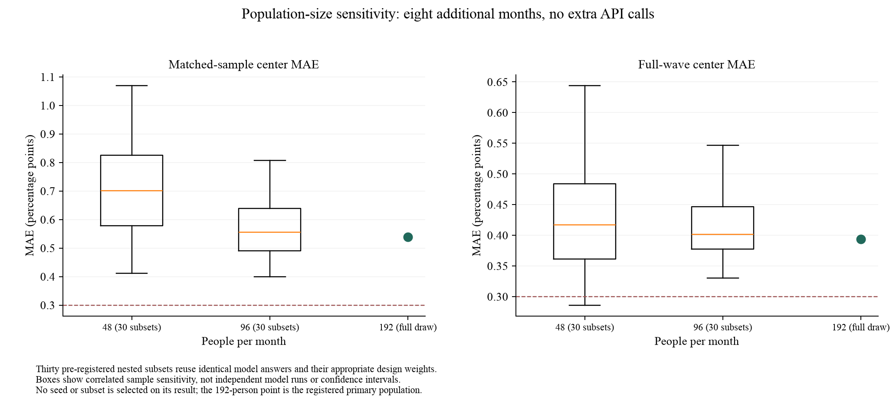

# 十二个月扩大验证结果

## 1. 本次完成了什么

2020—2025每年预选两个月，共12个月；每月192名回访者，同一参考配置生成两遍，计划4,608次请求。实际完成4608次，原始回答与轨迹逐项核验；有效率99.96%。模拟token费用估算$5.155，低于授权$21.50，运行约24.1分钟。新闻分类另计约$0.711。金额均非平台账单。

输入沿用人口画像、合成CE支出、美联储信心、公开价格/新闻/政策、本人真实上期Q8/Q9和更早摘要、信息发布时间标签及直接作答。未新增Q1、数理实答、购买频率或更新规则。人口来自完整合格回访者池，按年龄×收入分层；评价用调查权重÷入样概率，模型不接收权重。

## 2. 先看新增八个月，而不是用旧月好结果拉低平均

主要检验的新增8个月，同样本Q9中心MAE为**0.539pp**，未达到本项目0.3pp的平均误差目标；同样本照抄本人上期为0.277pp。模型点估计高于或等于该基线，模型减基线的误差差为0.261pp，按年份分组重抽的探索性95%区间[0.078, 0.457]。区间衡量这组有限时期下的不确定性，不是未来准确率保证。

新增8个月中，有1/8个月的两遍平均误差≤0.3pp，最差月份0.831pp。整体平均达标与每个月稳定达标不同。

| 时间范围 | 模型对同样本MAE | 照抄本人上期对同样本MAE | 模型对完整波次MAE | 完整波次上月值延续MAE |
|---|---:|---:|---:|---:|
| 新增8月（主要检验） | 0.539 | 0.277 | 0.394 | 0.237 |
| 原4月 | 0.300 | 0.164 | 0.341 | 0.164 |
| 全部12月 | 0.459 | 0.239 | 0.376 | 0.213 |

单位均为通胀百分点。逐月、逐遍先取绝对误差，再按月等权平均；不是将多个月预测先平均后计误差。旧4月、新增8月、全12月不择优替换。

原4个月扩大到192人后为0.300pp，接近此前48人的0.290pp；主要差距出现在新增时期。扩大人数与扩展月份检验不同问题，不能把整体变差简单解释为人数增加。

## 3. 同样本拟合与完整SCE重建必须区分

新增8个月，模型对完整SCE微观波次的中心MAE为**0.394pp**，完整波次上月值延续为0.237pp。同样本中心误差与这一指标不能互相替代。完整波次也由同一近似计分器重算，不是直接换用官方发布headline。

每月带符号的偏差分成：模型−所抽真人、所抽真人−完整合格回访者、合格回访者−完整SCE波次。三项相加等于模型−完整波次；只有带符号差可以相加，绝对误差不可相加。这用于观察抽样/回访覆盖与模型误差是否抵消，不是因果归因。

## 4. 个人分布是否更接近

新增8个月个人Q9均值MAE：模型3.519pp，对照抄上期3.253pp；跨人分布W1：模型2.439pp，对照0.965pp。模型人际IQR为2.310pp，真人为5.050pp，照抄为5.370pp。人际IQR要接近真人，不应以越大越好。

模型变化分布W1为1.551pp；个人主观概率IQR误差为2.941pp。十档中的所有通缩概率都填0者，模型占7.0%，真人占54.6%。跨人分歧与同一个人的主观不确定性是两种不同对象。

## 5. 人口规模与分组检查

同192份回答中，预先固定30组48⊂96⊂192子样本；不追加API，不选择表现最好的一组。以下范围是同一批回答的抽样敏感性，不能当作30次独立模型实验或置信区间。

- 每月48人：30组同样本MAE的中位数0.701pp，2.5%—97.5%范围[0.416, 0.989]；对完整波次MAE中位数0.417pp，范围[0.289, 0.580]。
- 每月96人：30组同样本MAE的中位数0.555pp，2.5%—97.5%范围[0.414, 0.773]；对完整波次MAE中位数0.402pp，范围[0.331, 0.530]。

年龄、收入、数理、教育、地区、住房、就业均按预设分组记录。每月每组不足3人不报告该格指标；缺失格不填补，分组差不能解读为该特征的因果影响。详见summary.json中的prespecified_descriptive_groups。

新增8个月，高/低数理组中心MAE为0.410/1.319pp，个人均值MAE为2.950/4.556pp；高中/大学组中心MAE为1.398/0.513pp。差距提示应重点检验这些群体的信息理解与概率表达，尚不是控制其他特征后的因果效应，也不表示之前具体答题提示的效果已得到验证。

## 6. 目前最清楚的机制线索

事后复用已计分回答，扣除月份共同水平，对本期与本人上期信念做加权线性回归。全12月平均斜率：真人0.598，模型0.359。直观上，上期信念高1pp的人，本期真人仍平均高约0.60pp，模型保留约0.36pp的差距。模型保留了部分个人排序，但跨人差异收缩较强。此项只是描述关联，不是因果权重或可直接部署的更新系数；一年期预测窗口重叠11个月也会产生持续性。

模型在2020年3/9月、2021年9月、2025年3月偏低，在2022年6/12月等时期偏高。全12月平均带符号偏差-0.045pp，但MAE为0.459pp，正负偏差相互抵消；单加统一常数不足以消除跨时期差距。

下一步优先用已有轨迹定位哪些家庭改变过多、哪些月份更新方向错误，再审定历史持续性与新信息反应的机制。扩样减小了抽样波动，当前配置仍未显示额外信息的稳定预测增量。新机制需在开发期估计、未用于调整的时期检验，不能用本次12月调好再称独立成功。

## 7. 有效范围和下一步

Q9共同可评分2284/2,304个人月，真人缺失或不可拟合18个人月，任一遍模型Q9失败2个人月；两者可能重叠，不能将真人缺失算作模型失败。Q8独立评价，不混入Q9中心。

这是一项使用真实本人过去问卷和当期回顾性人口画像的A条件历史重建。每月各自重建，不是连续12月自主更新，也不是严格事前B预测。模型训练知识、受访者覆盖、合成CE/信心与新闻历史版本的限制仍保留。

本轮结果不用于再改这套提示或选择月份。先区分宏观水平、微观分布、抽样与覆盖差异；若转向B，须另做合成人口、初始信念、连续递推和误差累积验证。

## 图表与复算

原始聚合评价：/Users/wushuyue/Documents/科研/DISC/socioverse_challenge/outputs/sce_reference_validation_evaluation_20261017_v1/summary.json
执行与费用：/Users/wushuyue/Documents/科研/DISC/socioverse_challenge/docs/workstreams/20261017_reference_scaleup/execution_receipt.json
评价入口：scripts/analyze_sce_reference_validation.py（新输出目录；0API）
图表入口：scripts/plot_sce_reference_validation.py；本文件由report_sce_reference_validation.py生成。
