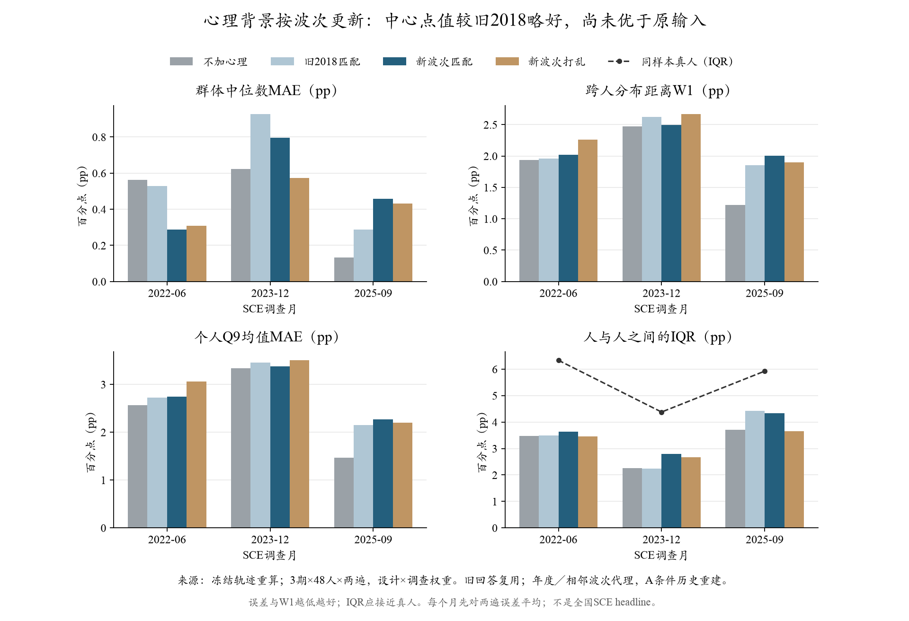

# 按较新GSS波次重做：中心比旧2018略好，仍未优于不加心理

2026-10-18（北京时间）。**576次新增真实请求全部有效，0连接错误、0重试；费用按高峰token价估$0.650，低于$3上限。**原输入288份回答复用，旧2018结果也未重复调用。官方引擎API运行约192秒，评价约31秒；这些不包含Agent整理与开发总时长。

## 1．先看实验结果

三个相同时期、每期48人、各生成两遍，四种配置均使用相同的144个有效人月、同一套设计×调查权重和近似计分器。以下Q9中位数指“个人密度均值的跨人中位数”，Q8另计；不是全国指标或实际CPI预测误差。

| 指标，单位pp | 不加心理 | 旧2018匹配 | 新波次匹配 | 新波次打乱 |
| --- | ---: | ---: | ---: | ---: |
| 群体Q9中位数MAE | 0.440 | 0.582 | 0.514 | 0.438 |
| 个人Q9均值MAE | 2.459 | 2.775 | 2.797 | 2.922 |
| 跨人分布W1 | 1.875 | 2.148 | 2.174 | 2.277 |
| 更新分布W1 | 1.361 | 1.510 | 1.635 | 1.654 |
| 人际IQR，真人5.546 | 3.145 | 3.383 | 3.593 | 3.261 |

**数据更新后的中心点值比旧2018下降约11.6%，但个人误差、分布和更新没有同步改善；仍不采用心理模块为默认配置。**新匹配较不加心理中心误差增加约0.074pp，个人误差增加0.339pp。人际跨度有所扩大，W1却变差，说明新增差异没有更准确地落到真人分布的位置。

主比较包括新匹配／新打乱的同期对照。匹配较打乱个人误差与W1点值略小，中心却更差；配对区间均跨0，未确认稳定的匹配增量。不加心理与旧2018来自较早API批次；实际回包指纹一致，但仍不能将跨批差异全部归因于心理或年份。

分月Q9中心MAE是每月先平均两遍误差：

| SCE时期 | 不加心理 | 旧2018匹配 | 新波次匹配 | 新波次打乱 |
| --- | ---: | ---: | ---: | ---: |
| 2022-06 | 0.564 | 0.530 | 0.287 | 0.310 |
| 2023-12 | 0.622 | 0.928 | 0.797 | 0.573 |
| 2025-09 | 0.133 | 0.288 | 0.459 | 0.432 |

新匹配相对旧2018在前两期中心较好、2025-09较差；相对不加心理仅2022-06较好。旧四期0.459／0.540不能直接与本表比较：本轮排除没有新波次的2020-03，三期的原输入为0.440、旧匹配为0.582。没有按新结果挑时期。



## 2．每一期具体怎么匹配

| SCE时期 | 采用的心理背景 | 供体分配 | 放宽地区的人数 | 时间含义 |
| --- | --- | ---: | ---: | --- |
| 2020-03 | 旧2018结果保留 | 不重跑 | 沿旧记录 | 没有3月同期GSS横截面；2020面板收集于8—9月，不倒称疫情初期心理。未计入本轮验证。 |
| 2022-06 | GSS 2022 | 48/48 | 18 | 同年年度代理；该波跨5—12月并有少量次年收尾，包含6月之后观察，只能用于本轮A回顾，不是6月实测或B可得输入。 |
| 2023-12 | GSS 2022 | 47/48 | 16 | 没有2023横截面，使用前一波；1位缺教育保留未知。 |
| 2025-09 | GSS 2024 | 48/48 | 10 | 没有2025横截面，使用前一波；不能称逐月更新。 |

三期合计143/144个可分配、44个放宽地区；最小被接受供体ESS约10.06。GSS 2021也已下载审计，但本轮没有新加2021目标月。来源、收集期、原始哈希、权重与字段审计见[方案](plan.md)及[source_audit.json](source_audit.json)。

**逐人的规则：**先找同年龄段、教育、粗收入档、地区的GSS记录，按其调查权重抽取一个整对的幸福／满意组合；供体太少时只取消地区条件，仍不足则未知。年龄实际边界为18—39／40—59／60+，不是按旧类别名字猜边界。跨$100k界限的$90k—109999收入档不硬切。固定seed42和draw0，五套离线分配作为不确定性检查，没有挑最好一套。

新波次仍加入原来的两句状态描述：

```text
Your personal outlook on life and finances:
Taking life as a whole these days, you feel pretty happy.
With your present financial situation, you feel more or less satisfied.
```

具体档位随分配变化；没有加“悲观就应高报通胀”的规定。原P/E、本人真实上期Q8/Q9、更早均值／次数、直接问卷、DeepSeek Flash、temperature0.5及关闭思考均不变。没有额外加入Q1、Q2、频率或MIDUS。

## 3．对设计不合理之处的反思

**第一，旧来源确实过于陈旧，但换年份不足以解决问题。**对这批SCE画像的条件分布，预期“不太幸福”比例在三期分别由11.3%／7.9%／9.4%升至22.2%／18.7%／15.8%；财务不满意也增加。这是按供体分布计算的输入变化，不是从真人SCE心理观测出来的事实，也不是疫情的因果估计。新数据实质改变了输入，拟合仍未整体改善。

**第二，按四个条件配出心理比例，无法确认本人心理与本人信念的关系。**现模型已经读到这个人真实的过去通胀回答；额外心理却来自另一批人。即使两边分别合理，也没有数据保证它们能构成同一个人的完整状态。合成标签可能只给已有信念增加扰动，这是需要检验的解释，不是本轮已识别的原因。不能反过来用本期通胀答案挑选让拟合更好的心理。

**第三，收入和家庭单位还不完全可比。**GSS为一般成年人的上个日历年family income；SCE为家庭户主、过去12个月household income。较近波次减少年份错位，未消除家庭单位、收入参考期及粗档误差。SCE的就业、住房虽已在提示中，本轮未用它们匹配心理；现有供体并非覆盖全部财务处境。

**第四，供体池与访问方式都影响估计。**主样本WTSSPS与补样复合权重不能混用；已按官方字段排除无主权重的补样。2018面对面与新波次混合／线上方式不同，不能把所有波次差异当成心理变化。44个接收者需要放宽地区，ESS约10仍属小格；有匹配支持不等于条件分布精确。

**第五，固定种子不等于观测了心理轨迹。**三期有41／38／41个人的标签较旧2018改变，其中包含改抽另一批供体的实现差异，不是这些真人实际心理改变。五套离线分配已留存，但本次只对固定一套跑LLM，效应区间不包括全部供体估计／分配不确定性。打乱保留未加权人数，仍会改变加权比例；也不能把它当完美随机心理实验。

**第六，标签仍没有落实心理传导。**幸福感、财务满意不是通胀态度，也不是稳定乐观人格。模型读到状态后如何选择记忆和理解价格没有被独立识别；两项同时加入，也不能分解各自影响。新的波次更适合做时代背景参考，但这轮不能证明该注入形式正确。

## 4．统计解释与处理

主加权、按人聚类的1000次探索性配对区间，新匹配减原输入：中心MAE差[−0.147,+0.433]、个人MAE差[+0.036,+0.766]、W1差[−0.001,+0.752]。固定三期下，个人误差恶化有较明确的人员重抽样支持；中心与W1尚不能确认稳定变化。区间未校正多重比较，未覆盖换月份／供体分配／模型批次，不能外推普遍因果结论。

新匹配减新打乱的三项区间均跨0。新匹配减旧2018三项也均跨0（中心[−0.245,+0.283]）。不把0.582→0.514称作已经确立的年份改善效应。

等人权重下，中心原输入0.322、旧2018为0.332、新匹配0.326、新打乱0.268；不能事后改用打乱／等权较好结果取代主配置。Q8另列：新匹配群体中心MAE1.200→1.167、个人MAE5.593→5.559，小幅点值改善不能替代Q9。

**决定：保留新波次数据和本轮结果，不升级心理模块，不继续在这三期调措辞或供体种子。**若以后再做，应优先寻找心理／财务状态与通胀信念同时观测的依据，或明确而可检验的记忆、注意、更新机制；不把增加人设本身当作解决同质化的方法。当前共同参考不改，新付费实验另定范围和预算。

## 5．复现与执行记录

- 正式输入：`outputs/sce_psychological_wave_trial_20261018_v1/`；评价：`outputs/sce_psychological_wave_evaluation_20261018_v1/`；旧2018共同样本比较：`outputs/sce_psychological_wave_comparison_20261018_v1/`。逐人文件仅本地忽略目录。
- 源码冻结`51366d3`；16项定向／兼容测试、12个官方引擎干跑；576份实际消息／原始回包／Action及参数检查通过。144项独立聚合复核最大差约2.67e−15，未重拟合旧Q9；15份保护文件不变。
- 输入1,801,756／输出91,174token；峰值估$0.6499356，账本逐job舍入和$0.649937。API192.373秒、评价31.067秒，费用是用量估计而非平台账单。没有新的MCP／新闻费用，也未使用平台Chat额度。
- 同旧批的返回别名与fingerprint一致，仍不保证底层权重不可变。三期均已查看，不能称独立留出或严格B预测。
- [完整主结果](results_summary.json)、[旧2018同样本比较](comparison_2018.json)、[输入分布诊断](matching_design_diagnostic.json)、[执行收据](execution_receipt.json)、[授权](authorization.json)、[核验](completion_verification.json)。

离线复算，必须新输出目录，不会调用API；不要重启已完成真实运行：

```sh
python scripts/run_sce_frozen_trial.py evaluate --folder outputs/sce_psychological_wave_trial_20261018_v1 --out outputs/<NEW_EVAL>
python scripts/summarize_sce_psychological_waves.py --evaluation outputs/<NEW_EVAL> --out outputs/<NEW_COMPARISON>
python scripts/plot_sce_psychological_wave_results.py --summary outputs/<NEW_COMPARISON>/summary.json --out outputs/<NEW_FIGURES>
```

今后源码改变时，旧试验按冻结提交和来源哈希复现，不改旧manifest冒充同版。Source: General Social Survey, NORC at the University of Chicago; Survey of Consumer Expectations, Federal Reserve Bank of New York. 来源机构未参与或认可本研究解释。
