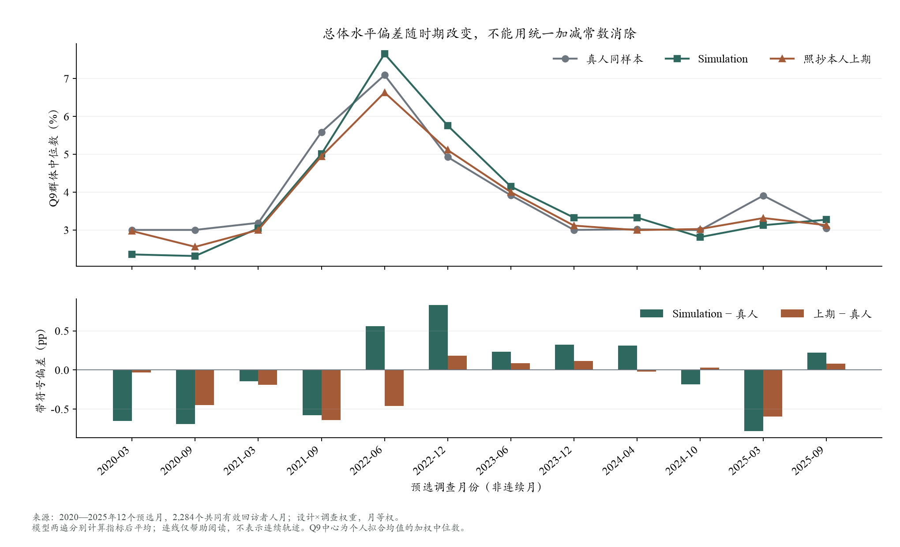
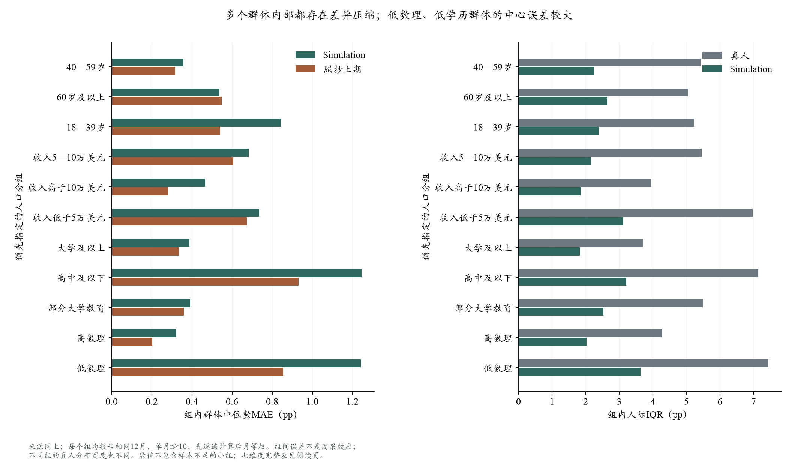
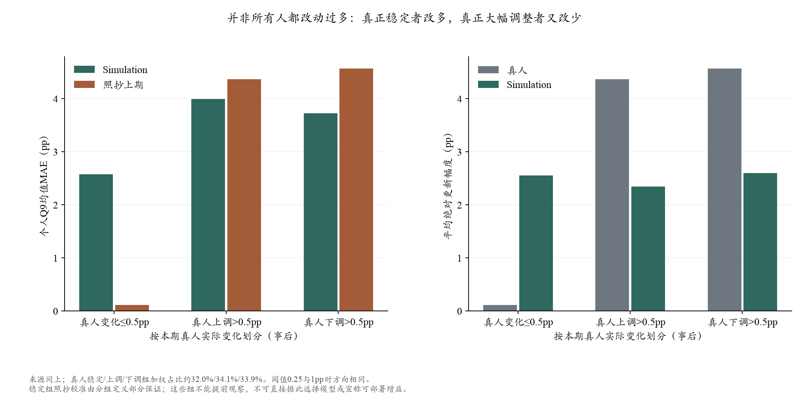
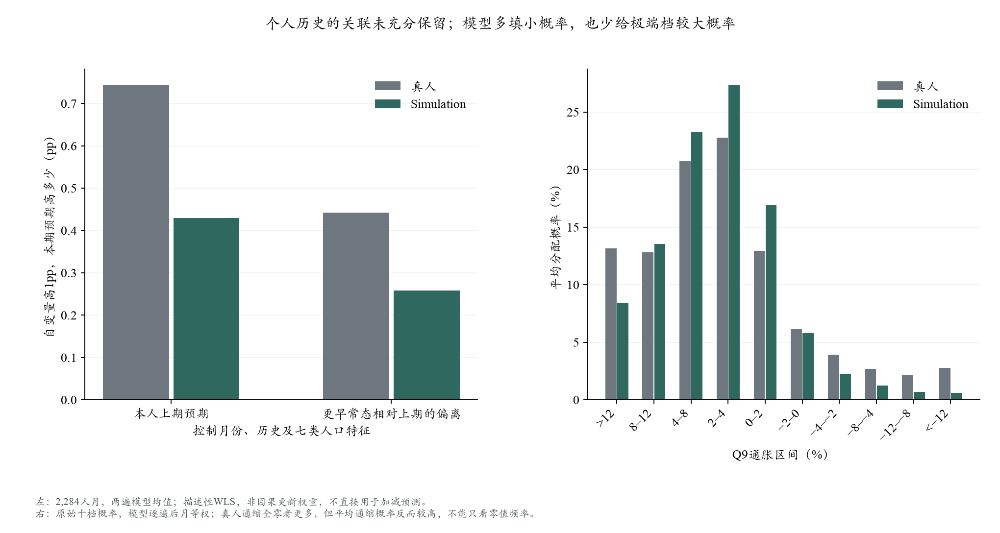

# 真人与模型差距诊断：结果与行动建议

日期：2026-10-18。分工完成逐月/人群统计、实际回复审计、经济学文献与时期背景，主代理整合。**新增API调用与费用均为0，未重新拟合Q9，未修改任何模拟配置或旧回答。**

阅读入口：[现有阅读页的本次分析](../20261013_behavior/codex_expansion_diagnostic_20261014.html#response-gap-diagnostic-20261018)。可切换七类人口分组，查看各组十二个月的水平、误差和分布。聚合数值见[analysis_summary.json](analysis_summary.json)。

## 1. 最重要的结论

目前的关键缺口是：**模型没有像真人一样保留个人位置，也没有正确区分哪些人应基本保持、哪些人会明显调整。** 这比“再补一个人口标签”更接近当前需要解决的问题。

这是对可观察差距的定位，不是已经识别了唯一原因。共有信息吸收、私人经历缺失、报告取整、模型的规范化回答习惯，都可能产生相似结果。现有数据不能把它们全部分开。

## 2. 数据与口径

- 12个预选月：2020-03/09、2021-03/09、2022-06/12、2023-06/12、2024-04/10、2025-03/09。每月192名合格回访者，模型生成两遍。
- 2,304个人月中共同可评分2,284，涉及2,128名不同真人；155人出现在多个月份。重复生成、重复出现的人都不当作新增独立受访者。
- 主权重是调查权重÷入样概率，月内归一化、月份等权。每遍分别计算指标后平均。回归才先平均两遍模型回答。
- Q9个人水平是十档概率拟合后的个人均值，群体中心是这些均值的加权中位数；Q8点回答另外检查。拟合使用既有冻结近似计分器，未改算法。
- 这是使用本人真实过去问卷的A条件重建，覆盖回访者，不是全国人口全覆盖、未来预测或新盲测。十二期均已看过结果。
- 每月分组n<10不报告误差；n≥10但ESS<10标弱支持。ESS反映权重不均后有效信息量，不能用累计两遍增加它。

## 3. 逐月：偏差随环境改变，统一校正不够

主加权Q9中心MAE：模型0.459pp、照抄本人上期0.239pp。模型在2020两期、2021-09、2025-03偏低，在2022两期偏高；2022-12中心偏高约0.831pp，2025-03偏低约0.783pp。平均带符号偏差很小，是正负相互抵消，不代表逐月准确。

这与通胀阶段有关联，但不能从12个月分离出政策、新闻和价格的因果贡献。例如2022-06输入最新可见CPI是5月首发8.6%，不是后来发布的6月9.1%；2020-03不能用截点后降息和失业数据解释模型“应该知道什么”。完整逐期背景及来源见[文献与环境](literature_mechanisms.md)。



## 4. 人群：误差大不等于某标签完全没生效

在共同十二期内：

- 数理高/低组中心MAE约0.322/1.241pp；个人误差2.920/4.441pp；真人人际IQR约4.27/7.44pp，模型约2.02/3.63pp。低数理群体原本也更分散。
- 大学/高中及以下中心MAE约0.388/1.246pp。后者只占256个人月，但各月都达到最低报告人数，仍需注意较低ESS。
- 18—39岁组中心MAE约0.844pp，40—59岁约0.358pp、60岁以上约0.537pp；年龄不是一个统一的“年长者都高报”修正项。
- 年龄、收入、教育、数理、地区、住房的主要组内，都有真人分布宽、模型分布窄的问题。不是把人口比例调准就能自动消除。
- 失业、残障、照料家庭等月度人数不足；当前不能给出这些组稳定的十二期结论。完整表明确保留缺失，不用少数可报告月与其他组排名。

控制月份、上期预期、更早历史和其他人口特征后，低数理相对高数理的水平关联为真人约+0.428、模型约+0.698pp。**因此，粗组误差大不能直接解释为模型没读数理标签，更不能据此再给所有低数理者统一加点。** 这些关联也不证明数理能力的因果影响。



## 5. 更新：稳定者改多，真正大幅变动者改少

按本期真人相对本人上期Q9均值变化划分，阈值0.5pp：

- **基本稳定者**：740个人月、月等权加权占32.0%。真人平均绝对变化0.117pp，模型却为2.553pp；约59.0%的模型回答移动到0.5pp之外。模型个人MAE2.580pp。
- **真人上调者**：763个人月，加权占34.1%。真人平均上调幅度4.368pp，模型平均绝对移动2.346pp，约18.6%反向；模型个人MAE3.995，照抄4.368pp。
- **真人下调者**：781个人月，加权占33.9%。真人平均下调幅度4.567pp，模型绝对移动2.602pp，约19.4%反向；模型个人MAE3.731，照抄4.567pp。

用0.25或1pp替代阈值，定位方向一致。全体模型平均绝对移动2.504pp，小于真人3.074pp；所以不能笼统说“所有模型都更新过度”。更准确的是**该保持时多改，该大幅变化时又不够**。

这里稳定组照抄误差低，部分由定义保证；大幅变化组照抄误差大也有同样选择性。**不能用已经知道的真人分组来选择方法，不能把组内胜负当作可部署的预测收益。** 下一步必须只用当时可见信息预测保持/更新状态。

原始十档向量完全不变的月等权加权占比，真人16.54%、模型2.24%；拟合均值完全不变为16.57%/2.24%。原始概率也有明显不变质量，现象不只由拟合均值相等造成；但不变仍可能来自信念、报告取整或重复答题习惯，不能全部命名为“不关注”。



## 6. 个人历史：有信息，但模型保留不足

使用完全相同的描述性加权回归，分别解释真人与模型本期Q9均值，控制月份、上期、历史摘要与七类人口特征：

- 上期预期高1pp，本期真人平均高0.744pp，模型高0.429pp。
- 更早常态相对上期的偏离，关联为真人0.442、模型0.258。
- 模型减真人的先验系数约−0.315；逐次去掉一个年份，为−0.353至−0.280。历史偏离系数约−0.184，去一年范围−0.233至−0.087。
- 相同控制变量解释模型本期水平的样本内R²约69.0%，真人约41.9%；不能把两个不同因变量的R²差当作已识别的“缺失心理份额”。误差本身的回归R²仅13.1%，不能声称已解释所有差距。

这种保留不足在排除单一年份后仍存在，是较稳的描述线索。**回归斜率不是可直接用于更新的心理权重。** 相邻一年期预测重叠11个月、私人信息及测量误差都可能影响关联；此前标量线性历史组合已测试，不能将重复组合包装成新机制。

## 7. 概率分布与Q8：不只是计分器问题

原始Q9平均非零档数：真人4.69、模型7.82。真人约81.8%的概率向量全在5%刻度，模型约4.8%；模型填得细、给多数档保留小概率。

但**真人通缩全零者54.7%，同时平均通缩概率17.6%；模型分别8.8%、10.6%**。真人是多数全零、少数很大，模型更普遍但量小。删掉模型所有小概率既可能改变中心，也不能恢复正确的人际分布。

个人拟合密度的平均IQR：真人5.762、模型4.474pp；个人均值的人际IQR：真人5.055、模型2.424pp。非零档数、原始概率熵、个人不确定性与人际分歧，不是同一个概念，不能互相替代。

另在Q9共同样本内、本人上期/本期Q8均可用的2,277个人月上，Q8人际IQR为真人7.275、模型1.650pp；模型/照抄中心MAE为0.971/0.283pp。月度上期关联斜率平均为真人0.482、模型0.080。**Q8也明显压缩，不能仅把差距归咎于Q9拟合或十档表达。** 这个Q8子样本与旧主Q8评价支持不同，不能混用数字。

已有机械报告映射曾改善刻度和零值外观，却没有恢复个人身份信息与分布宽度；这次不再将统一取整列为主要新方案。



## 8. 实际输入和理由：查到什么，没查到什么

4,608条实际请求与冻结预览逐项一致，原始回复与已计分点值/概率一致。先验、本人十档、历史常态及时间说明确实传入了模型。输入含6条各12个月序列、8篇新闻、3项政策摘要与39条发布时间标签；信息体量不能直接当作注意力权重。

没有找到把环比直接贴成同比、乘12的错误算式或明确错置问卷期限的证据。题目对“未来12个月”的改写有可消歧空间，但终点12个月同比与未来12个月累计价格变化是同一窗口，不能把二者误说成不同目标。

在2023-12，有38/384条理由称食品价格下降，而输入的最新同比和当月涨幅均为正。未注明时距的说法与统计有张力，是值得做小型理解检查的候选；不是所有预测已被证明错用概念，也不能据此解释全部通缩尾部。理由和关键词只作线索，不能直接观测模型内部思维。详[回复审计](reply_audit.md)。

## 9. 下一步：只保留两个方向

### 第一优先：先检验“保持/更新”能否被事前资料预测

从已有连续SCE面板估计保持、明显上调、明显下调与变动幅度，先检查原始十档及阈值稳定性。候选输入仅包括本人过去变化习惯、短/长历史、原有预期/不确定性、人口特征及当时可见经济信号；不以本期真人状态作输入。

先做零API的时间顺序检验：与照抄、简单经验条件转移、已做标量历史组合比较；对短历史者用群体收缩/回退并保留标记。若这些资料根本无法区分保持者，就不强行按本期比例随机贴状态。

若有跨期增量，再冻结一个**显式状态转移机制**，保留整份有效问卷及Q8/Q9联合结构，测试模型怎样解释新增消息。它是有经验约束的混合行为模型，不冒称LLM自然恢复了真人认知，也不以给提示词加一句话替代检验。原始答案始终保留。

### 第二优先：只针对可疑价格语义做小型对照

先准备独立小例，区分“价格仍涨但涨得慢”“价格下降”，以及过去同比、月环比、未来12个月。再区分已知事实与新发布信息。只有需要测量实际模型响应时才另报窄范围API实验；不再增加一批无同人验证的心理标签。

纽约联储随机信息实验确有40.15%—52.83%的处理组保持一年期点预测，为保持/更新并存提供依据；它是同次调查前后，不能照抄为SCE跨月比例。[原始论文PDF，第14页](https://www.newyorkfed.org/medialibrary/media/research/staff_reports/sr543.pdf)。更多文献、替代解释及来源见[机制综述](literature_mechanisms.md)。

### 什么时候扩大样本

- **当前不需要盲目把每月192再翻倍。** 每月共同样本ESS约107—132；年龄、收入、数理等常见组已有明显差距。扩大人数主要减少抽样波动，不能直接修复这种模式。
- **小群体需要定向扩样。** 失业/残障等每月只有少数，当前8个可报告格ESS仍低于10。只有当相应机制成为主要研究问题时，再定向增加。
- **验证新机制优先扩大月份。** 机制固定后选未用于调整的时期；这些12月可以继续诊断，但不能重新称新盲测。严格B还需单独处理截止前资料、合成初始化与递推误差。

## 10. 统计解释、复算与交接

本轮不是随机干预，分组和回归仅定位关联。没有进行大量显著性筛选，没有把多组比较或两遍生成当独立样本。去一年范围是敏感性，不是置信区间。模型个人MSE约35.281、照抄36.330pp²，虽然平方损失略小，个人MAE与分布仍差；不据此替换主目标。

逐cell可加恒等式为个人MSE＝平均个人误差的平方＋中心化误差方差，再按月/遍平均；模型为0.508＋34.773＝35.281。**其中第一项不是群体中位数误差平方，也不能据此声称宏观偏差只占1.4%。** MAE和中位数误差不做可加因果分解。

独立合成测试14项验证主分析；360个旧评价指标对账最大误差2.45×10⁻¹⁴。控制回归与Q8支持检查4项手算测试，系数线性恒等式残差3.56×10⁻¹⁵。旧源和15项保护文件另作哈希检查；不重复整套拟合。

复算命令在项目根执行，输出必须是新目录，均为0 API：

```bash
python scripts/analyze_sce_response_gap.py --out outputs/<new_diagnostic>
python scripts/analyze_sce_response_gap_controls.py --out outputs/<new_controls>
python scripts/audit_sce_replies_20261018.py --out outputs/<new_reply_audit>
python scripts/render_sce_response_gap.py --diagnostic outputs/<new_diagnostic> --controls outputs/<new_controls> --out outputs/<new_reading>
```

当前权威输出：`outputs/sce_response_gap_diagnostic_20261018_v1`、`outputs/sce_response_gap_controls_20261018_v3`、`outputs/sce_reply_audit_20261018_v1/final`、`outputs/sce_response_gap_reading_20261018_v2`。controls v1/v2是追加检查前快照，不混用于最终Q8分析。公共资料仅聚合，逐人记录和人工病例只留忽略的outputs。

下一交付：保持/更新的零API可预测性检查与语义小例；新付费调用另登记范围和预算，当前没有新增API授权需求。
