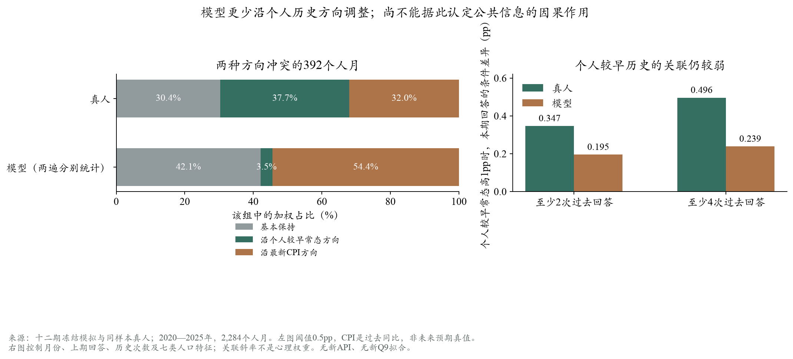

# 回到个人常态，还是靠近共同水平？

2026-10-18。新增API调用0、密度拟合0；复用十二期2,284个共同有效人月，计算约0.39秒。原主Sim中位数MAE0.459pp、照抄0.239pp均复算一致，未改善或替换主配置。本轮是已看月份的探索诊断，不是新的验证成功。

## 1. 为什么做这个区分

一个人原先报5%，较早通常报8%，最新CPI为2%。若其本期上调，方向与本人常态一致；若下调，方向与该公共统计一致。两种方向相反时，比把所有更新都叫“均值回归”更有区分力。若个人常态与CPI同在上期的一侧，移动方向不能区分两种解释。

个人常态由冻结历史摘要恢复并严格去掉t−1；2,013人月可计算，271人月只有一次过去回答，不能伪造常态。392人月的两种方向相反、两段距离都超过0.5pp，占原权重下总支持约18.0%；每月26—40人。分组没有用本期真人结果挑人。

## 2. 主要结果：模型几乎不沿个人历史的相反方向调整

在这392人月中，沿用原调查×设计权重、先各月等权，再条件于该组。真人只有一份答案；模型两遍分别分类后平均，重复不增加人数：

- **真人：**基本保持30.4%，沿个人较早常态方向37.7%，沿最新CPI方向32.0%。
- **模型：**基本保持42.1%，沿个人较早常态方向3.5%，沿最新CPI方向54.4%。

模型两遍先取均值的画像为46.5%／1.2%／52.4%，不是主MAE的新口径。逐遍与均值口径共同提示：模型较少恢复那些方向与共享统计相反的个人更新。这与“模型回到自己的历史更强”不同。



不应忽略的幅度结果：该组真人平均绝对变化2.87pp，模型逐遍1.11pp。真人虽有37.7%沿个人常态方向变动，但平均到本人常态的距离反而增加1.22pp，说明方向一致不等于最终离锚更近，跳跃/超调仍重要。不能由上述比例直接推导一个统一回归率，更不能规定所有人应回归常态。

## 3. 排除部分简单解释，但没有完成因果识别

- 历史至少4次时，冲突组292人月；均值模型沿个人方向仅0.36%，真人36.4%。这不是只由一次/两次历史者造成。
- 原先预期限制0—10%时，冲突组338人月；均值模型沿个人方向1.4%，真人39.6%，所以不只是极端原值。
- 阈值改为0.25/1pp，以及逐次剔除一个年份，模型沿个人方向的比例依然较低；不因这些子组结果更好就替换主口径。
- 改以同月其他Agent回答的加权中位数为共同参照，374人月方向相反，均值模型沿个人方向1.4%、真人36.5%。该中心由模型输出计算，属于内生的事后描述，不能当成一条外部信息。

描述回归控制月份、上期值、历史次数和七类P。同样上期值下，较早常态高1pp对应真人本期高0.347pp、模型高0.195pp；至少4次历史时为0.496/0.239。这里采用严格去掉上期的常态、完整历史子样本，不与旧“包含上期、缺失填充/舍入”回归的0.442/0.258混用。关联斜率不是直接可部署的心理权重。

**仍不能证明“读到CPI导致错误”。**CPI描述过去同比，SCE问未来一年；所有方向差距共享上期值，可能含数学耦合和测量误差；公共信息没有随机变化。特别是在月份固定效应下，“CPI−上期值”完全由月份常数和上期值表示，复算残差小于1e−10，无法另识别CPI的独立系数。这里发现的是一种输出模式，不是模型内部心理。

## 4. 对用户提出的新闻机制有什么启发

目前确实每人3篇共同头版＋5篇个人新闻，只改变内容，没有改变接触强度；而所有人还读到较完整的共同价格序列/政策。因此：

1. **值得检验实际输入的信息接触差异。**只写“你不关注经济”、或仅减少新闻却保留完整统计表，可能没有改变主要共同信号。
2. **更多新闻不是自动的增量。**若模型仍只沿共同方向更新，增加篇数可能继续加强共享叙事；若减少篇数只让模型更接近照抄，也不算获得新预测信息。
3. **解释方式应针对事件渠道。**不要按收入随机指定“凯恩斯/货币主义”，优先考虑成本、需求、家庭购买力等可被问卷观察和情境检验的联想。外部调查可提供分布参考，但不等于本人实测。

具体来源、两阶段对照及措辞变体规范见[information_exposure_design.md](information_exposure_design.md)。下一步先检验分布数据能否支持分配，再准备一项小对照；当前没有新增付费调用计划或已授权的新批次。

## 5. 工程与复算

分析模块`evaluation/anchor_direction.py`，共用原始加载、权重、量化与评价方法；没有重建运行器。3项必要数学测试包括去掉上期、冲突方向/稳定边界及方向正确但超调的反例。聚合摘要和图在`anchor_direction_readout_v1/`；私人回答不复制进Git。冻结输入/回答来源哈希随摘要保存。

```bash
python scripts/analyze_sce_anchor_direction.py --out outputs/<新的诊断目录>
python -m pytest -q tests/test_sce_anchor_direction.py
```
