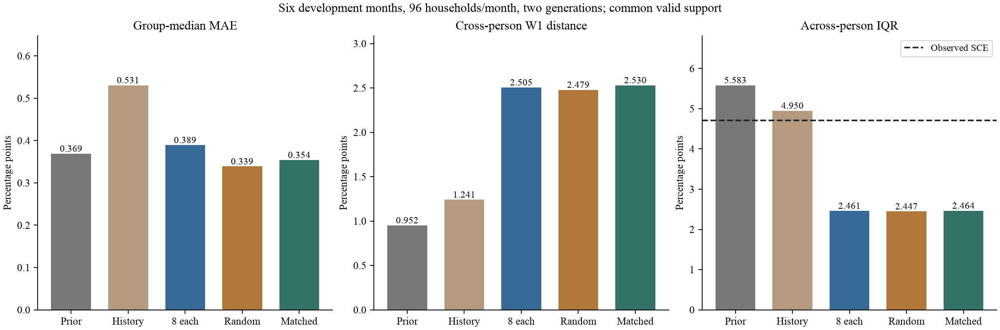
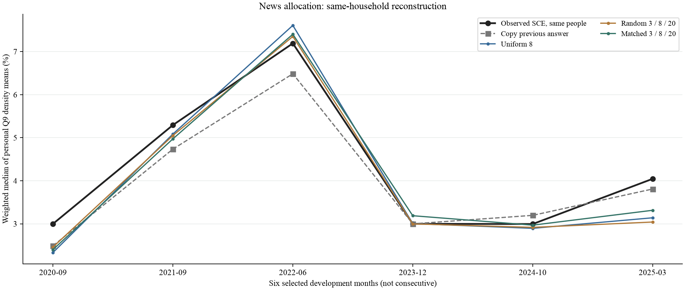

# 差异化新闻量实验：结果与解释

2026-10-19，水上挽月SCE项目。结论：**匹配组相对人人8篇有局部改善，但未优于随机分配，也未解决人际分布压缩；未通过预登记筛选，不升级默认配置。**

## 1. 实验改了什么

六个开发月2020-09、2021-09、2022-06、2023-12、2024-10、2025-03，各96人，三组各生成两遍，共3456请求。

- 固定组：人人8篇。
- 随机组：每月48人3篇、28人8篇、20人20篇，随机分配。
- 匹配组：同样名额，按年龄、教育、收入、地区估计的外部经济新闻关注概率分配。

3篇为共同头版背景，8/20篇另加5/17篇个人新闻。使用相同来源和50/50相关抽取规则。完整价格统计、个人先验、历史摘要、CE占比、央行信心、政策、问卷保持一致；没有新增购物角色或心理字段。分配没有使用本期SCE答案。

匹配和随机组的加权篇数、新闻字节数及完整提示字节数差小于1%，粗主题占比差小于2个百分点。相对固定8篇，两种差异化分配的调查加权平均篇数仍不同，因此主要检验匹配对随机；与固定8篇比较的是整项分配政策的效果。

## 2. 实际执行及评价口径

全部36个单元完成，3456次调用、0接口错、0重试；3454份回答有效、2份无效原样保留。估算费用**$3.859845／上限$16**，是按token计算的估算，不是独立账单。官方返回模型均为deepseek-flash、指纹一致；温度0.5，关闭思考。

输入组装约1.25秒，官方引擎真实模拟并行窗口1124秒（18.7分钟），共享计分评价87.6秒，结果汇总0.55秒。本轮复用新闻标签、旧完整输入、时间标签、官方引擎与共享评价，没有重新抓取或打标。

全部三组和两遍共同可评价支持为**571个人月、562位不同受访者**。原576个人月中，3个真人当期Q9均值或IQR缺失，2个涉及模型无效回答；不替换样本、不修补概率。主指标为冻结近似计分器得到个人Q9密度均值，再取群体设计加权中位数，计算各月/遍的MAE；Q8单列。这里不是全国官方headline。

## 3. 总体表现

群体中位数MAE，单位百分点，越小越好：

- 照抄上期：**0.369**。
- 个人历史半锚：0.531。
- 固定8篇：**0.389**。
- 人口匹配：**0.354**。
- 随机分配：**0.339**。

匹配比固定少0.035pp（约9.1%），但比随机高0.015pp；主比较没有显示人口匹配的额外收益。随机和匹配的MAE在本批描述性均略低于照抄上期，不能据此声称跨期稳定超越基线。

按更重罚大误差的RMSE看：固定0.500、匹配0.431、随机0.483、照抄0.442。匹配在2025-03等较大误差上有帮助，但在一些原本误差很小的月份反而增加误差，因此MAE和RMSE排序不同。RMSE是补充描述，不代替预登记的MAE及分布判据。

跨人分布W1：固定2.505、匹配2.530、随机2.479、照抄0.952pp。人际IQR：固定2.461、匹配2.464、随机2.447，真人4.710pp。**这项改动没有明显恢复人际差异；模型之间的细小差别仍远小于模型与真人的差距。**

Q8群体中位数MAE为固定1.108、匹配/随机均1.133pp，不将Q9局部收益推广到所有问卷指标。



## 4. 改善是否稳定

匹配相对随机只在2024-10、2025-03两个时期MAE更低；另外四期更高。逐月三组MAE（固定／匹配／随机）：

- 2020-09：0.666／0.598／0.540。
- 2021-09：0.209／0.320／0.244。
- 2022-06：0.418／0.213／0.160。
- 2023-12：0.038／0.188／0.009。
- 2024-10：0.100／0.073／0.077。
- 2025-03：0.905／0.731／1.003。

第一遍匹配/随机MAE为0.302/0.351，第二遍为0.406/0.327，排序反转。只删除2025-03后，匹配比随机高0.073pp，而全样本为高0.015pp。可见结果对生成重复和时期均敏感。

匹配相对随机的中位数MAE差为+0.015pp，家庭聚类95%区间约[-0.092,+0.140]；W1差+0.052，区间约[-0.043,+0.183]。区间同时容许改善和变差，不能证明匹配更好，也不能证明两者等效。区间只固定这六个开发月，对家庭重抽样，不代表其他时期。

匹配相对固定8篇的MAE差-0.035pp，区间约[-0.124,+0.116]；随机相对固定-0.050，区间约[-0.133,+0.094]，也不能把点估计下降说成稳定收益。

预登记要求匹配对随机的MAE和W1同时下降，且至少4/6个月中位数误差不增。本次三项均不满足，**筛选未通过**。没有依结果修改名额、选种子或更换成功指标。



## 5. 这说明什么，不说明什么

**可支持的判断：**当前用四个人口变量推断关注程度，再分配3/8/20篇的规则，没有显示可靠的身份匹配增量。此前外部关注预测增益本来很弱，本轮也没有足够证据把它升级为已验证机制。

**尚待检验的解释：**学历等只是新闻关注的间接代理，可能无法区分谁真正关注通胀；同时，三组仍拿到完整官方价格统计表，即使少看新闻也能从表中获得共同宏观信号，新闻数量变化未必足以改变其实际信息结构。后者是潜在旁路，当前试验没有单独识别它的影响。

**不能据此否定：**真人新闻接触有差异、购物角色影响价格体验、信息处理能力存在差异。这些经济学机制不等于本次具体合成规则。试验识别的是提示输入对LLM回答的影响，不是人类新闻消费的因果效应。

## 6. 后续安排

1. 保留本次名额、全部轨迹、阴性主结果和RMSE局部信号，暂不追加同六个月的调参运行。
2. 新闻量规则保留为候选，不因样本内9%下降成为默认。若后续复核，应登记额外分配种子和未参与本机制开发的月份。
3. 下一项优先准备**购物责任→价格信息呈现**：新闻量作为固定对照条件，核本人可接触的食品/日用品类别及具体呈现，避免完整统计表已把同样的全部信息给了每个人。先离线准备、保持匹配/打乱的信息量公平，再申请新真实批次。
4. 本轮不足以改写项目主12期误差（0.459／照抄0.239pp）；支持、时间与配置不同，不能用本批0.339替换原扩大验证结果。

## 7. 复算与证据

研究包：`outputs/sce_news_breadth_trial_20261019_v2/`，此前未完成v1不复用。已执行授权：call_0c2701736b5a4cdf9efafbfba83dfe97。准备提交2680769；本轮未推送。全部新分析只读取既有轨迹，报告层0新API、0新Q9拟合；108项独立聚合对账通过，15项保护文件不变。

```
python scripts/run_sce_frozen_trial.py evaluate --folder outputs/sce_news_breadth_trial_20261019_v2 --out outputs/<fresh_evaluation>
python scripts/report_sce_news_breadth.py --folder outputs/sce_news_breadth_trial_20261019_v2 --evaluation outputs/<fresh_evaluation> --out outputs/<fresh_readout>
python scripts/plot_sce_news_breadth.py --summary outputs/<fresh_readout>/summary.json --out outputs/<fresh_figures>
```

仅需重画或重汇总时直接复用已有评价，不重做密度拟合。聚合[summary.json](news_breadth_results_v1/summary.json)与[核验回执](news_breadth_results_v1/verification_receipt.json)可选入Git，个人记录仅留本地。执行前规则见[方案](news_breadth_trial_plan_20261019.md)，准备过程见[交接](news_breadth_readiness_20261019.md)。
