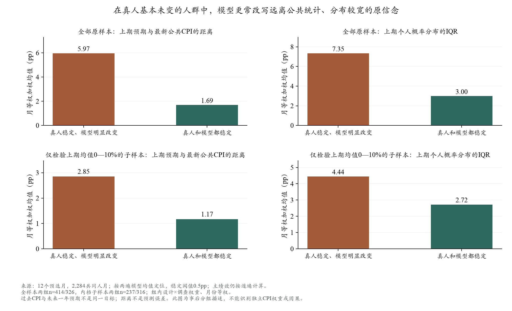

# 从具体人群差距确定下一项P/E改动

2026-10-18。复用十二期、2,284个共同有效回访者人月；本轮没有新增Simulation调用，也没有重新拟合Q9。主模型、人口、环境与计分配置保持冻结。本页是探索性诊断，不是新的独立验证。

## 1. 现在定位到的不是一个统一的高报或低报问题

这里将“本期相对上期的个人Q9派生均值变化不超过0.5个百分点”称为基本稳定。为减少两遍生成的随机波动，**本轮画像使用两遍模型均值**；主实验误差仍按每遍分别计算，没有修改。

- 真人基本稳定的740个人月中，414个被模型明显改动，326个模型也保持稳定；按原设计和调查权重、各月等权，前者约占真人稳定组的**59.9%**。
- 真人有变化的1,544个人月中，574个模型却基本稳定，加权约占**34.6%**；按“模型幅度小于真人幅度”的更宽定义，约为64.6%。
- Q8单独检查也有相同问题：真人基本稳定时，模型约67.8%移出稳定范围。因此不能把差异全部归结为Q9密度拟合。

这些分组使用本期真人答案，只能帮助定位问题。不能把“真人本来会稳定”作为下一次模型输入。

## 2. 哪些人更容易被模型改写？

最清楚的区别是**原有信念与公共价格统计的距离，以及本人原概率分布的宽度**。

- 真人稳定、模型明显改变：上期个人预期与最新公开CPI同比的平均绝对距离约**5.97pp**，上期个人概率密度的IQR约**7.35pp**。
- 真人与模型都稳定：对应约**1.69pp、3.00pp**。
- 将上期个人预期限制在0—10%后，仍分别约为**2.85/4.44pp**和**1.17/2.72pp**，所以不只是极端答案造成。
- 真人改变、模型却稳定的一组，距离与宽度约为**1.79/4.08pp**。它与前一类错误不同：公共水平附近的人可能被模型留在原位，实际个人变化却没有被恢复。

注意：过去实际CPI与未来一年预期是不同对象，距离大**不等于真人预测错了**。IQR指一个人的不确定范围，不是人与人之间的分歧。

低数理、低收入者的粗略错动率更高，但控制原信念、历史、月份和其他人口特征后，这两项关系发生变化，不能简单把“低数理”或“低收入”转换成固定的高报、低报或低注意力。

## 3. 数据指向的机制，以及还不能确定的部分

### 第一项：给模型完整宏观资料，可能相当于给所有居民做了一次共同的信息干预

**观察：** 离公共价格统计较远、原概率较宽的人，更容易在模型中被改写；实际真人却常保留原判断。控制月份、七类P、历史和原分布宽度后仍有相同方向，逐年剔除也未反转。

**经济学解释候选：** 真实居民对公共统计的接触和信任不同。个人判断离统计值较远，不代表他获得新统计后必然修正。当前所有Agent实际都读到较完整的宏观表，可能强化统一的“根据最新数据纠正旧判断”的回答方式。Armantier等的信息实验显示，提供共同信息会促使预期靠拢，但一部分人仍不修正，支持区分信息暴露和个人原有判断。[纽约联储SR543](https://www.newyorkfed.org/medialibrary/media/research/staff_reports/sr543.pdf)

**不能确定：** 先验与CPI距离、模型改动都包含同一个先验值，且本组按真人稳定筛选，存在数学耦合和选择问题；控制月份后，先验减当月CPI也不能识别独立的CPI效应。现有结果不证明模型内部心理，也不能反推出真实居民的注意力比例。

**对应改动：** 先固定同一事实集合，检查同一个首发数值是否在最新摘要、滚动序列和新闻中被重复突出；将已知背景、新发布事实、政策承诺与预测分开。比较原展示与同事实的整理展示，P和问卷完全相同。跨日期的新闻重复按用户要求保留，不用“同事件”名义一概删除。只有明确这一项是否有作用，才单独测试公共信息随机显隐；随机比例仅是实验处理，不冒充真实人口分布。

### 第二项：家庭处境与具体事件的关系，比再增加一个情绪标签更值得检查

**观察：** 控制原信念和既有人口特征后，上期财务/前景/风险字段联合增加对模型误差的月内解释力约**1.90个R²百分点**；本期财务/前景约增加**1.77个百分点**，在真人变动组约增加3.10个百分点。增量有限，档位关系也非完全单调。

**经济学解释候选：** 同一事件可以使某家庭先想到购买力受损，使另一家庭先想到失业和需求走弱。已有美国研究支持个人经历影响宏观判断，也支持相同事实下不同人想到不同传导渠道；没有证明财务恶化必然抬高通胀预期。[Kuchler–Zafar](https://www.newyorkfed.org/research/staff_reports/sr748.html)；[Andre等](https://academic.oup.com/restud/article/89/6/2958/6531988)

**对应改动：** 核查本人过去就业变化、财务变化与具体价格/贸易事件的可观察联系。只有存在同人记录或有依据的消费暴露时，才连接P与E；不知道行业就不猜行业。先与过去资料基线作跨期离线比较，再准备真实连接/打乱连接对照。本期Q1/Q2只作A的事后解释，不放进B；既往Q1、上期Q2的单句标签已试过，不重复当作新实验。

### 竞争解释：一部分“稳定”可能来自报告习惯，并非经济信念完全没变

真人稳定、模型错动者约61.4%的本期十档与上期完全相同；正确稳定者约34.2%。前者也更常用5的倍数填概率。控制其他变量后仍有关联，但粗刻度可能同时反映填法、认知、未知特征或真实信念，不是已识别的因果。以前的程序取整实验已说明“外形更像”不保证身份或准确度改善，所以不立即重做取整或强制保持。

## 4. Event MCP：已经完成什么，付费部分准备取什么

已实际调用免费目录：**Event MCP 1.28.1、21个来源**。不是只依据Kimi的转述。目录确认了`ustr`、`google_trends`、`household_pulse`与FRED；后两类目录默认不开启不等于历史数据不可取，仍要实际探查。

已准备三个窗口：**2020-09、2022-06、2025-03**；四源各一次，共12次结构化取数。FRED只取`UMCSENT`消费者情绪，不重复抓CPI，永久排除`nyfed_sce`。按组委会邮件$0.005/次预计**$0.06**，请求硬上限**$0.10**，无自动重试。**具体预算卡仍待用户回复；当前付费调用0，未启动Simulation。**

用途和约束：

- **USTR：** 核查关税宣布、生效、暂停等事实及涉及商品，先与已有NYT内容对账，不默认旧E完全没有关税。
- **Google Trends：** 衡量全国/地区的相对关注变化；0—100不是“多少居民看过新闻”，不能直接分配个人注意力。[官方定义](https://support.google.com/trends/answer/4365533?hl=en)
- **Household Pulse：** 核查家庭压力的时期/分组资料；群体比例不能冒充该SCE家庭的实测处境。
- **UMCSENT：** 是消费者情绪，不能改名为政府信任、美联储信任或个人乐观；与目标的构念重叠要披露。

接口只接受年/月，没有`as_of`参数。整月结果可能包括截止日后资料；返回成功、缓存时间或抓取时间也不证明历史可得。需要逐项核验原始发布日期、参考期、版本和来源。版本不明的资料可帮助现在的研究，但不进入严格事前B输入。

## 5. 执行顺序与验收

1. **已完成：** 人群错动画像、控制变量检查、极端先验敏感性、Q8交叉检查、经济学依据、MCP免费目录和12项取数协议。
2. **待本批预算回复：** 实际取得四源三期回包，保存来源/日期/版本/哈希；失败不自动重发。
3. **随后：** 逐条列出旧E已有内容、新增事实、是否截止前公开、是否只有聚合信息。只有真实新增信息才进入候选输入。
4. **下一次模拟前：** 只选一项改动，固定P、同样本、模型和问卷；至少同时检查群体中位数MAE、跨人W1、真人稳定者的错动和真人变动者的漏动。不能仅靠统一平移中心算恢复微观机制。
5. 现十二期都已查看，属于开发证据。正式扩大检验另选未参与调整的月份；新增Simulation另确认范围和预算。

完整字段、控制与竞争解释见[理论与设计](theory_and_design.md)和[输入草案](candidate_inputs.md)；可公开聚合见[profile_summary.json](profile_summary.json)。私有人行只保留在忽略的`outputs`，不进入Git。

## 复算与解释范围

入口`analyze_sce_update_mismatch_profiles.py`要求新输出目录，复用冻结计分、过去信息与已有财务/风险缓存。画像组内以设计×调查权重归一，再对有支持月份等权；稀疏组标记，不能将不同覆盖月份直接排名。统计模型控制月份、七类P及既有历史，报告逐年剔除方向，但没有将这些探索性系数当因果、正式显著性或可部署分类器。上面的描述不改原十二期主误差。

权威本地输出为`outputs/sce_update_mismatch_profiles_20261018_v1/summary.json`与`brief_summary.json`；`execution_receipt.json`注明初次不完整序列化和中间版本不作最终结果。全套分析0新API、0新密度拟合。
