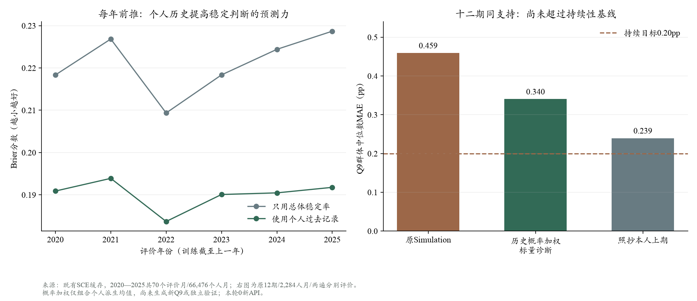

# 第一项结果：个人更新规律有预测力，但仅加权仍不足

2026-10-18。持续目标仍为Q9群体中位数MAE低于0.20pp，并优于同支持持续性基线。**本轮没有达到目标，原Simulation也没有被替换。**没有新增API、没有重新拟合Q9；新计算是对下一机制的离线筛查。

## 做了什么

使用既有2017—2025年SCE缓存，分别以往年训练、下一年评价。例如2020只用2017—2019训练，2025只用2017—2024训练。共评价2020—2025年70个月、66,476个连续回访者人月。

预测的问题很具体：**只凭此前记录，能否提前判断这位受访者本月的个人Q9均值是否变化不超过0.5pp？**预测资料包括本人上期预期、概率范围与填法、过去改动和保持的比例；再分两步加入上期人口特征和上期财务/风险字段。本期答案和本期财务字段不作输入。

模型采用固定正则的简单逻辑回归，与只用过去总体稳定率、个人过去稳定率比较。不随机拆散月份，不按十二期结果挑参数。每年模型不使用该年标签训练，但该年已发生的真实上期回答可以更新个人历史特征；这是一步条件回放，不是连续自主预测。微观资料的公布时滞也没有因此被消除，不能改称严格B。

## 1. 保持与改变，并非完全不可预测

- 只用过去总体稳定率，概率预测Brier分数为**0.2208**。
- 加入本人过去回答记录后为**0.1901**，约下降13.9%；六个评价年份均有改善。
- 月内区分稳定者与调整者的AUC约**0.707**；随机排序为0.5。它是区分能力，不是“70.7%的人预测正确”。
- 再加人口、财务与风险，Brier为0.1899/0.1898，增量很小。这只针对“本月会不会保持”这个问题，不说明这些特征对预期水平没有作用。

本人过去更常保持原答案，更可能继续保持；上次刚有较大改动、历史波动较大者更可能再次改变。六次前推的相关系数方向一致，但不能解释为心理因果。

**对前一轮诊断的修正：** 前一轮在“真人保持”的事后子组中发现，模型更常改写宽概率分布。全历史预测却显示，概率较宽者总体上更容易变化。两者并不矛盾，但说明不能据前一条观察就给所有宽分布者统一加大惯性。

## 2. 有用的预测线索，不等于直接得到了正确的更新公式

将预测稳定概率p用于简单标量诊断：个人新均值 = 上期均值 + (1−p)×(原模型均值−上期均值)。以下均为既有十二期、2,284共同人月、两遍分别评价。

- 原Simulation中位数MAE：**0.459pp**。
- 用个人历史概率加权：**0.340pp**；个人MAE约3.107、跨人W1约1.812pp。
- 若只用总体稳定率加权：中位数MAE反而更低，约**0.326pp**。个人概率没有在这个使用方式下提供额外的总体中心优势。
- 照抄本人上期：**0.239pp**，个人MAE约3.074、跨人W1约0.873pp，仍更好。

因此，保留这项“个人更新规律可以预测”的证据，但**不将该概率加权方式升级为默认机制**。这些是程序组合的个人标量，没有生成新十档或新密度，不能称新Simulation已降至0.340。

## 3. 为什么只调保持比例仍有明显不足？

对每个已有真人答案检查：它是否位于“本人上期值—模型本期值”这段数轴区间内。约**66.0%**的实际值在区间外。也就是说，对许多个人答案，即便事后任取0—1之间的加权比例，也无法到达真人本期值。

这只是**个人均值标量加权的几何诊断**，使用了本期真值，绝不能部署；它不是十档混合后重新拟合的边界，也不是群体中位数MAE的下界。它指出：对大量个人，问题还包括模型给出的变化方向或幅度，而不只是保留多少原信念。

## 下一步的具体改变

1. **P：**将“过去实际保持/变化模式”作为可测量的个人行为记录候选，短历史保持未知。它比只写高低数理或悲观标签更有直接预测依据，但暂不把它硬编码为真实注意力。
2. **E：**继续核查公共统计的重复突出，以及关税、家庭压力、公众关注中真实新增的事件内容；MCP12次取数预算卡仍待回复。不是继续增加同样的数字或情绪标签。
3. **行为层：**下一项区分“是否改变”和“改变的方向/幅度”。先检查已知个人历史、实际处境与事件是否解释方向差距，再准备一项对照；不再将一个稳定概率直接当作LLM的学习权重。
4. **验证：**本十二期已用于诊断，不能反复调到0.20后称成功。候选固定后仍要在另行登记、未参与调整的月份验证；保留同支持照抄和原Simulation。



## 证据与复算

- 最终权威输出：`outputs/sce_retention_predictability_20261018_v2/summary.json`，个人预测仅在同目录忽略文件中。
- [公开聚合结果](retention_readout_v2/summary.json)；[目标与执行前方案](goal_020_plan.md)。
- 训练与评价计算约8.27秒，另有代码、阅读和报告时间；不要将计算秒数当作整个Agent任务耗时。
- 六项定向测试覆盖严格滞后、短历史、跨月缺口、已知概率信号和校准分箱边界。首次v1的校准分箱边界已修正，v1保留，主数值与最终v2一致。
- 训练使用原公开微观派生值，主十二期评价仍使用冻结项目计分器；2,282个可比较个人月中，27个稳定标签不同。2,284个主支持均有预测，不因短历史或标签差异删人。
- 既有原回答、计分器、运行配置与15项待审文件不变，没有新增真实模拟、付费取数或推送。

```sh
OPENBLAS_NUM_THREADS=1 OMP_NUM_THREADS=1 /Users/wushuyue/anaconda3/envs/socioverse/bin/python scripts/analyze_sce_retention_predictability.py --out outputs/sce_retention_predictability_NEW
```

从项目根运行，输出目录必须是新目录。没有正式因果或“稳定胜出”的显著性声明，当前目标仍未达成。
