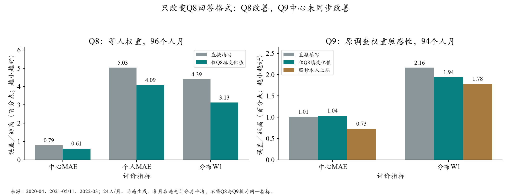
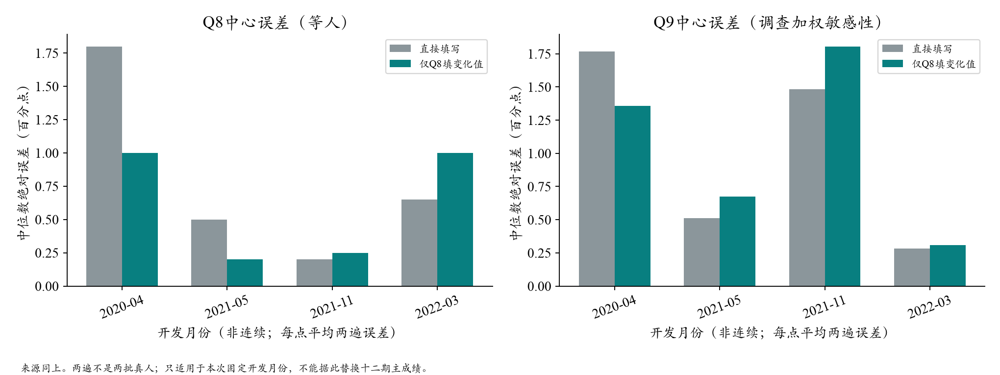

# Q8变化值对照：点预期分布改善，主Q9中心未改善

2026-10-19。**384次真实调用完成，全部合法，0接口错误、0重试；估算费用$0.4323／上限$2。保留开发信号，不替换参考配置。**

[图文阅读](../20261013_behavior/codex_expansion_diagnostic_20261014.html#q8-only-delta-results-20261019) · [聚合评价](q8_delta_results_v1/summary.json) · [运行收据](q8_delta_results_v1/run_receipt.json) · [执行前方案](next_trial_design.md)

## 1. 研究什么，怎样控制

检验**相同信息下，回答“本期是多少”与回答“比上期改变多少”，是否影响模型保留个人旧信念和生成差异的方式**。旧实验同时改了Q8和Q9，大量Q9负概率使结论混在一起；本次只改Q8，隔离回答接口的作用。

- 对照：直接填本期Q8点预期和Q9十档概率。
- 候选：只把Q8改为本期减本人上期的差值；程序准确加回上期值。Q9仍直接填本期概率。
- 举例：上期3%，填写变化−1个百分点，恢复本期2%。负差值合法；不限制更新大小或方向，不裁剪、取整或自动归一化概率。
- 两组人口、环境、真实上期Q8/Q9、较早历史摘要与说明相同，只替换末尾回答格式。1个人月缺上期Q8，两组都直接填本期值。

2020-04、2021-05、2021-11、2022-03，各24人；两组各生成两遍。DeepSeek官方`deepseek-flash`、温度0.5、关闭思考、最多1024输出token。官方当日标示Flash-1017，实际返回仍为别名`deepseek-flash`，不能据此确认固定模型权重。两组同期重生成，未把旧模型输出充作新对照。人口六格草案没有应用到本轮。

经济直觉是原有信念有持续性，新信息通常在原有判断上形成调整；本实验测试一种落实方式，**不预设真人一定在心算差值，也不把程序加回旧值当成心理机制已被识别**。

## 2. Q8：分布改善较明确，中心改善仍有不确定性

96个人月，两遍分开计分；每月、每遍等权，月内每人等权。下列中位数均为本次样本人群的Q8中位数，单位为百分点，不能当全国SCE主Q9成绩。

| 指标 | 直接填本期 | 仅Q8填变化值 |
| --- | ---: | ---: |
| 群体中位数MAE | 0.788 | 0.613 |
| 逐人MAE | 5.030 | 4.086 |
| 跨人分布W1 | 4.392 | 3.126 |
| 相对上期的变化分布W1 | 3.273 | 2.937 |
| 跨人IQR（不是误差；真人4.500） | 1.488 | 2.850 |

W1下降28.8%，人际宽度恢复一部分。候选减对照的按人配对重抽样95%区间：

- Q8 W1：−1.266，区间[−2.346, −0.324]；在这四期固定条件下支持改善。
- 逐人MAE：−0.944，区间[−2.092, −0.003]；仅略低于0，作为辅助结果。
- 中心MAE：−0.175，区间[−0.613, +0.337]；仍容许中心变差，不能称中心收益稳定。

每遍汇总均改善：第一遍W1为4.355→3.092，第二遍4.428→3.159；中心0.800→0.725、0.775→0.500。**两遍不是新增两批真人，只有四个月的信息。**

| 开发月 | 中心MAE：直接→变化值 | W1：直接→变化值 |
| --- | ---: | ---: |
| 2020-04 | 1.800→1.000 | 6.902→3.788 |
| 2021-05 | 0.500→0.200 | 3.515→2.077 |
| 2021-11 | 0.200→0.250 | 1.673→2.000 |
| 2022-03 | 0.650→1.000 | 5.477→4.637 |

改善并非每期一致。2021-11分布变差；2022-03分布改善但中心变差。这说明“更多保留旧信念”不等于所有指标都会提高。

### 同支持照抄基线

只用95个确有上期Q8的人月，重新在相同支持上比较，不能把此处与上表96个人月混算：

| Q8指标 | 直接填本期 | 仅Q8填变化值 | 照抄本人上期 |
| --- | ---: | ---: | ---: |
| 中心MAE | 0.788 | 0.713 | 0.900 |
| 逐人MAE | 4.850 | 3.901 | 3.415 |
| 跨人W1 | 4.207 | 2.926 | 2.093 |

候选中心优于照抄，但逐人误差和整体分布仍落后；不能说已整体战胜持续性基线。少1人即可改变中心改进幅度，也是小样本中位数敏感性的具体例子。

## 3. Q9：分布点值改善，中心略差

两组模型Q8/Q9均192/192合法且可计分。真人2个人月缺Q9，只排出Q9评价，不删其有效Q8。以下为94个共同Q9人月，沿用旧调查权重作为敏感性保护口径；不声称这批24人是新全国概率样本。

| Q9指标 | 直接填本期 | 仅Q8填变化值 | 照抄本人上期 |
| --- | ---: | ---: | ---: |
| 群体中位数MAE | 1.012 | 1.037 | 0.730 |
| 跨人W1 | 2.162 | 1.940 | 1.784 |
| 跨人IQR（真人5.681） | 2.575 | 2.833 | — |

Q9中心差为+0.025pp，95%区间[−0.485,+0.277]；W1差为−0.222pp，区间[−0.417,+0.052]。都不能排除相反方向，**没有证明Q9遭到损害，也没有证明Q9无退步**。

执行前的继续筛选规则是：Q8 W1差区间上界低于0、Q8中心点值不差、Q9中心与W1点值均不差、模型合法率≥99%。本轮通过其余四项，**仅Q9中心点值不差未满足，因此按原规则记为未通过**；没有看完结果后新增或放宽门槛。这是是否继续的保守筛选，不是“真实理论错误”的检验。





## 4. 统计解释与机制边界

W1衡量整批人的预测分布相距多远，逐人MAE衡量是否预测对某个人；中心MAE只比较两个中位数。三者改善程度不同是正常的，不能用扩大IQR替代匹配个人或整体分布。

区间用1,000次按受访者重抽样：同一个人的月份、两遍生成以及两组回答一起保留，避免把重复输出当作独立人数；月份固定，不能代表换时期的不确定性。多项辅助比较未作多重校正，本轮也不是独立测试。

两组获得完全相同的旧信念，回答格式变化后Q8出现可见差异，说明“把先验放进去”与“任务如何使用先验”确实不同。差值任务把旧值设为明确计算起点，可能减弱公共信息对个人判断的覆盖；但要识别这一解释仍需专门对照。Q8和Q9在同一回包中生成，改变前者任务也可能影响后者，不能假定未改格式的Q9一定不变。

本轮未提高P/E的信息质量，没有新增真实经历或购物接触；Q8改善不等于模型恢复了居民完整的认知机制。四个旧开发月、每月24人、可变模型别名及回访者条件都限制外推。十二期主成绩仍为Q9中心MAE 0.459、照抄0.239pp。

## 5. 决定、下一步与复算

1. 保留Q8变化值的开发证据，不升级默认，不重新启用Q9概率差值，也不马上为同一句式扩样。
2. 下一主任务是已有采购角色—可见价格方案的离线预检；只选择一项新机制，先完成匹配／打乱对照与时间、主题、文字量检查。
3. 随机新闻量等候选仍需未参与调整的月份和额外分配种子。任何新付费模拟另列范围与预算。

有效运行包`outputs/sce_q8_only_trial_20261019_v3/`，评价`outputs/sce_q8_only_evaluation_20261019_v1/`。v1/v2准备失败残留保留、未调用，禁止复用。输入和源码哈希门禁、384份原答/转换证据、DuckDB行动均经共用评价器核对。共计1,193,040输入token、61,990输出token；调用跨度129.5秒，评价12.4秒。费用是按固定峰时费率和回包usage估算，不是厂商账单；不假定缓存或折扣节省。

```text
python scripts/run_sce_frozen_trial.py evaluate --folder outputs/sce_q8_only_trial_20261019_v3 --out outputs/<fresh_evaluation>
python scripts/report_sce_q8_delta.py --source outputs/sce_q8_only_evaluation_20261019_v1 --trial outputs/sce_q8_only_trial_20261019_v3
```

评价命令只读已有回答，不新增API。图文输出目录与章节已存在时，作图脚本拒绝覆盖；复算评价用新目录即可，不必为了重算再生成阅读页。原始提示、问卷和回包留本地忽略目录；公共版只含聚合、图和哈希。
