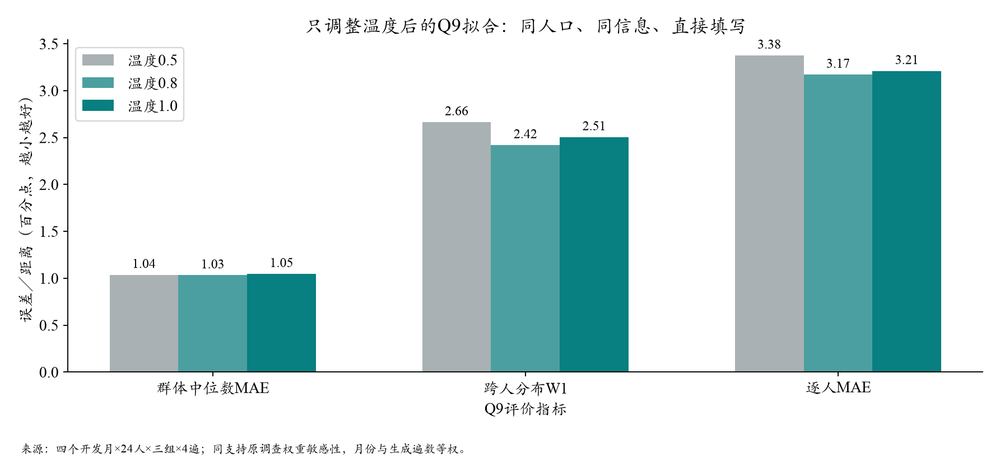
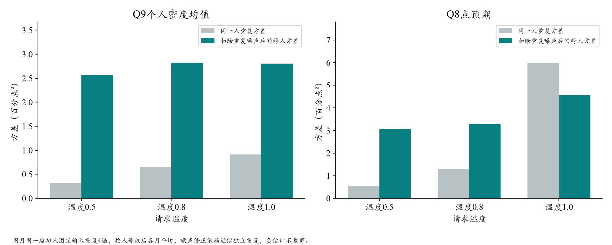

# 温度对照结果：分布有小幅收益，随机波动增加更明显

2026-10-19。**1,152请求全部合法、可计分；0接口错误、0重试，估算费用$1.2875／上限$6。主比较未通过预登记筛选，继续保留温度0.5工作参考。**

[图文阅读](../20261013_behavior/codex_expansion_diagnostic_20261014.html#temperature-results-20261019) · [聚合评价](temperature_results_v1/summary.json) · [运行与分解收据](temperature_results_v1/run_receipt.json) · [事先方案](temperature_trial_plan.md)

## 1. 实验配置

2020-04、2021-05、2021-11、2022-03，每月24人，温度0.5／0.8／1.0三组，每人各回答4遍。使用DeepSeek官方`deepseek-flash`，关闭思考、最多1,024输出token、无自动重试；原始P/E、本人真实上期信念及更早摘要、新闻和提示一致，全部直接填写本期Q8/Q9。没有同时采用人口网格、Q8差值格式、财务或心理新字段。

主比较在执行前固定为1.0对0.5，0.8作辅助敏感性。四遍用于估计同一虚拟人的重复波动，不是增加真实人口；共96人月，Q9因两份真人概率缺失而在94个共同人月上评价。两种题型分别计分。

## 2. 拟合质量：中心基本未变，分布有所改善

Q9沿用原调查权重作为敏感性口径，每月、每遍先计分再等权平均；不是将四遍均值当最终答案，也不代表全国概率样本。

| Q9指标（百分点） | 温度0.5 | 温度0.8 | 温度1.0 | 同支持照抄本人上期 |
| --- | ---: | ---: | ---: | ---: |
| 群体中位数MAE | 1.037 | 1.032 | 1.047 | 0.730 |
| 跨人分布W1 | 2.665 | 2.420 | 2.505 | 1.784 |
| 逐人密度均值MAE | 3.376 | 3.172 | 3.210 | 3.070 |
| 跨人IQR（真人5.681） | 2.002 | 2.164 | 2.071 | — |

0.8的W1下降约9.2%，1.0下降约6.0%，有局部进展；两种高温的中心误差都没有实质性的点值改善，跨人IQR仍远小于真人。没有整体超过照抄基线。

Q8等人辅助口径：中心MAE为0.756／0.744／0.744；个人MAE为5.142／5.064／4.922，W1为4.577／4.466／4.358。点值有小幅改善，不能据此宣称主Q9目标已改善。



### 月份与生成遍数

| 开发月Q9中心MAE | 温度0.5 | 温度0.8 | 温度1.0 |
| --- | ---: | ---: | ---: |
| 2020-04 | 1.621 | 1.409 | 1.380 |
| 2021-05 | 0.673 | 0.698 | 0.519 |
| 2021-11 | 1.640 | 1.799 | 1.855 |
| 2022-03 | 0.216 | 0.224 | 0.434 |

提高温度在疫情月缓解偏差，在2021-11与2022-03反而扩大偏差。1.0对0.5的逐遍中心优势也有反转：4遍中3遍点值较好，但汇总仍略差。生成更随机不保证每期或每项误差单调下降。

等人Q9中心敏感性为1.028／1.089／1.193，与调查加权方向并不完全一致；不因看到结果而更换主比较权重。这批24人的权重与尾部都会影响中心，四个旧开发月不能替代十二期结果。

## 3. 差异增加来自哪里？

下表按人等权，再对四个月平均，单位为**百分点²**，与上方误差的权重和单位分别解释。“稳定跨人差异”是四遍均值间样本方差，减去平均人内样本方差÷4后的估计；不是观测到的真实人格参数。

| 方差分解 | 温度0.5 | 温度0.8 | 温度1.0 |
| --- | ---: | ---: | ---: |
| Q9同一人重复回答方差 | 0.315 | 0.644 | 0.915 |
| Q9扣除重复噪声后的跨人方差 | 2.567 | 2.823 | 2.801 |
| Q8同一人重复回答方差 | 0.548 | 1.287 | 5.997 |
| Q8扣除重复噪声后的跨人方差 | 3.056 | 3.299 | 4.559 |

**对主Q9，温度1.0让同一人的重复方差增加至约2.9倍，扣除这部分噪声后的跨人方差仅增加约9.1%。**真人同批Q9跨人方差约23.384，仍有很大差距；该真人方差包含未观测状态及问卷误差，不能全部当成应由稳定人格复现的目标。

Q8在1.0下重复方差约为0.5时的10.9倍，稳定差异估计也增加，但个人MAE只小幅下降。扩大输出范围与准确恢复某个人，是不同的目标。



精确的有限样本恒等式为“全部输出的总体方差＝个人重复均值的总体方差＋平均人内总体方差”；另外的噪声修正依赖近似独立重复及有限遍数。后者若出现负值应原样保留，本次没有截为0。API共同波动可能影响解释，真人只有单次观测，不能直接比较真人与模型的人内波动。

也须分清：API温度、某个人Q9概率分布的宽度、不同人的通胀判断分歧，是三个概念。温度升高不能直接解释成该居民更悲观、更低数理能力或更不确定。

## 4. 筛选、统计边界与决定

预定主比较1.0减0.5的按人配对95%区间：

- Q9中心MAE差+0.010pp，区间[−0.451,+0.186]。
- Q9 W1差−0.160pp，区间[−0.344,+0.033]。

均跨0，既不能确认稳定收益，也不是证明完全无效。W1差上界低于0、中心点值不差、合法率≥99%三项中，本轮只通过合法性，按执行前规则记为未通过；不升级默认。

辅助0.8的W1差−0.245pp，区间[−0.491,−0.004]略低于0；中心差区间[−0.765,+0.137]仍跨0。它是值得保留的次要信号，但边界很近、月份已用于开发，也没有稳定中心优势，不能事后改称确认性主结果。1,000次重抽样按人保留月份与4遍，不能覆盖换时期风险，也未对所有辅助比较多重校正。

**解释：**在相同P/E下，提高温度可以探索更多答案，但没有增加关于这位居民的真实信息；本轮确实观察到重复随机性大幅增加、主Q9稳定人际差异只小幅增加。这支持把温度当成敏感性参数，而非直接填补个人信念、价格接触和信息理解的机制。不能据此排除其他模型或温度范围的可能效果。

**下一步：**保留全部输出与0.8局部W1信号，不继续围绕这四期搜索温度；继续采购角色—可见价格的离线准备，以及有希望候选的独立时期验证。主参考仍为0.5；十二期Q9主MAE仍0.459、照抄0.239pp，不能用本次或其他小样最低点值替换。

## 5. 运行、评价修复与复算

有效包`outputs/sce_temperature_trial_20261019_v1/`，评价`outputs/sce_temperature_evaluation_20261019_v1/`。1,152次请求全部正常结束、没有截断；3,543,552输入token、186,995输出token，调用跨度398.1秒（约6.6分钟），成功评价37.4秒。$1.2875是按回包usage和固定峰时价估算，不是厂商账单。

首次评价发现旧真值缓存仅有1／2遍索引，本轮需要1—4遍。新增**仅评价层适配入口**，先核192个缓存键中同人同月的两份真值完全一致，再将96个人月事实映射至384个生成索引。没有改真值、输入、原答、冻结源码或manifest，没有新增API；适配来源哈希及检查收据在运行聚合中保留。失败发生在输出目录创建前，未覆盖旧结果。

```text
python scripts/evaluate_sce_temperature.py --folder outputs/sce_temperature_trial_20261019_v1 --out outputs/<fresh_evaluation>
python scripts/report_sce_temperature.py --source outputs/sce_temperature_evaluation_20261019_v1 --trial outputs/sce_temperature_trial_20261019_v1
```

本批复算使用上述评价适配入口，不用缺少四遍真值索引适配的原通用evaluate命令。已有图文目录拒绝覆盖；只重算评价时不必重新生成图。公开保留聚合、图、协议及补充适配哈希，原始人群和回包不入Git。
