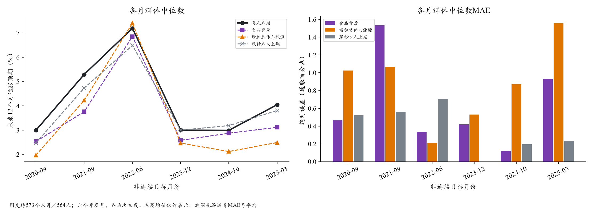
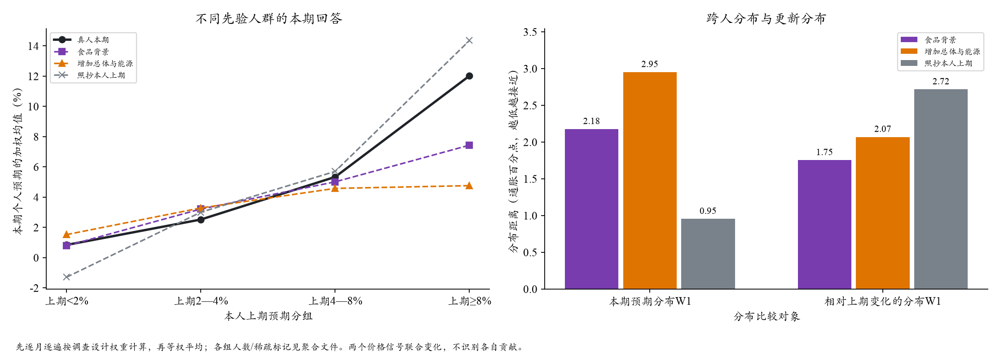

# Qwen价格背景对照结果｜2026-10-21

**结论：不采用“向所有人补充总体CPI与能源同比”这一改动。**它在两个高通胀月份改善群体中心，但六期分布距离全部扩大，人际差异进一步收窄。此前“食品背景删掉重要宏观信号”的怀疑只得到局部支持，不能解释整个差距。

[图文阅读页](price_background_results_v1/index.html) · [冻结主聚合](price_background_results_v1/summary.json) · [配置与依据](price_background_plan_20261021.md)

## 1. 本次实际做了什么

- 同一Qwen2.5-72B、OpenRouter→DeepInfra/fp8；温度0.5、JSON模式、最多1024输出token。
- 2020-09、2021-09、2022-06、2023-12、2024-10、2025-03，各96人，两组各两遍，实际2,304请求全部完成，0接口错误、0重试、0供应商回退。
- 人口、采购角色与食品细分、8篇新闻、个人上期真实Q8/Q9及更早摘要完全一致。对照沿用食品背景；处理仅加入同份BLS首发报告中的总体CPI与能源同比及发布时间标签，没有恢复历史整表。
- 两组原始Q9各1122/1152合法；按已批准等比例规则处理后各1152/1152可用且可计分。共64份发生归一化，其中60份原答加总不合法、4份原答本就在校验容差内。原答未改写，合法Q8独立保留。
- Q9主比较共同573个人月、564位真人；Q8共同575个人月。重复生成不增加真人数。是A线回访者条件重建，不是全国代表性预测或独立测试。

实际API报告费用**$2.155662/$11**。模型调用57.8分钟、计分27.1秒、缓存汇总0.30秒；后两者不含Agent撰写/开发和图文整理时间。没有重复抓取新闻、重拟合真人Q9或重新审计整套数据。

## 2. 整体结果

以下均在相同Q9支持上逐月逐遍计算，再等权平均；单位为通胀百分点。

- **群体中位数MAE：**食品背景0.634，补充背景0.877，照抄本人上期0.370。
- **群体中位数RMSE：**0.794→0.980；照抄0.443。
- **跨人分布W1：**2.177→2.952；照抄0.954。
- **跨人IQR：**3.162→2.308；真人4.703。更集中使原有分歧缺口扩大。
- **个人预期误差MAE：**3.216→3.648；照抄2.717。
- **变化分布W1：**1.754→2.070；照抄2.717。模型这一项仍优于完全不变，但处理组变差；它不能替代本期水平、分布和逐人误差。

主中位数是**每人Q9拟合密度均值的跨人设计加权中位数**，不混入Q8。Q8中心MAE仅1.292→1.283，W1反而6.098→7.151，没有提供整体改善的旁证。



## 3. 两个局部改善，与四个恶化月份

群体中位数MAE分别为：

- 2020-09：0.464→1.026。
- 2021-09：1.536→1.067，改善0.469。
- 2022-06：0.337→0.211，改善0.126。
- 2023-12：0.419→0.531。
- 2024-10：0.118→0.871。
- 2025-03：0.929→1.555。

**六个月W1和人际IQR的变化方向一致：W1都扩大，IQR都缩小。**所以2021-09的中心改善不能作为整体机制成功。总体与能源两项联合改变，不能将不同月份的效果直接归因于能源的正负方向；月份间其他条件也不同。

## 4. 哪些人被拉向了中间？

按本人真实上期Q9预期分组，先求各月组内加权均值，再对月份和生成遍数平均：

- **上期<2%（156个人月）：**真人本期0.841%，食品背景0.785%，补充背景1.525%。原先相当接近，补充后反而过度上调。
- **上期2—4%（141个人月）：**真人2.523%，模型3.217%→3.289%，已有高估略增。
- **上期4—8%（154个人月）：**真人5.337%，模型5.014%→4.582%，低估增加。
- **上期≥8%（122个人月）：**真人12.024%，模型7.438%→4.762%，高预期端进一步消失。

2021-09尤其直观：全体中位数更接近真人，但该月上期≥8%的20人，真人本期组均值13.896%，模型却6.402%→5.455%。**总体中心可以改善，同时错过这类人的持续高预期。**这些是条件均值，不是全国均值或个体回答中位数。

高、低数理两组的W1都变差，分别1.445→2.199、3.383→4.191。学历×就业六格的方向也均为W1扩大；高中及以下两个格子多数月份稀疏，不能据其数值作强结论。支持与稀疏标记保存在聚合文件。



## 5. 统计上能说到什么程度

按真人身份配对聚类重抽样1000次，跨月身份和重复保持在同一簇；比较为“补充减食品”：

- W1差值+0.776pp，95%区间[+0.541,+0.921]，在这些固定月份上有明确的恶化证据。
- 中位数MAE差值+0.243pp，区间[−0.005,+0.475]跨0；点值变差，但不能声称对所有样本都显著变差。
- 两次生成的W1都变差；逐一删月后的差值仍为+0.611至+0.905pp。
- 仅保留两组两遍原答都合法的523个人月，W1仍2.236→3.055、中心MAE0.660→0.879。该检查使用同一套已归一化分数，只改变支持，不能当作归一化处理本身的因果效应。

预先登记的开发条件未通过，不升级默认。区间条件于六个已使用过的开发月，不衡量对未见时期的适用性。两遍生成也不能充分刻画所有模型随机性。

## 6. 对机制的解释与取舍

可以直接观察到：同一人口与历史下，这段公共数字输入使高预期者下移、较低预期者多有上移，分布向中间收缩。**本次两项数字补充没有补上真人信念的持续性和人际差异。**

一种与结果相符的解释是：模型把较清晰的公共价格数字当作共同参照，进而修正个人旧信念；而任务需要重建的是这个人会如何回答，他可能持续持有偏高的预期。模型可能偏向“判断合理通胀”，而非“保留并更新这个人的信念”。这仍是机制假设：本轮没有单独区分数字内容、显著性、文本长度和位置的作用，也没有证明真人会同样反应；理由文字不作因果证据。

对照仍有新闻/政策，可能已经涉及同一事实，本轮检验的是明确列出这两项统计的联合影响，不是完全不知情与首次获知的区别。双方采用同一可变托管模型，不能因此消除知识截止与权重修订风险。

**当前取舍：**保留食品背景作为本次机制底座，冻结此次阴性结果；暂不恢复整张宏观统计表或追加更多共同数字。下一步优先依据已有先验差距，讨论信息如何被个人保留/吸收，并安排现成候选的独立月份验证。当前不自动新增另一轮提示词或付费请求。原12期参考配置没有被这次六期开发对照替换。

## 7. 保存与复算

完整运行：`outputs/sce_price_background_calls_20261021_v1/`；输入包：`outputs/sce_price_background_trial_20261021_v4/`。以上已经执行，**禁止重启运行命令**。

评价：`outputs/sce_price_background_evaluation_20261021_v1/`；只读汇总：`outputs/sce_price_background_readout_20261021_v1/`；支持检查：`outputs/sce_price_background_sensitivity_20261021_v1/`。代码封存`553f092`，主缓存汇总/图入口`1366341`；后续支持检查另留提交。完整提示、回复、真值和人月不进Git，公开只有聚合、图及费用收据。

```text
python scripts/evaluate_sce_call_ledger.py --ledger outputs/sce_price_background_calls_20261021_v1 --out outputs/<fresh_evaluation>
python scripts/report_sce_price_background.py --trial outputs/sce_price_background_trial_20261021_v4 --evaluation outputs/<fresh_evaluation> --out outputs/<fresh_readout>
python scripts/report_sce_price_background.py --support-sensitivity --evaluation outputs/<fresh_evaluation> --out outputs/<fresh_sensitivity>
python scripts/plot_sce_price_background.py --source outputs/<fresh_readout> --dest docs/workstreams/20261020_procurement/<fresh_public_result>
```

仅解释/重画既有结果时从缓存汇总开始，不重复Q9拟合。全批24项官方引擎干跑、40项输入/传输定向检查、1项报告数值测试通过；6项主指标与共享评价对账一致，两图已目视检查，没有重做全项目复核。

Kimi面板可从新评价目录读取现有`summary.json`/`cases_private.json`契约；组名为`food_background`（食品背景）与`broader_background`（增加总体与能源），基准为前者。当前未修改Kimi的面板实现或页面。
