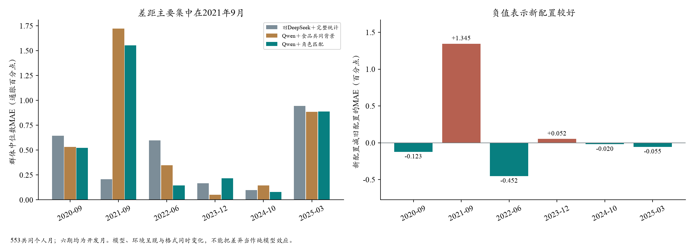
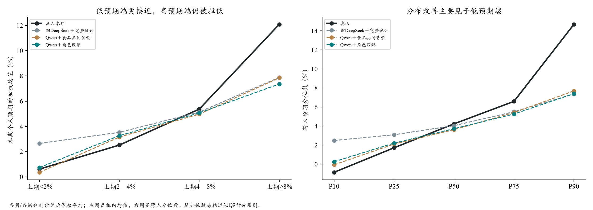

# Qwen与DeepSeek的条件分布诊断

2026-10-20。**只读取已有评分，0新增API、0新增个人密度拟合。**主比较是同553个人月的六期“旧DeepSeek＋完整统计／Qwen＋食品共同背景／Qwen＋采购角色匹配”。模型和环境/格式同时变化，不称纯模型因果效应。另检查既有三期同提示迁移的65个人月，作为小样本旁证。

## 1. 首先修正判断：并非每个月都变差，主要问题在2021年9月

| 月份 | 共同人数 | 旧DeepSeek | Qwen食品背景 | Qwen角色匹配 | 匹配减旧版 |
| --- | ---: | ---: | ---: | ---: | ---: |
| 2020-09 | 93 | 0.646 | 0.531 | 0.523 | -0.123 |
| 2021-09 | 92 | 0.209 | 1.723 | 1.554 | +1.345 |
| 2022-06 | 93 | 0.597 | 0.347 | 0.145 | -0.452 |
| 2023-12 | 85 | 0.166 | 0.052 | 0.218 | +0.052 |
| 2024-10 | 95 | 0.100 | 0.144 | 0.080 | -0.020 |
| 2025-03 | 95 | 0.944 | 0.886 | 0.889 | -0.055 |

以上为Q9群体中位数MAE，单位通胀百分点。六期平均旧版0.443、新匹配0.568；**四个月新配置更好，两个更差。2021-09单月差1.345pp，是整体平均恶化的主要来源。**去掉该月后均值为旧0.490、新0.371；这只用于定位误差，不能据此删除月份、修改主成绩或宣布验证成功。



2021-09还可进一步定位：低数理组32人，组中位数偏差旧−0.903、新匹配−2.759pp；高数理组60人，旧+0.232、新−0.659。上期预期4%—8%的29人，偏差旧+0.155、新−1.231；上期≥8%的19人，旧−3.301、新−5.743。分组是重叠的，不能把其误差相加当作贡献分解。

## 2. 为什么这一月值得优先怀疑E的信息构成？

核查冻结提示，而不是事后拼背景：2021-09旧输入明确给出8月总体CPI同比5.3%、汽油42.7%、能源25.0%，以及CPI从约1%升至5%以上的12个月趋势。本轮三组删去了整表和趋势，食品总体背景保留的是**在家食品同比3.0%、未季调环比0.3%**；匹配组另有食品细分。新闻和政策中的数字仍保留，所以不能说所有宏观消息都消失了。

此时食品涨幅明显低于总体和油气涨幅，**只突出食品，可能改变模型用于判断整体物价的信号构成**。这能提出一个具体解释：近期整体涨价加速、但食品同比尚未同步的阶段，新输入可能低估更广泛的价格压力。它不是证明LLM真的锚定3.0%，更不能证明恢复整表必然改善。

信息实验文献发现，提供简明通胀统计可以改变家庭预期，而且相同政策内容经不同形式传达，效果也不同。这支持将“给什么信号、如何呈现”单独设为对照因素，不能把新闻文字与明确统计量默认当作等价输入。[Coibion、Gorodnichenko与Weber的原作者研究介绍](https://cepr.org/voxeu/columns/monetary-policy-communications-and-their-effects-household-inflation-expectations)。文献证明的是其调查处理效应，不能直接识别本次LLM差距。

## 3. 按原有信念看，低预期端改善，高预期端仍严重压缩

按本人真实上期Q9派生均值分组；每月、每遍分别计算组内加权均值，再等权平均：

- **上期低于2%：**真人本期0.612%，旧DeepSeek2.648%，Qwen食品背景0.360%，Qwen匹配0.737%。Qwen更接近真人，改善并非虚构。
- **上期2%—4%：**真人2.519%，旧3.529%，Qwen匹配3.265%，有部分改善。
- **上期4%—8%：**真人5.372%，旧5.136%，Qwen匹配5.070%，较接近但新配置略低。
- **上期至少8%：**真人12.093%，旧7.887%，Qwen匹配7.364%。两者都大幅拉回高预期，Qwen匹配在该组更低。

上述四组均覆盖六个月，人数分别147／138／149／119个人月。这里是组内均值，不是全国中位数，也不是不同档真实人口比例的估计。



跨人分位数也显示相同结构：各月P10的平均为真人−0.854%、旧2.481%、Qwen匹配0.259%；P90为真人14.680%、旧7.367%、Qwen匹配7.404%。**低预期端更像，正向高预期端没有恢复，因而W1能改善而总体中位数MAE同时恶化。**P90是六个月分位数的平均，尾部数值依赖冻结近似密度与开口档处理，不能把它当作全国真实值14.68%。

## 4. 人口分组与控制变量：低数理组存在额外偏低

以月内组指标为基础，再对有支持月份等权平均：

- 高数理组377个人月：组中位数MAE旧0.344、新匹配0.388pp；个人预期平均偏差旧−0.555、新−0.909pp。
- 低数理组176个人月：组中位数MAE旧0.820、新1.033pp；个人预期平均偏差旧+0.093、新−1.371pp。
- 收入5万—10万美元组189个人月：组中位数MAE旧0.739、新1.085pp；10万美元以上组192个人月则旧0.597、新0.424。不是所有群体一起退步。

为避免把上期预期、教育或年龄的差异全归给数理标签，复用共用WLS设计：

`本期回答 = 月份固定效应 + 上期本人预期 + 年龄/教育/收入/数理/地区/住房/就业类别 + 残差`

同553个人月、29列设计，月份等权，使用调查设计权重；只在回归中把两次模型输出取平均，主MAE仍分遍计算。Qwen匹配相对旧DeepSeek，对低数理组相对高数理组的额外下移约**−0.756pp**。逐一排除月份为−0.965至−0.596；仅保留绝对上期值≤20%的敏感性为−0.429。方向较一致，但没有证明数理标签造成下移，也不能将它作为应加回的修正常数。误差项相关、少数稀疏类别和先验测量误差仍存在。

另一个需要纠正的判断：控制人口后的上期系数真人0.643、旧DeepSeek0.252、Qwen匹配0.312；去掉极端先验后为0.813／0.452／0.612。**本批数据不支持“Qwen比DeepSeek更不保留个人先验”的简单说法。**两者都未达到真人的条件关联，Qwen在这项上反而更高；系数随极端值处理变化，不能当成人的结构性更新率。

## 5. 哪些真实变化没跟上？

事后按真人本期相对上期变化分组（±0.5pp内为稳定）：

- 真人上调组184个人月：真人平均+4.049pp，旧模型+1.194，Qwen匹配仅+0.175。
- 真人稳定组188个人月：真人平均+0.015pp，旧−0.445，Qwen匹配−1.374。
- 真人下调组181个人月：真人−3.890pp，旧−1.664，Qwen匹配−1.947。Qwen对下降者略更接近，但下降幅度仍不足。

这描述了“需要上调时没跟上、应保持时却下调”的不对称现象。**分组用了本期真人答案，只能做评价诊断，不能预先告诉模型谁会涨、按该分组分配输入或给保持者拟合一个特殊规则。**也不能从这些组直接区分真实私人冲击与问卷测量噪声。

## 6. 原三期同提示迁移提供什么旁证？

已完成的同P/E/同问卷迁移，Q9共同65个人月：2020-04中心MAE旧1.355／Qwen1.489，2021-05为1.751／2.481，2021-11为1.584／0.962；整体1.563／1.644。仍是阶段性差异，不是Qwen各期都弱。

该样本没有新食品视图，因而提示模型本身也可能参与差异；但仅65个人月、未完成原四期、原概率错误排除、旧回答非同期生成，不能估计普遍模型优势。不解释其中含大量人口类别的回归系数，避免小样本过拟合。

## 7. 下一步应检验什么

1. **优先隔离E的信息删减。**固定Qwen、样本、角色、问卷和后处理，在食品视图上仅恢复少量总体价格/能源变化背景，明确发布时点；不一次恢复所有表格或新增多种人格标签。准备阶段先比较2021-09食品与总体/油气分化的信号，以及食品和总体同步的月份。真正运行需另冻结范围预算，不按本次结果删除失利月份。
2. **保留严格同提示模型对照。**若要识别模型差异，两模型必须使用完全相同消息、格式示例和归一化规则；现有三期迁移作旁证，六期跨配置不冒充纯模型效应。
3. **针对f()的假设进一步收窄。**重点检查数理标签与概率质量、本人高预期持续性的传导，不统一给低数理加数值，也不注入“必须上调”的指令。本人不确定性与跨人分歧不同，不能用普遍撒宽来替代异质性。[纽约联储原研究](https://www.newyorkfed.org/medialibrary/media/research/staff_reports/sr415.pdf)也区分了二者。

本次没有改配置、没有拟权、没有按发现的组别选模型、没有新增付费调用。这些是开发期的探索性诊断，不是独立验证或因果识别。

## 8. 工程与复算

源码：`studies/sce_inflation_expectations/evaluation/procurement_gap.py`；复用`metrics`、`response_gap_controls`、`cell_metrics`，不重写W1或分位数。完整单元聚合留在忽略目录，公开只有去除冗余单元的汇总与图。12个主聚合数值与上一轮同支持比较一致，553/65支持计数一致；两图已目视检查。

```text
python scripts/analyze_sce_procurement_gap.py --out outputs/<fresh_gap>
python scripts/plot_sce_procurement_gap.py --source outputs/<fresh_gap> --dest outputs/<fresh_figures>
```

复算不发API，不重新拟合Q9密度。回归是已评分结果的描述分析，不是新的LLM回答。原始输出、源数据、提示和旧manifest不改。[汇总与来源哈希](qwen_conditional_gap_v1/summary.json)。
