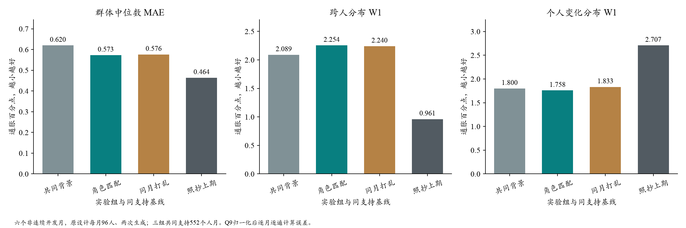
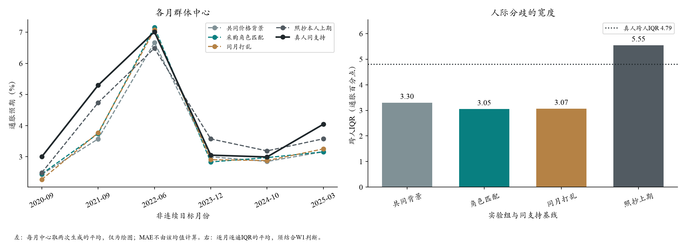

# 食品采购角色与可见价格：六期Qwen实验结果

2026-10-20。**已完成全部3,456个原定请求的首次尝试；当前没有模型任务运行。**概率合计偏差按用户要求等比例归一化，未用纠错API，未重发失败槽。

## 1. 结论

角色匹配的群体中位数MAE从共同背景组的0.620降至0.573pp，但打乱组也达到0.576pp。**增加角色和分类价格的局部中心收益，尚不能归因于人口匹配正确。**匹配的跨人分布W1为2.254，略差于打乱2.240和共同背景2.089；人际IQR从共同背景3.302缩到3.051，真人为4.794。没有恢复更多真实的人际差异，本轮不升级默认配置。

## 2. 实验设计与实际规模

- 月份：2020-09、2021-09、2022-06、2023-12、2024-10、2025-03；原设计每月96人、三组各生成两遍，共3,456请求。角色分配种子20261019；两遍生成不是新增真人。
- 共同背景：相同在家食品总体价格。匹配：按年龄、住所人数、有无未成年人，从ATUS迁移采购角色概率，进而分配0/1/3/6/6条食品细类信息。打乱：在同月相邻权重块中交换完整角色与信息包，控制信息量和类别比例。
- 三组同用固定8篇新闻、合成CE支出和美联储信心、本人真实上期Q8/Q9与更早摘要；统一移除完整宏观表和十二期趋势表。角色不是本人实测，全国分类CPI不是个人收据。
- 模型：OpenRouter→固定DeepInfra/fp8的Qwen2.5-72B，温度0.5、JSON模式、最多1024输出token，无自动重试或供应商回退。没有新增DeepSeek或平台Chat调用。
- 本研究是A线回访者条件模拟，不是全国全部受访者或严格B线自主预测；六个月都曾参与开发，不是独立验证。

## 3. 概率归一化与缺失

收到3,430份回答，26次接口无回包（20连接错误、6超时）。所有已收到回答的十档均齐全、有限且非负；127份合计不为100%，统一使用 `新概率=原概率/合计×100`，保留原答、原始合计、零值、比例、Q8和原答哈希。没有取整、按真人修正或填补缺失。

原校验容差下3313份合法、117份不合法；127次归一化还含10份原容差内的微小偏差。归一化的原合计范围95%—115%，最大单档调整3.913个概率百分点。三组原始状态与归一化状态分别记录，不能称原模型全部直接合格。

共同背景／匹配／打乱分别收到1136／1146／1148份；缺失16／6／4份，其中共同背景2023-12缺11份。三组两遍和真人均可评价的共同支持为**552个人月、543名不同受访者**，各月93／91／93／85／95／95人。

共同背景可用率98.61%，使原定“三组均至少99%”质量条件未满足。因此按原规则只报告描述结果，不宣称机制通过，不输出该规则下的正式配对区间；这不阻止归一化计分，也不把网络缺失算作预测错误。

## 4. 同人、同权重的主要结果

每个人Q9十档经过冻结近似密度计分器取密度均值，再计算跨人的设计加权中位数；与同支持真人比较，按月份与生成遍数等权平均。这里不是十档概率的简单中位数，也不是Q8/Q9混合。单位pp为通胀百分点；误差和距离越低越好，IQR需与真人及W1合看。

| 对象 | 中位数MAE | 中位数RMSE | 跨人W1 | 变化W1 | 跨人IQR |
| --- | ---: | ---: | ---: | ---: | ---: |
| 共同食品价格背景 | 0.620 | 0.843 | 2.089 | 1.800 | 3.302 |
| 采购角色匹配 | 0.573 | 0.778 | 2.254 | 1.758 | 3.051 |
| 同月打乱 | 0.576 | 0.779 | 2.240 | 1.833 | 3.068 |
| 照抄本人上期 | 0.464 | 0.480 | 0.961 | 2.707 | 5.546 |
| 个人历史锚 | 0.547 | 0.567 | 1.243 | 1.806 | 4.971 |



匹配相对打乱：MAE仅低0.003pp，W1反而高0.014pp；只有2/6个月的W1不差于打乱。两遍中位数MAE排序反转：第一遍匹配0.501／打乱0.565，第二遍0.645／0.587。变化W1改善0.074pp，但对真人本期稳定者，错误改动比例从共同背景45.7%升至匹配51.6%。不能将单项更新距离改善说成完整更新机制已恢复。

Q8单独评价（共同554个人月）：共同背景／匹配／打乱群体中心MAE为1.425／1.425／1.400pp，跨人W1为5.787／6.053／6.073pp。本轮没有明确的Q8匹配增量。



2021-09和2025-03三组仍明显低估，匹配组中位数MAE分别1.554和0.889pp；2022-06匹配与打乱均约0.145pp。共同的月份偏差比匹配—打乱的差异大，是后续优先解释的问题。

## 5. 支持变化会影响中位数，不能跨表拼成绩

- 仅要求匹配／打乱完成，可用564个人月：中心MAE0.601／0.622，W1为2.206／2.193。分布上未见匹配优势的判断不变；这是探索性敏感性，不替代主表。
- 只纳入三组两遍原始合法的475个人月，仍用同一派生评分：共同背景／匹配／打乱MAE为0.816／0.821／0.795。支持不同，不能与主表相减称归一化的因果效果；小幅中心收益不稳健。
- 完整可评价真人名单573个人月的照抄MAE为0.370，主表共同支持下为0.464。**基线没有改算法，是缺失筛选改变了中位数附近的人与权重。**完整名单基线不能直接同主表模型排名，也不能把本轮数值与旧DeepSeek六期／十二期拼比。

## 6. 这次获得了什么信息，下一步怎么做

理论路径“生活角色改变接触信息”已有依据，但本轮只实现了采购责任→全国食品分类统计的可见条数。它仍缺本人买到的具体商品、成交价、记忆和对涨价持续性的判断。当前对照没有分别识别这些环节，也不能证明购物经历不重要。

现在较有把握的判断是：**仅让食品细分类的数量随合成角色变化，尚不能恢复本人异质性；中心移动可以与分布恶化同时发生。**角色与信息加入后，三组仍共同低估特定月份；匹配与打乱的差距远小于这些月份偏差。

下一步先用本批现有回答定位：2021-09／2025-03哪些先验水平和家庭组被共同拉低，食品信息是否只把中心一起移动；不再立即调0/1/3/6等参数重跑。保留角色机制为待修订候选，随机新闻量的独立月份／额外分配种子验证仍是单独待办。本轮不拟合宏观组合权重，不自动新增付费实验。

## 7. 费用、运行方式与复算

API已回包报告费用$3.050970；包含26次未知计费请求预留的合计为$3.151706，上限$16。原144份复用，新增3312次均只尝试一次；零自动重试、零纠错请求。初始1499次经官方SocioVerse Core，网络中断后1957次由同一SCEOpenAILLM逐槽账本发送，消息和参数不变；后段调度移出Core循环，如实记录，不伪造旧数据库动作。

技术段／原主段／后续账本的首末请求跨度分别356.5／782.4／2245.1秒，含中断与衔接间隔，不等于纯模型计算时间。离线评分32.2秒、汇总不足1秒；108项共享评价聚合对账一致，两张图已目视检查。原始微观资料和完整提示／回复均留在忽略目录，公开只有聚合与图。

```text
python scripts/evaluate_sce_call_ledger.py --ledger outputs/sce_procurement_pending_chunk_20261020_08 --out outputs/<fresh_evaluation>
python scripts/report_sce_procurement_normalized.py --folder outputs/sce_procurement_qwen_trial_20261020_v2 --evaluation outputs/<fresh_evaluation> --out outputs/<fresh_report>
python scripts/report_sce_procurement_support.py --evaluation outputs/<fresh_evaluation> --out outputs/<fresh_support>.json
python scripts/plot_sce_procurement_normalized.py --source outputs/<fresh_report> --dest outputs/<fresh_figures>
```

这些入口不新增API；只能使用新输出路径。不要重启旧运行包或补发26个失败槽。实际输入包、全部调用哈希、授权、原始合法率和归一化派生记录均已保留。

[输入设计与理论依据](README.md) · [归一化修正与运输调度](qwen_normalization_amendment_v2.md) · [完整聚合](qwen_results_v2/summary.json) · [支持敏感性](qwen_results_v2/support_sensitivity.json)

## 8. 与上一轮DeepSeek是否可比（10月20日补充）

两批原计划完全同六期、同96人、同两遍、每臂1152请求；576个人月的身份、原画像、设计权重及评价真值逐项相同。固定8篇新闻的全文、本人先验/更早摘要和Q8/Q9正文也逐人相同。没有采用新人口网格或增加Normal。

不过它们不是“只换模型”的对照：

- 旧版DeepSeek-Flash保留完整CPI/就业/汽油等统计和12个月趋势；本轮Qwen三组统一删去整表及趋势，以食品总体价格和按角色分配的细分类替代。新闻/政策内原有数字仍保留。
- 人口基础相同，但本轮匹配/打乱增加合成采购角色；旧固定8篇没有。CE支出、美联储信心与本人真实上期Q8/Q9等共同底座保留。
- 温度均0.5、最多1024输出token、JSON对象、无自动重试；Q8/Q9仍直接填写、期限相同。本轮另追加855字节无答案数值的完整字段示例。相同温度不保证两种模型的输出离散程度相同。
- 原DeepSeek不修补不合法概率；本轮按用户要求归一化。两个原报告的完整共同支持为571对552个人月，不能将0.389与0.573直接相减当作模型效应。
- 后段Qwen转为同客户端逐条调度，冻结消息/参数没有改变；这是执行方式差异，不能称全部仍经Core循环。

为剔除样本支持这一项差异，零API复用了两批缓存分数，在旧固定8篇、Qwen共同背景、Qwen匹配均完成的**553个人月**上重算：

- 旧DeepSeek＋完整统计：中心MAE **0.443**、W1 **2.570**、人际IQR **2.414**。
- Qwen＋食品共同背景：中心MAE **0.614**、W1 **2.108**、人际IQR **3.310**。
- Qwen＋采购角色匹配：中心MAE **0.568**、W1 **2.272**、人际IQR **3.055**。真人IQR **4.871**。

这张补充比较仅要求上述三臂完整，所以553与主表三种Qwen臂的552支持不同，原报告不改。旧无效回复仍排除，未追加API、未重新拟合个人密度。**统一样本后，中位数变差、分布部分改善的现象仍在；但剩余差异仍同时含模型、E呈现及格式约束，不能识别各自贡献。**后续若检验模型本身，必须同一消息、同一样本/权重、同一归一化规则，仅替换模型。

[补充聚合与输入核查](qwen_results_v2/cross_batch_comparison.json)。
