# SCE项目证据材料册

供作者理解和挑选素材 · 2026-10-27 · 非论文正文

这份材料册回答“我们为什么这样设计、实际发现什么、能贡献到哪里”。材料按主题展开，技术与来源按需阅读；不追求论文式文采，不受8页限制，也不新增模拟。数字从已封存聚合重新核对，图表用高对比配色和线型区分。

**阅读顺序：** 先看01—03的研究对象与设计，再看04—09的分任务结果，最后看10—12的实验取舍、贡献边界和写作讨论。每节把事实、解释和局限分开；方法与来源可展开。

[返回交付框架](../index.html) · [数字清单](numbers.csv) · [结构化材料](materials.json) · [来源与哈希](sources.json) · [离线核对](validation.json)

## 01 研究对象：我们到底在模拟什么

**先抓住这一点：** 目标是居民的通胀预期答卷及其人口分布；实际CPI是环境/后续结局，不是SCE回答的替代真值。

SCE每月约1,300人，轮换面板通常最多连续12个月。研究主线覆盖2019-01—2025-10的82个月，另有2025-11—2026-09的11个月回顾性B与动态拓展。数字跨度大，不代表全部时期都是未查看的测试集。

### 已有事实

- Q8：问未来12个月价格总体将涨/跌多少，得到一个点预期；Q9：把100%的概率分配到十档可能的通胀/通缩区间。两题相关，但没有理由要求两题数值或误差相同。

- Q9全国指标的层次是：十档概率→每个人拟合连续密度→个人密度均值→跨人的设计加权中位数。不是先平均所有人的概率，也不是把每人的Q9密度中位数再取中位数。

- MAE是每月中心与真值的绝对差再对月份等权平均；RMSE会更重视大偏差。0.30pp表示通胀预期相差0.30个百分点。

- W1衡量跨人预测分布与真人分布的距离，越低越接近；跨人IQR衡量不同人的分歧，个人密度内部IQR衡量某个人自己的不确定性。两种IQR不是一个概念。

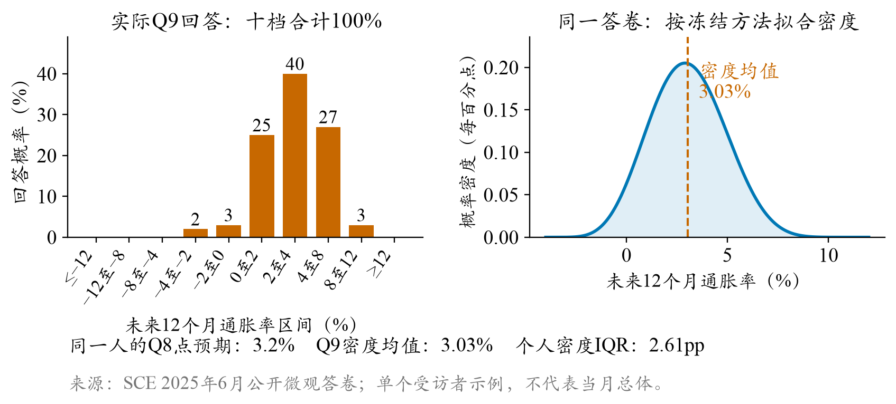

*2025-06一份真实匿名SCE答卷；密度均值约3.03%、个人密度IQR约2.61pp。不代表总体。*

### 这组材料怎样理解

- 真实匿名示例用于让读者理解问卷和算法，不选一张“很正常”的虚构答卷代表调查总体。示例的均值约3.03%、个人内部IQR约2.61pp，不能与当月全国中位数混为一谈。

<details><summary>展开技术细节与设计依据</summary>


冻结近似计分器按非零档结构选择平滑密度/稀疏档处理；十档完整、合法、非负且正总和时可等比例归一化。保留原回复、异常类型与后备来源，不因答案离真值远而重跑。

官方完整Beta生产实现没有全部取得。同人同权重仅更换密度算法，82个月月中位数平均绝对差约0.013272pp；整条重算相对官方发布差约0.026928pp，含其他步骤。两数不是可直接从模拟MAE扣除的误差份额。

</details>

**后续写作用途：** 背景、研究目标和计量口径的基础材料；正文保留简短真实示例，完整拟合分支进研究包。

**证据入口：**[SCE_EVALUATION_CONTRACT_V1.md](../../../SCE_EVALUATION_CONTRACT_V1.md) · [source_index.md](../../../reports/final_report_draft_v05/source_index.md) · [README.md](../../20261026_measurement_anomaly/README.md)

## 02 设计依据：把经济学直觉落到可检验的输入差异

**先抓住这一点：** 理论给出应该观察的路径；具体篇数、供体、格网与权重仍是本项目可质疑、可比较的操作化。

框架可理解为：家庭画像与原有信念P → 截止时点内真正可见的E → LLM对Q8/Q9的回答B → 统一计分与人口加权。当前模型为OpenRouter→固定SiliconFlow FP8的DeepSeek V3.2，温度0.5、关闭思考、JSON、最多1024输出token。

### 已有事实

- 信息吸收并不连续也不相同：[Carroll（2003）作者稿](https://www.econ2.jhu.edu/people/ccarroll/epidemiologyqje.pdf)用新闻传播解释家庭总体预期的黏性。它支持研究接触差异，不直接证明本项目4/8/16/32篇是居民真实阅读量。

- 价格体验不仅是宏观统计：[D’Acunto等的机构摘要](https://www.ifo.de/en/cesifo/publications/2019/working-paper/exposure-daily-price-changes-and-inflation-expectations)支持日常商品价格变化与预期有关，特别是频率和幅度；不能把CE支出份额当作本人实测注意力。

- 先验与更新规则都重要：[Armantier等NYFed研究](https://www.newyorkfed.org/research/staff_reports/sr543)的随机信息实验显示预期会更新，异质性与信息集、处理方式均有关。它不证明LLM与居民用了同一种贝叶斯心理过程。

- 项目采用本人历史/匿名联合供体保持初始差异，区分购物价格与新闻两类暴露，再用匹配/打乱、信息量、时间窗口和模型对照检查，而不只是往提示词添加更多标签。


*既有理论路径示意：购物价格和新闻是不同通道；箭头为研究假设，不是已估计的因果系数。具体当前参数以本册T0说明为准。*

### 这组材料怎样理解

- 贡献候选是把理论路径变成有控制的工程接口和跨层验证，不是声称这些经济学理论由本项目提出。

- 当前T0是随机4/8/16/32篇＋CPI相关度1.5＋警示权重1。权重1意味着没有额外警示加权；补齐标签并不等于启用所有候选机制。

- 个体原有信念不是人口网格的替代品；画像相同的人仍可能有完全不同的历史。反过来，单靠本人上期值也无法代表新闻与实际价格变化。

### 结论边界

- 教育、购物角色、合成信心等有统计关系不等于对某个真人准确测量；参考文献不为我们的任意参数提供“理论最优”认证。

- NYT材料偏向、社交媒体放大、模型“有人感”等目前仍是候选解释，不能写成2021失败已经识别的原因。

**后续写作用途：** 形成“理论依据→操作化→可比较对照”的方法论素材；后续论文至少保留两到三条完整链条。

**证据入口：**[expectation_formation.md](../../../literature/sce/themes/expectation_formation.md) · [household_price_experience.md](../../../literature/sce/themes/household_price_experience.md) · [news_attention_demographics_20261019.md](../../../literature/sce/information_exposure/news_attention_demographics_20261019.md) · [CURRENT_SIMULATION_CONFIGURATION.md](../../../CURRENT_SIMULATION_CONFIGURATION.md)

## 03 人口网格：为什么是学历×数理×年龄×收入

**先抓住这一点：** 54格来自预测信息、冗余、可解释性及抽样约束的共同取舍；不能说碎石图自动找出了唯一正确四维。

### 已有事实

- 比较8类人口特征的126套三/四维候选；2019—2022为开发期，按受访者固定四折，不让同一人的不同月份跨折。评估个人均值、密度宽度、零通缩填法和跨人CDF四个领域。

- 分类关联用加权Cramér V，整块共线性用调整GVIF；约1.007—1.186，未见需要机械删除年龄/收入的严重共线性证据。MCA仅描述人口X的共变。

- 强支持约束下最初偏好12格；允许小格过采样、人口降权与部分汇聚后，保留学历3×数理2×年龄3×收入3＝54格、未知另池。此选择同时保留年龄与经济资源含义，不宣称严格全局最优。

- 54格的旧加性模型开发/后续时期综合结构分数约4.917%/5.413%/5.471%，是标准化月内损失改善，既不是全国MAE也不是解释了相同比例的全部行为。

- 82个月在256/384/512 Core均可分配，并能把每格汇总质量恢复到目标，误差<1e−12；512方案总体权重ESS约424.9，但只有约60.03%已知人口质量在格内ESS≥10的格，细格仍需借力。

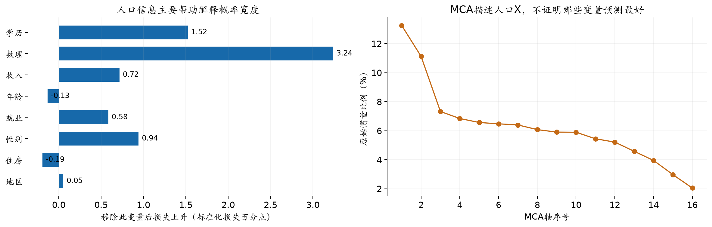

*2019—2022开发期，按受访者分组留出。左图为整块移除再拟合后的个人Q9密度宽度损失；右图不是问卷Y解释率。54格另结合年龄/收入解释性、过采样与部分汇聚，并非PCA唯一最优。*

[矢量版](figures/01_grid_basis.svg)

### 结论边界

- 过采样不创造新的真实受访者，Normal也不使稀有格拥有更多独立LLM判断。

- 曾查看过的后期不能重新命名为全新盲测；未知画像不静默补成一个完整格。

<details><summary>展开技术细节与设计依据</summary>


抽样：每个非空格先分配min(8,N_g)名，剩余按人口质量分配并受N_g上限约束；格内固定种子无放回。抽样概率π_i=n_g/N_g，先用w_i/π_i，再作格内比率校准，使各格质量精确复原。

过采样使稀有格在Core中占比更高，最终权重使其仍只代表原人口份额。加权中位数取总体加权CDF首次达到0.5的位置，不是把各格中位数求加权平均。

移除变量后重新拟合的条件信息与MCA解决不同问题。学历/数理对概率宽度有信息，不表示它们就能解释很多个人预期水平；年龄/收入补充生活周期与资源维度。

</details>

**后续写作用途：** 主要展示专业决策依据：监督用途、分类冗余、样本设计三者分工，而不是只给54格结论。

**证据入口：**[grid_dimension_selection_20261023.md](../../20261021_fullperiod/grid_dimension_selection_20261023.md) · [summary.json](../../../../outputs/sce_grid_dimensions_20261023_v1/summary.json) · [summary.json](../../../../outputs/sce_grid_oversampling_20261023_v2/summary.json)

## 04 A82：全时段重建改善在哪里，失败又在哪里

**先抓住这一点：** 新版T0降低了全期和2021的中心误差，但没有在全期击败历史参照，微观分歧仍明显偏窄。

### 已有事实

- 82个月2019-01—2025-10，41,970个合格个人月，一人一次。本人严格更早Q8/Q9和摘要，缺失用最近1—3个月匿名联合供体。14份跨月完成记录按预设规则排除。

- 新版同时引入个人完成日前一天的环境截止、四档新闻和CPI相关度。与旧A相比，不能只把改善归给“更晚新闻”或某一个权重。

- 2021旧原名单MAE0.822126，新版0.577424；若旧答也按新版名单/权重重算，旧值是0.825607。全国参照0.325000；全年仍低估。

- 全82月39个月改善；2020与2025较旧版变差。新旧MAE差的月份块区间跨零，不能宣称跨时期稳定优势。

| 序列/口径 | 月数 | MAE（pp） | RMSE（pp） |
| --- | --- | --- | --- |
| A新版Core | 82 | 0.298407 | 0.415121 |
| A旧版同名单 | 82 | 0.317508 | 0.471203 |
| A旧版原名单参照 | 82 | 0.317093 | 0.469650 |
| A公开历史参照 | 82 | 0.223171 | 0.317190 |
| A Core＋Normal | 82 | 0.301422 | 0.414236 |

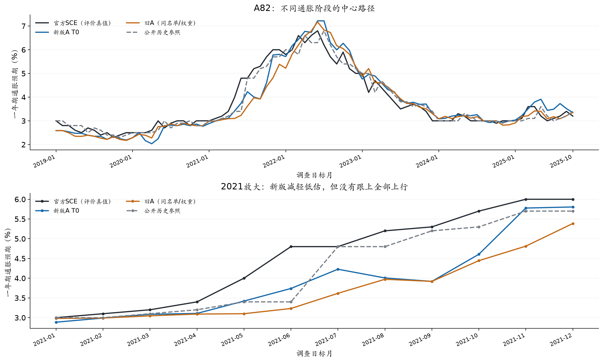

*A 2019-01—2025-10，共82个月，41,970个人月，一人一次。旧A按新版名单和权重重算；2021同名单旧A的MAE是0.825607，旧全名单是0.822126。历史参照沿用原截止锚，并非每位受访者同一as_of。*

[矢量版](figures/02_A_path.svg)

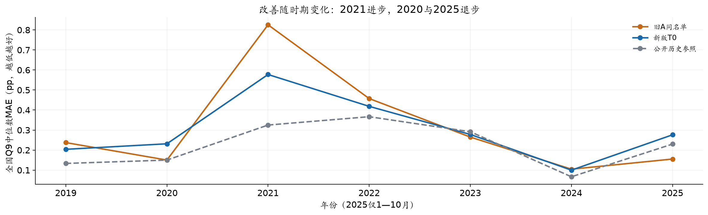

*同一新版名单/权重的版本比较；曲线不是置信区间。新旧同时改变时间、数量与路由，不能识别某个组件的单独因果作用。*

[矢量版](figures/03_A_years.svg)

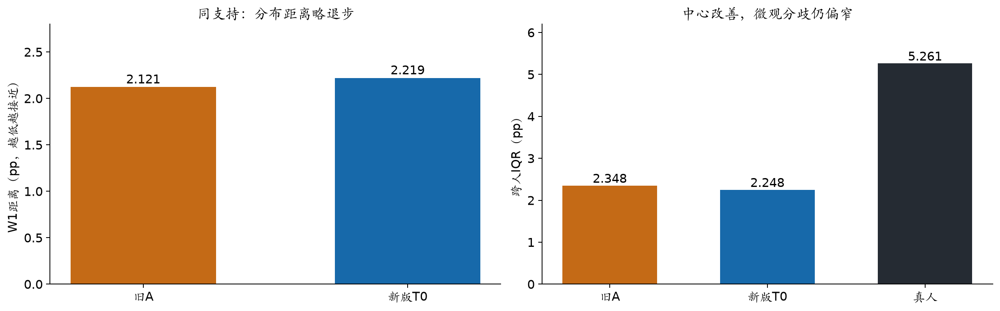

*41,042个共同合法Q9人月，月份等权；同一真人、权重和计分器。跨人IQR不是个人主观概率密度内部IQR。这里不与全波次Normal的W1交叉混算。*

[矢量版](figures/04_A_micro.svg)

### 这组材料怎样理解

- 能支持：输入时间与信息接触的联合调整会改变拟合，2021低估可部分缓解。

- 更重要的诊断：全国中心改善与跨人结构改善没有同步。共同41,042人月上W1由2.121269增至2.219218，跨人IQR由2.347834降至2.247712，而真人5.260960。

- Q8与Q9也不一致：同支持Q8中心MAE由0.818293降至0.721951，个人MAE却由8.172607增至8.214558；Q9全国0.298407与同支持Q8中心不使用完全相同支持，不能简单相减解释。

### 结论边界

- 2021失败不能凭模型自述推断为NYT偏专家/政策暂时性叙事的因果效果。

- 不把约1,300个Normal人口行或82×512答卷当作独立的宏观时间观测；宏观主样本仍是82个月。

<details><summary>展开技术细节与设计依据</summary>


全国主目标是官方首发；微观使用双方同一冻结近似计分器。全国、共同合法问卷、真实相邻回访者是不同支持，不能挑各自最小的数拼成一行。

A Core的2019—2022早48月MSE拟得模拟权重0.133976257，2023-01—2025-10后34月组合MAE0.184125，参照0.194118；MAE目标选到0。后段此前参与过机制探索，因此是时间顺序检查，不是全研究未触碰盲测。

42,029次新增物理请求、182份历史复用；实报$33.060210与未知预留$0.904153分别记录。这是本批，不是全项目总成本。

</details>

**后续写作用途：** 正文主结果和主要反例。图中保留2021及退步年份，不只挑2024或局部好月份。

**证据入口：**[README.md](../../20261026_full_a_refresh/README.md) · [summary.json](../../../../outputs/sce_full_a_t0_readout_20261026_v1/summary.json) · [monthly_national.csv](../../../../outputs/sce_full_a_t0_readout_20261026_v1/monthly_national.csv)

## 05 贝叶斯式扩展：补齐人数，为什么没有明显提高拟合

**先抓住这一点：** Core＋Normal解决人口表示与成本，不替代LLM的新判断，也不是改善MAE的必然途径。

下表只比较早48月拟权后的后34月组合，不是全82月原始模拟MAE。Normal使用其对应冻结权重0.134964302，Core为0.133976257；B/周度仍沿用Core权重，参数谱系不能混写。

### 已有事实

- A最终98,382行＝41,970 Core＋56,412 Normal，每月976—1,372人；30条原权重缺失保留null。B按约定扩到每月1,300合成代理，512 Core＋788 Normal，不声称是近期真实调查人数。

- A全国MAE0.298407→0.301422（+0.003015pp），RMSE0.415121→0.414236；2021 MAE0.577424→0.565315。MAE/RMSE方向不同，改变均不大。

- B全国MAE0.348509→0.346169，固定组合0.144277→0.143964，11期中9期中位数不变。人数补齐没有根治B上偏。

- τ=8来自A早48月已有LLM答卷的遮蔽验证，候选0/8/24；B直接迁移。不采用训练MAE敏感性得到的τ约202。

| 序列/口径 | 月数 | MAE（pp） | RMSE（pp） |
| --- | --- | --- | --- |
| A Core固定组合 | 34 | 0.184125 | 0.256272 |
| 公开历史参照 | 34 | 0.194118 | 0.270076 |
| A Normal固定组合 | 34 | 0.184980 | 0.256700 |

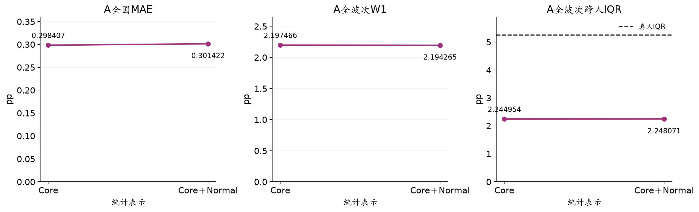

*A82、τ8，Core/Normal比较均对同一完整调查波次。纵轴从0起避免放大0.003pp差异。扩展人口表示不等于增加LLM信息；B扩展结果另列。*

[矢量版](figures/05_Normal.svg)

### 这组材料怎样理解

- 可以把它写作资源受限下的人口规模适配：扩展后的总体误差基本保持，并明确付出约1%的A MAE代价。

- 全波次W1 2.197466→2.194265、IQR2.244954→2.248071，真人5.258538；这些与第04节共同样本的2.219218/5.260960不是同一个支持。

### 结论边界

- Normal不是正态分布的同义词，不创造模型未输出的新尾部或真实新人信念。

- 约0.3的首位数字变化有视觉影响，但主文须披露精确差值与不确定性，不能为“2开头”而事后换参数。

<details><summary>展开技术细节与设计依据</summary>


格g的答卷分布：P_g = n_eff/(n_eff+τ) × P_local + τ/(n_eff+τ) × P_parent。父池来自同入组类型、其他格中已知坐标最相似的格，不重复计入本格。完整十档答卷是原子，不能平均成一张标准答卷复制。

分布估计使用校准Core权重；有限人口汇总时Core保留本人原始来源质量，Normal承担剩余质量，防止放大的Core与Normal重复相加。主统计用精确原子CDF积分；人口抽样行只用于展示/检查。

当某格的Core数少时，后验更依赖邻格。条件分布在中位点附近微调，就可能改变总体中位数；这不要求均值或W1按同一方向变化。扩展是经验贝叶斯式/伪Dirichlet近似，不是严格多层完整后验。

</details>

**后续写作用途：** 用一条公式、人口质量示意和前后结果说明作用；完整τ敏感性和原子算法放研究包。

**证据入口：**[README.md](../../20261026_core_normal_full_a/README.md) · [README.md](../../20261026_b_core_normal/README.md)

## 06 最新B11：没有真实个人上期答案时，模拟还增加什么

**先抓住这一点：** 原始B不如持续性；少量冻结模拟权重与公开历史组合后有局部增量。二者必须同时呈现。

### 已有事实

- 2025-11—2026-09，每月512旧框架代理；各月独立初始化，无人口进出。用合格旧匿名联合供体、已公开历史全国Q9构造/校准先验，不用目标月真值校准。

- 合成作答日来自前一年同月分布，环境截止取作答日前一日与原全局D的较早者。2025-11采用已确认11月13日候选。人口/数值先验仍按全局D准备，个人日期只限制E。

- 固定组合λ=0.133976257来自A早48月MSE拟权；不是看B拟合后挑到的最优。Normal版同λ0.143964与Core版0.144277分别保留。

| 序列/口径 | 月数 | MAE（pp） | RMSE（pp） |
| --- | --- | --- | --- |
| B原始Core | 11 | 0.348509 | 0.432837 |
| B Core＋Normal | 11 | 0.346169 | 0.431449 |
| B固定组合 | 11 | 0.144277 | 0.174003 |
| B Normal固定组合 | 11 | 0.143964 | 0.173663 |
| B持续性 | 11 | 0.172727 | 0.211058 |

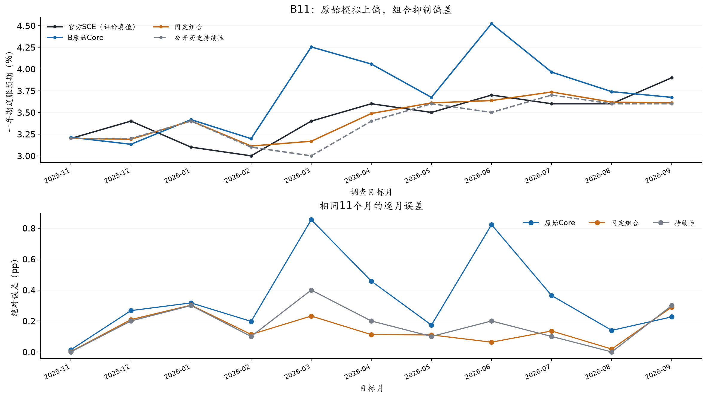

*2025-11—2026-09、每月512 Core，固定组合λ=0.133976257；非本期拟参。合成个人日期只限制E，P/先验按全局D准备；不称完全认证的严格实时预测。*

[矢量版](figures/06_B_path.svg)

### 这组材料怎样理解

- 原始上偏说明旧微观形状＋全国先验对齐并不充分；模型更新仍可能过度响应部分公开环境。

- 组合小于持续性说明这11个月内，模拟偏离历史锚的部分包含可用方向信息；并不要求原始模拟单独优于持续性。

- 同结构宏观无模拟MAE0.160025，加Core模拟0.142174；比复杂模型更简单的凸组合0.144277也很接近，不强调复杂度本身是贡献。

### 结论边界

- 旧B原始0.240815与新B0.348509不能误写成同一版本；统一同λ后旧组合0.159907、新组合0.144277。原始变差而固定组合变好，两者不是逻辑矛盾。

- 这是回顾性时点模拟，模型知识、旧人口与历史文本版本限制未完全认证，不称严格封存实时预测。

- 近期没有真人微观真值，不能给W1/个体准确率；模拟IQR/分组仅描述。只有11个月，不宣称普遍预测优势。

**后续写作用途：** 主报告给原始/组合/持续性三者；辅助宏观对照与Normal变化放紧凑表或材料附页。

**证据入口：**[B_TERMINAL_RUNBOOK_20261026.md](../../20261026_response_dates/B_TERMINAL_RUNBOOK_20261026.md) · [README.md](../../20261026_b_core_normal/README.md) · [summary.json](../../../../outputs/sce_recent_b_core_normal_evaluation_20261026_v1/summary.json)

## 07 月度自主递推：是否出现了误差累积

**先抓住这一点：** 后段确实更高估，但不是每月单调爆炸；平滑的模拟链也可能逐步偏离真实值。

### 已有事实

- 固定2025-11的512户，复用根月512份答卷，后10个月用本人上月模拟Q8/Q9和周期历史；不重新对齐全国先验，无进出/Normal。

- 主要评价从2025-12开始，排除共同根月，不能用包含初始化月的较低误差代替。

- 前5期原始MAE0.111015，后5期0.500486；从5月起高估更突出，5/6/7/8/9月偏差约+0.286/+0.467/+0.628/+0.753/+0.369pp。这是事后分段描述。

| 序列/口径 | 月数 | MAE（pp） | RMSE（pp） |
| --- | --- | --- | --- |
| 月度递推原始 | 10 | 0.305751 | 0.386107 |
| 月度递推固定组合 | 10 | 0.182718 | 0.198128 |
| 月度持续性 | 10 | 0.190000 | 0.221359 |
| 独立B原始（同10月） | 10 | 0.381984 | 0.453942 |
| 独立B组合（同10月） | 10 | 0.158521 | 0.182495 |

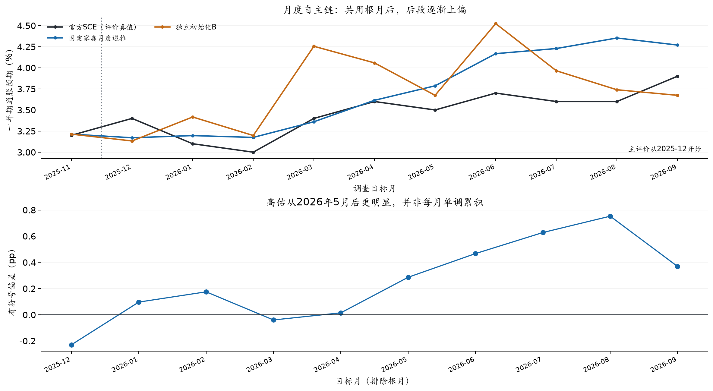

*固定512户，无进出/Normal，根月后不重新对齐全国先验。主要10个月；与独立B有人口、信息和状态制度差异，属于描述性比较。*

[矢量版](figures/07_monthly_recursion.svg)

### 这组材料怎样理解

- 同10个月独立B原始0.381984高于自主链0.305751，但独立B固定组合0.158521低于递推组合0.182718；不能只挑一个指标证明递推更好。

- 模型的月度变化更平滑，可能抑制噪声，也可能跟不上真实改变。连续性本身不能作为有效性证据。

### 结论边界

- 月度递推的10个月与A82或B11的数字不可无条件混排；固定家庭、旧框架、合成日期与根月重用都是边界。

<details><summary>展开技术细节与设计依据</summary>


5120主＋40技术补；5月一户保留本人前态并进入后继链。原始/后备字段和来源都保留，不追溯补写一条“完美”链。

后段漂移可能涉及无重校准、信念收缩、信息环境与状态依赖的共同作用。当前不是仅改变一个因素的随机对照，不能给出原因分解或声称找到最佳重置周期。

</details>

**后续写作用途：** 作为探索性拓展/边界验证，正文短段落足够，完整路径保留供讨论。

**证据入口：**[index.html](../../20261026_belief_recursion/monthly_results_v2/index.html) · [summary.json](../../../../outputs/sce_recent_b_recursion_analysis_20261026_v2/summary.json)

## 08 周度模拟：目前最值得展示的探索性正向结果

**先抓住这一点：** 无需输出层组合，周度原始指标在11个月主口径上小幅优于持续性；仍有漏判和样本限制。

### 已有事实

- 47个周五2025-11-07—2026-09-25，固定300户、2025-01旧人口框架，无进出/Normal。每次新历史SCE公开后重校准先验，12个发布周期内传递本人上周状态。

- 新闻月额度4/8/16/32逐周累计、去重；价格与政策按周时点更新。新信息不能只从月度已抽新闻中机械删文章而丢掉当周可得增量。

- 预先约定每月最后一个周点为主评价：原始MAE0.151581，对持续性0.172727约降12.24%；RMSE0.188942/0.211058约降10.48%。

- 这里的“原始”指尚未把输出与历史SCE线性混合；先验仍会用已经公开的历史SCE校准，不能称不依赖调查。

| 序列/口径 | 月数 | MAE（pp） | RMSE（pp） |
| --- | --- | --- | --- |
| 周度原始 | 11 | 0.151581 | 0.188942 |
| 周度固定组合 | 11 | 0.156409 | 0.188430 |
| 周度持续性 | 11 | 0.172727 | 0.211058 |
| 周期起点保持不动 | 11 | 0.170596 | 0.213190 |
| 周度宏观无模拟 | 11 | 0.160929 | 0.197886 |
| 周度宏观加模拟 | 11 | 0.150171 | 0.185340 |

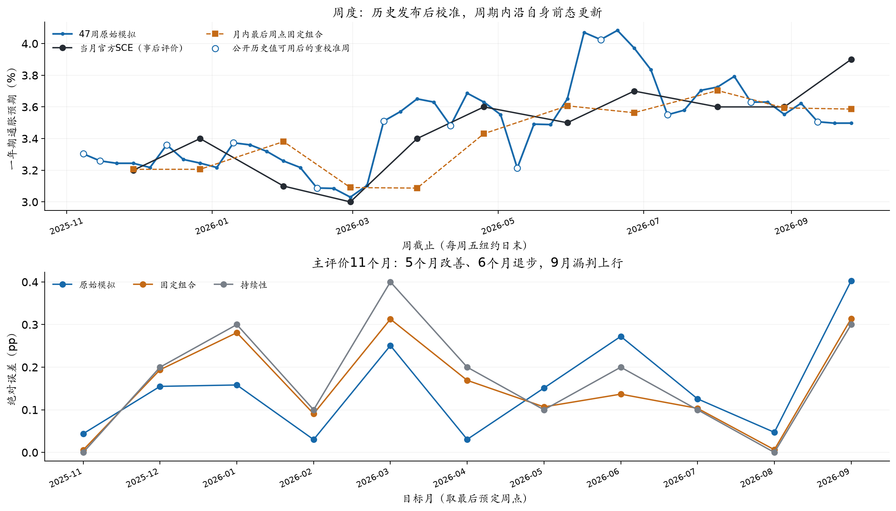

*2025-11—2026-09、固定300户、无Normal。重校准只使用当时已公开历史SCE；黑线是事后评价目标，不是提前输入。原始0.151581不是输出层加权组合。*

[矢量版](figures/08_weekly.svg)

### 这组材料怎样理解

- 同周期起点保持不动的MAE0.170596也高于原始0.151581，说明不只是靠把锚原封不动带过来；仍不是已识别的机制因果。

- 3月13日模拟约3.510%，当时公开锚3.0%；当月SCE3.4%直到4月7日发布，约25天提前上行，也有幅度高估。9月末模拟3.498%、实际3.9%，漏判上行，须一起展示。

- 仅5/11个月误差更小、6个月更大。留一月后平均差仍为负，是稳健性描述，不替代显著性或独立扩样。

- 固定组合MAE0.156409略差于原始，RMSE却略好；按A冻结权重保留两者，不用这11个月重新选权。

### 结论边界

- 真实评测目标仍只有11个月，不能把47周当47个独立真实观测；没有周度真人微观分布。

- 这是回顾性探索，不是实时报送证明；全部历史版本与模型知识风险仍要说明。

<details><summary>展开技术细节与设计依据</summary>


±0.1pp预设容忍带下方向正确9/11，但包括5个平稳月；上行召回3/5，非上行误报0/6。不能只用9/11写成准确预警。

47周共14,100主＋28补、2户周按冻结规则保留旧字段；无未发/未知在途。实报$8.918646，未知预留$0.090419单列，未达到$15帽。

周度比月度多了时点和重置差异，人口规模/框架也不同。即使原始序列更好，也不能据此识别纯更新频率收益；独立月度B组合0.144277仍低于周度组合0.156409。

</details>

**后续写作用途：** 拓展部分的主要图与视频演示亮点，保留3月正例、9月反例；不升级为全面预测突破。

**证据入口：**[WEEKLY_FINAL_RESULTS_20261027.md](../../20261026_belief_recursion/WEEKLY_FINAL_RESULTS_20261027.md) · [index.html](../../20261026_belief_recursion/weekly_results_v1/index.html) · [summary.json](../../../../outputs/sce_weekly_final_readout_20261027_v2/summary.json)

## 09 下游用途：循环信贷有线索，其他结局如何

**先抓住这一点：** 月度模拟SCE对循环信贷的同结构回归有增量线索，但简单历史均值仍更强，不能说普遍提升经济预测。

### 已有事实

- 4类结局×未来1/2/3个月×8模型；A扩展窗口41—44个原点、最少36个成熟训练行；B仅7—10个原点，用A拟合后冻结迁移。每组模型用相同联合完整案例。

- 信贷与耐用品的结局是未来h月累计对数增长，工资与Michigan是水平变化；比较RMSE的相对改善百分比，而不是SCE的pp误差。

- 月度原始模拟替代同结构官方SCE时，循环信贷1/2/3个月RMSE改善3.55%/8.17%/1.69%；组合改善−3.18%/+5.03%/+4.80%。

- 全部12个结局×预测期中原始模拟5正7负，组合3正9负；信贷历史均值基线在三个期限仍更好。工资/耐用品持续性强，Michigan的AR(1)强。

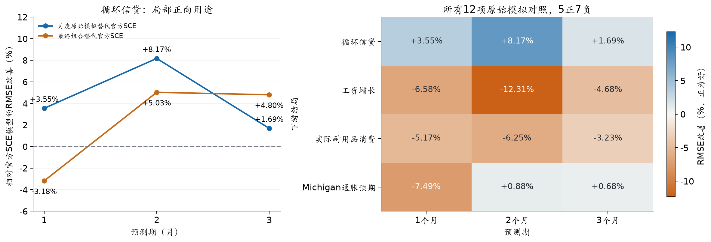

*A扩展窗口41—44个有效原点，同一结局/预测期各模型共同支持；8模型同结构比较。输入是月度A/B Core＋Normal，不是周度。工资/MICH预测水平变化，信贷/耐用品预测累计对数增长。当前版本控制和上游非嵌套限制保留；信贷历史均值基线仍更强。*

[矢量版](figures/09_downstream.svg)

### 这组材料怎样理解

- 可讨论模拟在消费/借贷情境中包含与官方指标不同的信息；这是用途线索，不是信息机制或经济因果已经识别。

- 这项研究使用月度A/B Core＋Normal，不是周度指标。不能把周度的较好拟合与下游的信贷成绩拼成一条已验证链。

- A的组合权重0.134964302与B的0.133976257分别继承对应版本；协议的单个通用权重字段不能替代实际列的参数谱系。

### 结论边界

- 相对官方SCE的同结构回归改善，不能改写成战胜所有基线；R²增加不能替代滚动误差改善。

- 不能只公布3个信贷正数而不交代12项总比较与失败结局；正文可简述，完整表保留。

<details><summary>展开技术细节与设计依据</summary>


输入官方/模拟SCE水平和一阶变化；同结构OLS含共同宏观控制及对应领域控制。训练标签只用在原点已形成的未来结局，B不更新系数。

控制序列使用当前版本、同月变量，且上游模拟校准没有在每个历史原点完全嵌套。因此即使回归标签按原点切开，也不是全链路严格实时预测。2/3月结局重叠，样本较小、多重比较均需披露。

完整产物4,896预测行、192指标行、408对照；9项模块定向检查通过，不等于全仓库测试全部通过。

</details>

**后续写作用途：** 展示应用价值的一张紧凑图；主体突出循环信贷，但图旁保留全12项热图和强基线提示。

**证据入口：**[README.md](../../20261026_downstream/README.md) · [regression_protocol.json](../../20261026_downstream/regression_protocol.json) · [manifest.json](../../../../outputs/sce_downstream_regression_20261027_v1/manifest.json)

## 10 实验工作量：用假设—对照—取舍表达

**先抓住这一点：** 研究品味来自能解释为什么采纳或放弃，不来自把所有实验次数排成流水账。

### 已有事实

- 人口网格：8特征、126候选，先区分统计信息、共线性和小格支持；由12格强支持方案转向54格过采样＋部分汇聚，保留原筛选记录。

- 新闻量：八期直接两臂1116共同个人月，固定8篇中心MAE0.272926→随机量0.259504；W1约1.206→1.208。支持渐进采纳，不证明人口与财经关注无关。篇数与比例是设定，不是实际阅读量估计。

- 主题/价格相关性：七期641共同支持，四档Q0→加CPI相关Q3，Q9中心0.484832→0.438800；但Q8中心0.864286→0.907143，跨人IQR仍远窄于真人。小样本收益不能外推所有年份。

- 个人时间×警示：654共同人月，C0/T0/T1中心MAE0.515536/0.477792/0.491437；2021三个样本月却为0.586310/0.707903/0.549883。T0按总体与稳定性取舍进入全量，2021全量另检，不能把小试当确认。

- 模型/表达/合成标签：已做模型迁移、温度、Q8变化值、数理、财务及心理对照。部分中心/微观有局部收益，但多数未支持默认升级；这些零/负结果限定了“加更多标签就更好”的朴素想法。

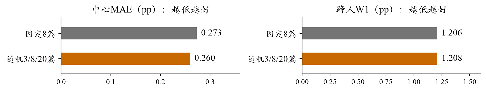

*历史八期V3.2、1116共同个人月、两遍：随机3/8/20相对固定8篇的开发对照，不是当前四档全量成绩。*

### 这组材料怎样理解

- 可以在主文选3—4个代表实验，讲清一次决策的证据与代价；其他实验用家族索引进入研究包。

- 现行食品角色、合成支出和信心出现在参考配置中，不意味着每个组件都已单独证明稳定有益。

- T0警示权重1，T1/独立警示臂不等于当前默认。补完警示标签保留后续复用，不倒推成“发现警示权重必然有效”。

### 结论边界

- 每组共同支持、真人上期可用子样本、不同生成遍次和种子分别保留；不能跨支持拼最好的成绩。

- 传统注意力/心理机制的社会科学依据不能替代对合成标签联合分布的有效性验证。失败是当前表达/匹配下的结果，不证明心理因素在人类中无效。

**后续写作用途：** 方法依据与消融/取舍表的素材库，支撑“有思辨性的连续实验”而非堆砌工作量。

**证据入口：**[news_matching_adoption_20261022.json](../../20261021_fullperiod/news_matching_adoption_20261022.json) · [RESULTS_20261025.md](../../20261024_media_mechanism/RESULTS_20261025.md) · [index.html](../../20261024_media_mechanism/timing_results_v1/index.html) · [EXPERIMENT_STATUS_20261018.md](../../../EXPERIMENT_STATUS_20261018.md)

## 11 候选贡献：哪些已经站得住，哪些仍需克制

**先抓住这一点：** 贡献可以是有约束的框架、跨层验证发现和有限用途，不必包装成全期超越基线。

### 已有事实

- 方法/工程贡献候选：形成有问卷、人口权重、历史信念和时点可见性约束的P/E/B流程，贯通人口抽样、真实调用、统计扩展、跨层评价与可追溯归档。54格/Normal/凸组合不宣称本项目首创。

- 经验发现候选：总体中心、微观分歧和动态稳定性并不等价。A的中心改善可与W1/IQR退步同时发生，自主月度链可更平滑却后段漂移。

- 用途贡献候选：公开历史锚＋模拟的小权重组合、周度原始信号、循环信贷回归有局部增量。它们分属不同研究任务，不合并成“模拟普遍更准”。

### 这组材料怎样理解

- 事实层：固定样本/配置下的数值和失败模式，可直接用图支持。

- 解释层：共同公开信息、过强均值回归或信息更新制度可能与收缩/漂移有关，属于与证据相容的解释。

- 待检验层：NYT光谱偏向、模型记忆SCE、特定模型更“有人感”、最佳校准频率尚未识别，不当成确认结论。

### 结论边界

- 当前没有全国全期的普遍预测优势，不能把零API复算与完整个体再生成说成一回事。

- 旧数据/模型知识、后期参与探索、小样本/重叠标签、合成匹配测量误差、条件分布收缩和完整受控复现缺口需要集中说明。

<details><summary>展开技术细节与设计依据</summary>


与ConsumerSim的联系是分层抽样/权重、Core＋Normal和历史—模拟组合的借鉴；差异应落在Q9概率答卷、真实微观支持、异常时期、身份状态与更新制度的联合检查，不能仅用换国家/换指数宣称方法创新。

因果边界、时间边界与随机性边界分别说：输入按发布日期筛选，不证明历史文本未修订；模型离线调用，不证明训练没见目标；同一提示生成两遍，不等于两个新闻分配种子。

</details>

**后续写作用途：** 后续摘要、引言末段与讨论的论点候选；本册不直接把这些句子排成论文正文。

**证据入口：**[framework.md](../framework.md) · [README.md](../../../../deliverables/README.md) · [acceptance.json](../../20261027_clean_release/acceptance.json)

## 12 先讨论什么，再开始写论文

**先抓住这一点：** 材料整理完成后，先确定主次和证据边界，再做文采、篇章与8页排版。

### 已有事实

- 主结果建议分层：A/B用于历史重建与回顾性预测；Core＋Normal作为规模适配；周度和信贷作为探索性价值；月度漂移作为动态边界。

- 主表同时给原始、固定组合、对应持续性，Core/Normal不混名；不跨A/B合报一个MAE。A、B、周度组合参数谱系在同一数字清单中保留。

- 图候选已提供9组新绘图＋3组既有匿名/机制/开发图，可按后续版面取舍；不是要求11张都进入8页论文。

- 当前包v05已通过62项包内测试、157模块独立导入、5类schema和聚合复算；完整受控微观复现/来源许可/完整费用覆盖与最终PDF/MP4仍有待办。全项目既有测试并非全部通过。

### 这组材料怎样理解

- 需要与你讨论一：三项贡献中，主标题更突出“概率答卷的多尺度验证”还是“居民预期的信息接触与动态更新”？两者可以结合，但主次要清楚。

- 需要与你讨论二：主要结果表以扩展后人口口径为主、Core作为对照是否合适？这影响A主文写0.301422还是先写0.298407，不能只按首位数字挑。

- 需要与你讨论三：周度给多少版面，月度链压缩到何种程度？建议主图突出周度，月度漂移保留一段与路径链接。

- 需要与你讨论四：信贷正向用途与全部12项混合结果怎样压成一图一段？建议同图给信贷曲线及12项热图，避免选择性汇报观感。

<details><summary>展开技术细节与设计依据</summary>


论文负责论证，视频负责看见流程和核心发现，研究包负责完整证据/复算。素材先固定出处，再按读者理解顺序整合，不按开发日期排序。

费用只按指定批次报实报与未知预留，不把日志覆盖额当全项目总发票；Normal行数与真实API请求数分开。示例工程20人干跑不是实证512人生成。

后续步骤：作者讨论材料→冻结主结论/数字/图→另建论文v06写作源→语言编辑与数字复核→8页视觉检查→统一视频/研究包版本。此刻不重写v05或改原封包。

</details>

**后续写作用途：** 这是作者审阅清单，不是新增实验计划；无需为了写报告再增加API预算。

**证据入口：**[framework.md](../framework.md) · [report_inventory.json](../report_inventory.json) · [latest_package.json](../../../../submission/latest_package.json)

## 数字与图表使用约定

- 所有全国误差默认单位为pp，通胀预期水平为%；RMSE改善为百分比，不与pp混淆。下游信贷/耐用品的结局是累计对数增长，不是余额水平。

- 每张图附时期、人数/统计单位、原始/组合与支持。不同任务的数字不汇总为一个排行榜；没有新的模拟、密度拟合或参数搜索。

- 原稿v05、研究包v05、原始运行和已验收ZIP均不变。这里的候选论点与图表要经作者讨论后，才进入下一版论文。

### 复建（全新目录、零API）

```bash
/Users/wushuyue/anaconda3/envs/socioverse/bin/python scripts/build_sce_paper_materials.py \
  --out docs/workstreams/20261027_final_delivery/materials_rebuild_new
```
